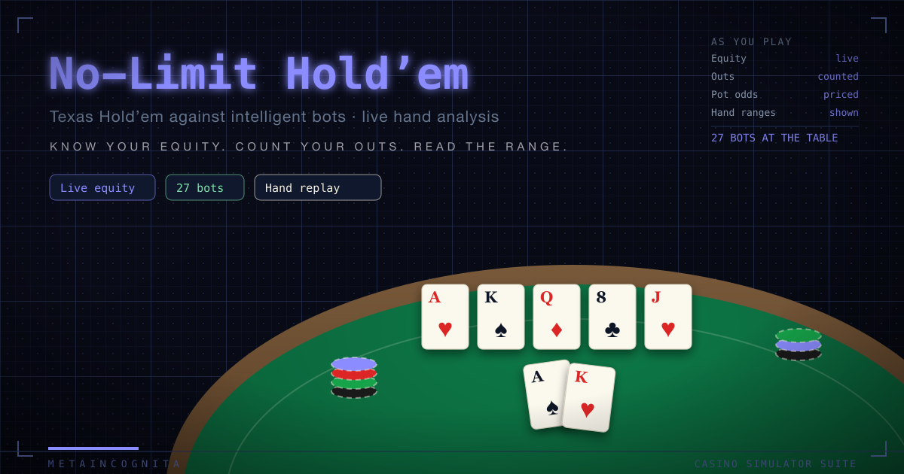
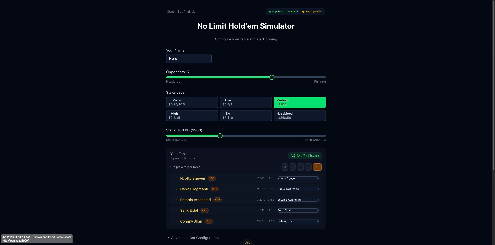
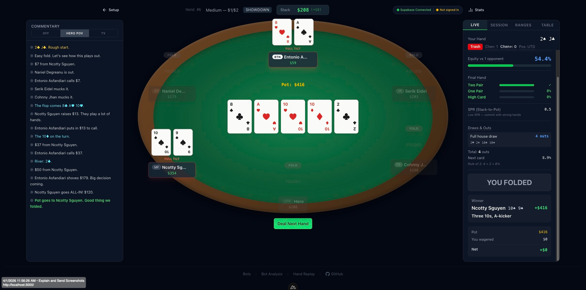
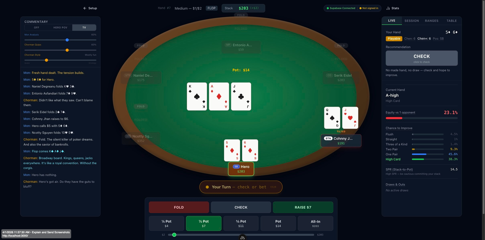
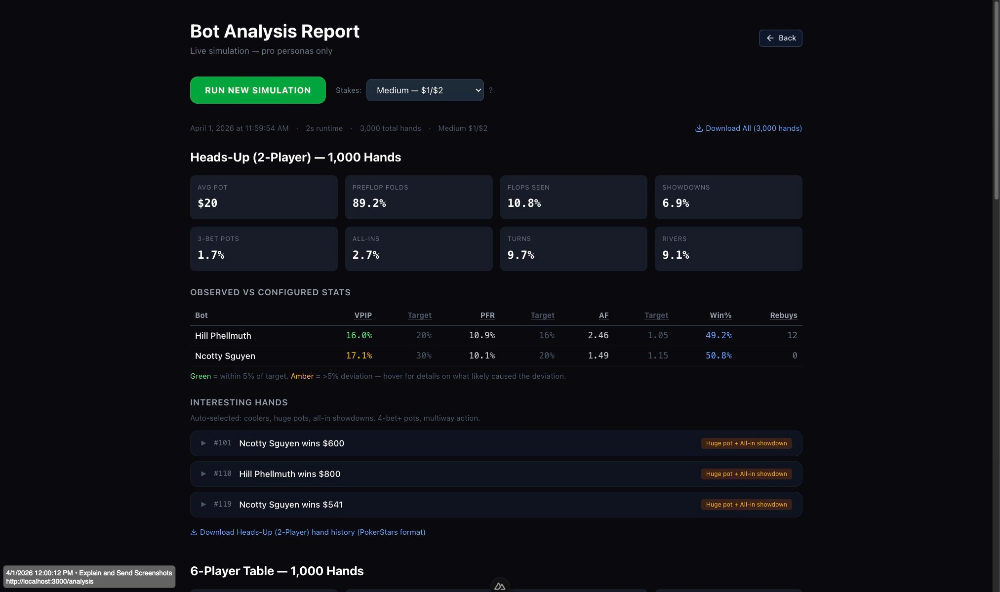

# No Limit Hold'em Simulator

**[Live Demo](https://holdem.metaincognita.com/)**

> **This is a free, open-source, single-player educational tool** -- no real money, no gambling, no multiplayer. The simulator itself is serious: nine logged audit rounds, real-time equity calculations, an observed-stats opponent HUD, and 27 bots with distinct playing styles. It just happens to also have funny commentary. Think of it as a poker training tool that doesn't take itself too seriously.



| | |
|---|---|
|  |  |
| *Setup: choose opponents, stakes, stack depth, and commentary mode* | *Showdown: Hero POV commentary, winner comparison, session stats* |
|  |  |
| *TV Broadcast: Mon & Chorman call the action, all cards face-up* | *Bot Analysis: 3,000-hand simulation with observed vs target stats* |

A browser-based No-Limit Texas Hold'em cash-game simulator with 27 heuristic bot opponents (7 fictional teaching bots and 20 pro-inspired personas), real-time hand analysis, live text commentary, session stats, a career ladder, and hand replay. Built for learning poker strategy through practice and observation. There is no AI model and no server: every bot decision is hand-written TypeScript running in your tab.

### How It Works (short version)

- **Where it runs.** A static Nuxt 4 single-page app (`ssr: false`), built with `yarn generate` and served by Netlify. No backend, no accounts. The only outbound request the deployed site makes is a cookieless Plausible page-view ping.
- **Where state lives.** The live table is a set of Vue refs in `app/composables/useGameState.ts` (players, pot, street, the full five-card runout, the action log). `app/pages/index.vue` owns the page flow (setup → table → timeout/busted), dealing, showdown, tilt and hand recording; `app/composables/useGameEngine.ts` runs the betting rounds. Three Pinia stores sit beside it: `heroProfile` (an in-memory 10-hand window on how you play), `nemesis` (the persistent book on you) and `career` (the bankroll ladder). The game page is kept alive across routes and its bots pause while you are on another page.
- **One hand.** `dealNewHand` builds and Fisher-Yates-shuffles a deck with `Math.random`, deals two cards to each seat, burns and deals the whole board up front, and moves the button. `postBlindsAndStartBetting` posts the blinds, then `runBettingRound` walks the seats until nobody is left to act: a bot waits a random "thinking" delay and decides; the hero's turn stops the loop until you click or press a key. Every action goes through `applyEngineAction` in `app/utils/bettingEngine.ts`, which clamps raises to the legal minimum and to the stack. When a street starts, `startBettingRound` decides who has to act: nobody, if at most one player has chips left and owes nothing to an all-in. `advanceStreet` reveals the next street, or runs the board out when at most one player still has chips. At hand end the last player standing takes the pot; otherwise `calculateSidePots` and `awardPots` (`app/utils/sidePots.ts`) split it by each player's total investment over the five-card board, with every chip that went in (folded players' included) paid out. Bot tilt, your hero model and the hand record are updated, and you click **Deal Next Hand**. A bot that is out of chips is marked eliminated: from the next deal its seat gets no cards, no blind and no button, and position labels are laid out for the players still in.
- **One bot decision.** `index.vue` takes the seat's configured stats, applies tilt (`applyTilt`), looks up the persona's consistency by the seat's preset, and builds a read on you (the session window, blended with the Nemesis book and scaled by that bot's familiarity when Nemesis is on), which it passes only while you are still in the hand. It passes those plus the bot's own two cards, the street-visible board, pot, bet to call, stack, seat label, whether the bot acts last among the players who can still act, whether the bet it faces is yours, and table context to `decideBotAction()` in `app/utils/botDecision.ts`. That function re-slices the board to the current street, rolls for a misplay, applies hero adaptation and table flow to a copy of the profile, runs the preflop or postflop branch logic, and applies a stack-commitment rule to the result. It returns `fold`, `check`, `call` or `raise` with a raise-to amount. See [Preflop Decision Flow](#preflop-decision-flow) and [Postflop Decision Flow](#postflop-decision-flow).
- **What is saved.** Only `localStorage`: the current session and its hands (`holdem-session-stats`), the career (`holdem-career-v1`), the Nemesis book (`holdem-nemesis-v1`), three commentary slider values, and the debug-log switch. See [Persistence](#persistence).
- **How it is checked.** `yarn test` runs 62 Vitest files (1,272 tests). Two of them are regression gates on bot strength: the [exploit probe](#exploit-probe-adversarial-validation) plays nine degenerate scripted strategies against a pro lineup and fails if any wins 10 bb/100 or more, and the [composite probe](#composite-probe-round-8) measures single deviations from a solid baseline. GitHub Actions runs `yarn test` on every pull request and on pushes to `main`.
- **Debug log.** Every build currently prints each decision and each finished hand to the browser console. The live per-decision lines show only your own hole cards; bot cards appear in the block printed after the hand ends. See [Debug Hand Log](#debug-hand-log-browser-console).

### Bot AI
- **Card-aware decisions** -- bots evaluate their actual hole cards and the visible board, not random probabilities
- **Combo-weighted preflop ranges** -- hole cards map to a percentile in a ranked 169-hand list (pairs 6 combos, suited 4, offsuit 12), shifted by position and persona; a 25% VPIP bot plays the top 25% of dealt hands
- **Chen and Chen+ scores** -- shown in the stats panel and the bot-thinking pill; bots use them only as a fallback
- **Board texture analysis** -- dry/wet, ace-high, low, paired, monotone — changes c-bet rates, barrel frequency, and bet sizing
- **Kicker-aware hand strength** -- top pair scores 0.38 (deuce kicker) to 0.48 (ace kicker) on a 0–1 scale
- **SPR awareness** -- stack-to-pot ratio is measured against the pot before the bet being faced, so an overbet does not read as commitment. Facing a bet on the flop or turn with a top-pair-or-better hand and SPR under 2, the bot shoves; deep SPR lowers c-bet frequency
- **Overbet defense** -- on the flop, top-pair-class hands fold more the further a bet goes past pot size; two pair mixes in folds against bets over 1.5x pot; trips and better never fold to size alone
- **Check-raises** -- a bot that checked and is then bet into raises more often, scaled by board texture
- **Position-aware 3-betting** -- 3.5x the open out of position, 3.0x in position, adjusted by aggression and the persona's size multiplier
- **Street-aware barreling** -- turn card analysis (Q or higher helps the raiser, a third card of a suit slows the barrel), river scare-card discounts on bluffs
- **Preflop escalation** -- separate 3-bet, 4-bet and 5-bet logic with per-persona frequencies and size-aware defense
- **Short stacks** -- below 12bb facing any bet, pure shove-or-fold (top 25–35% from late position, 18–28% elsewhere, tighter when calling a shove); from 12bb to 25bb normal play with any raise costing 40% of the stack promoted to all-in
- **Blocker-adjusted draws** -- flush draws discounted 5%, open-enders 10%, gutshots 18%
- **Hero adaptation** -- bots adjust to your last 10 hands, and with Nemesis on, to a persistent book
- **Table Flow** -- bots adjust when a player is dominating or they are running cold or hot (20-hand rolling window)
- **Table reads** -- a calling-station table (check-heavy, most flops reach showdown) gets thinner river value bets and fewer river bluff-raises
- **River polarization** -- on the river, bots bet monsters and air; top-pair-class hands either check or make a small thin-value bet; weaker made hands check
- **Range-shape personalities** -- per-persona `styleBias` (Degreanu plays suited connectors wider, Phellmuth favors big cards), `limpFreq`, `betSizeMult` (small-ball vs big-bet), and `overbetFreq` (Twan's 1.2-1.5x pot river bets)
- **Board-relative hand strength** -- a pair that is entirely on the board is not the bot's pair; "two pair" using a board pair, board trips, and played-the-board rivers are scored as the marginal hands they are, not monsters; two pair, sets and straights are marked down on a four-flush board, and a one-card flush by how many higher cards of the suit are still out
- **Size-aware turn and river defense** -- continuation against a bet is anchored to the defense frequency the bet size implies, split across multiway defenders
- **Hero bet-sizing exploitation** -- after four strong and four weak showdowns, bots detect whether your big bets mean value or bluffs and adjust how often they continue against a bet you made
- **Minimum raise** -- the betting engine raises an undersized raise to the legal minimum (current bet plus the last full raise increment, at least one big blind) unless the player is all-in for less
- **Short all-in raises** -- an all-in below the minimum raise does not reopen the betting: players who have already acted must call the difference or fold, and may not raise
- **Explicit draw detection** -- hand classification uses actual flush and straight draw detection, so bottom pair is a made hand, not a draw; a draw counts only when one of the bot's own cards takes part in it
- **Per-persona tilt** -- Phellmuth (2.5x) tilts after one lost pot; Pvey (0.3x) needs ten in a row
- **Consistency system** -- each decision has a 1–12% chance (by persona) of being an off-strategy misplay
- **27 bot personas** (7 fictional + 20 pro) with VPIP/PFR/aggression/bluff/tilt/consistency profiles plus range-shape, limp, and sizing personalities

### Real-Time Analysis
- **Expected Value (EV)** -- live +EV/-EV display when facing a bet, with pot odds integration
- **Monte Carlo equity engine** -- 1,000 simulated runouts against random opponent hands, never against the bots' actual cards
- **Equity against a bet** -- facing a postflop bet, the call is judged on equity discounted for the fact that a bettor does not hold a random hand
- **Pot odds** -- side-by-side percentage comparison (Your Equity vs Need), with pass/fail verdict; the price is capped at your stack
- **Real-time outs and draws** -- flush, OESD, gutshot, overcards, full house, trips draws with exact hit probability; only draws one of your own cards takes part in
- **6-max range charts** -- 169 hands ranked by EV, position-aware from UTG (14.9% of dealt hands) to BTN (41.8%)
- **Opponent HUD** -- live VPIP, PFR, Aggression Factor, WTSD with strategic reads
- **Action recommendation** -- FOLD/CHECK/CALL/RAISE pinned at top of stats panel, always visible

### Live Text Commentary
- **3-way mode selector** -- Off / Hero POV (default) / TV Broadcast. Defaults to Hero POV every session. Switch freely during play. TV mode confirms before flipping cards face-up mid-hand.
- **TV pause button** -- freeze the action in TV Broadcast mode to study bet sizing, board texture, and hand strength. Resume when ready. Only in TV mode.
- **Hero POV** -- first-person analysis commentary, straight play-by-play from your perspective
- **TV Broadcast** -- Chorman Nad & Mon LeEachern style dual-voice (homage to Norman Chad & Lon McEachern). All bot cards shown face-up, like watching WSOP on TV. Confirmation alert before enabling.
- **Several hundred scripted lines** -- roughly 850 across 39 pools in `app/utils/commentaryQuips.ts`, plus lines built in `useCommentary.ts`. Chorman: ex-wife jokes, self-deprecating humor, poker puns, persona-specific references (Gaplan/Sweathogs, Phellmuth/tantrums, Twan/durrrr), and asides about commentating a simulation of bots. He names players in action quips: "Degreanu there. Another one bites the dust."
- **Mon LeEachern analytical phrases** -- board texture, player reads, pot dynamics, tilt detection, street transitions, showdown analysis
- **Inter-voice banter** -- Chorman reacts to Mon's analysis ("What Mon said. I understood about half of it."), Mon reacts to Chorman's jokes ("...Anyway. Back to the poker.") — just like the real WSOP broadcasts
- **Position-aware commentary** -- Mon includes table position on interesting plays: "Degreanu folds Ah Qd from the cutoff facing a raise. Disciplined." Chorman reacts to questionable position plays: "From under the gun with THAT?" Street-aware — no outs/draws mentioned after the river.
- **Three independent voice sliders** -- Mon Analysis (depth), Chorman Style (quips↔strategy), Chorman Frequency (every play → rare). Frequency slider gates ALL Chorman speech — turn it down to let Mon lead.
- **Chorman strategic mode** -- slide "Chorman Style" toward strategy and he drops real poker analysis: outs math, bet-sizing reads, board danger alerts, equity calls. At 50%+, Chorman prefers Mon-banter and strategic observations over quips. Slide toward quips for pure comedy. Default 30% serious.
- Text only, no audio

### Career Mode
- **Persistent bankroll** -- start with $150 at Micro; every session's result banks into your career
- **Six-tier ladder** -- lineups toughen as you climb: fictional fish at Micro, leaky pros mid-stakes, the elite (Pvey, Ceese, Twan) at Nosebleed
- **Real bankroll rules** -- move up with 10 buy-ins of the next stake (and 100 hands at your tier), forced down under 2 buy-ins, career over if you can't cover a Micro buy-in
- **Run history** -- busted and retired careers archive to a hall of fame (peak bankroll, peak tier, hands)
- **Locked tables** -- a career session is six-handed at 100bb with five opponents drawn from the tier's roster, Hero POV commentary and Nemesis on. Movement is evaluated only when a session ends; reloading mid-session refunds the buy-in
- All pacing numbers in `holdem.config.ts` → `career`

### Nemesis Bots
- **Bots keep a book on you** -- one persistent, decay-weighted model of your leaks (500-hand half-life; old reads fade as you improve)
- **Familiarity matters** -- each persona exploits you only as hard as its own history with you: a stranger plays you straight, a 300-hand regular plays the full exploit
- **Scouting report** -- every bot's profile modal shows what they know ("Folds to 3-bets 68% → 3-betting you wider") and their familiarity tier, up to Nemesis
- **Always learning, opt-in exploitation** -- career sessions always face the book; quick-play has a "Bots Remember You" toggle (default off). One-click reset.
- **Fair by default, study on demand** -- the "bot is thinking" pill shows a bot's hand strength and reasoning only after you fold; the setup screen's **Show Bot Thinking: Always** toggle reveals it mid-hand for study (and says so: your stats will flatter you)

### Tools & Export
- **Full hand evaluator** -- all 9 ranks, wheel/steel wheel detection, kicker tie-breaking
- **Fisher-Yates shuffle** with chi-squared verified uniformity across 10,000 deals
- **PokerStars-style hand history export** -- text in the PokerStars layout, written for this app's own replay viewer. It is not a conforming PokerStars file and tracking software may not import it (see [Known Issues](#known-issues))
- **Hand replay** -- two modes per hand: "Watch" (non-interactive step-through, all cards up, pause/study) and "Practice" (interactive, make different decisions, compare outcomes)
- **Hand detail modal** -- click any hand for its PokerStars-style history, copy to clipboard, replay, analyze
- **Interactive bot analysis** (`/analysis`) -- run a 3,000-hand browser-side simulation (heads-up + 6-player + 8-player, pro personas only) with metrics, bot stats, auto-selected interesting hands with insights (leaks, good plays, teaching moments), and downloadable PokerStars-style hand histories per table size
- **Hand history replay viewer** (`/replay-hand`) -- paste a PokerStars cash-game hand history, or this app's own export, and watch it play out on the visual table. All cards face-up. Play/pause, speed control (0.5x-3x), step forward/back, keyboard shortcuts, action log. Click "Replay on Table" from analysis interesting hands.
- **Local persistence** -- the current session and its hands are saved in your browser (localStorage); export them as JSON, CSV or PokerStars-style text anytime. Starting a new session replaces the saved one. No accounts, no cloud, no serverless.
- **Debug hand log** -- every decision and every finished hand is printed to the browser console, with `holdemHands()` / `holdemCopy()` / `holdemLog('off')` helpers. Bot hole cards are printed only after the hand ends; see [Debug Hand Log](#debug-hand-log-browser-console).

## Known Issues

Open items after the 2026-11-11 whole-app review. Each was checked against the running code. The feature list below describes what the code is built to do; these are the places where it currently does something else. Everything else that review found is fixed and logged as Round 9 in the [Audit Log](#audit-log).

**Bots**

- **`creativeFreq` changes nothing.** Every persona carries it, tilt raises it and the configurator has a slider for it, but no branch of `decideBotAction` reads it.
- **`/replay` looks opponents up by display name.** It rebuilds each opponent from the persona or preset whose name matches the bot's name in the hand record, so a bot whose sliders were moved, or whose seat was switched to a quick-select preset, is not replayed with the stats it had at the table. A name that matches nothing gets a generic 22/18 profile.

**Coaching, stats and export**

- **The export is PokerStars-style, not PokerStars.** Against a real hand history it differs in the header (ISO date, no currency code, small sequential hand number), deals every player's hole cards in, writes an opening postflop bet as `raises to $X` and any all-in as `bets $X and is all-in`, has no `Uncalled bet` line, writes one `collected` line for the whole pot (split and side pots are not itemised), always writes `*** SHOW DOWN ***`, and omits hand descriptions and fold streets. The full list is in the header of `app/utils/pokerStarsExport.ts`. Import into tracking software is unverified.
- **Recorded hands store end-of-hand stacks.** Each player's `chips` in a hand record is the stack after the hand (plus the pot for the winner), although the field is documented as the stack at the deal. The export's seat lines and `/replay` both start from it.
- **Three views still count the board's draws as a player's outs.** The coach panel, the bots and the bot-thinking pill count a flush or straight draw only when a hole card takes part. The TV commentary, the Hand Analysis modal and `/replay-hand` use the older count.
- **The stats page says "Lifetime" for one session.** Only one session is stored (see [Stats Page](#stats-page-stats)).
- **`session.autoSaveIntervalMs` is unused.** Saves happen on session start, after each hand and on tab close.

## Table of Contents

- [How It Works (short version)](#how-it-works-short-version) -- architecture, the hand loop, one bot decision, what is saved, how it is checked
- [Known Issues](#known-issues) -- open defects from the 2026-11-11 review, each reproduced
- [Features](#features) -- poker table, hand analysis, ranges, HUD, betting, bot configurator, tilt, consistency, sessions, replay, stats, commentary, debug log
- [How the Bot Intelligence Works](#how-the-bot-intelligence-works) -- start here if you're wondering whether this is "AI"
  - [No AI, No Cloud, No Network](#no-ai-no-cloud-no-network) · [Where the Pro Stats Come From](#where-the-pro-stats-come-from) · [How a Stat Becomes a Decision](#how-a-stat-becomes-a-decision) · [Why Do It This Way?](#why-do-it-this-way)
- [How Bot Behavior Works](#how-bot-behavior-works) -- the full technical pipeline
  - [Poker Realism (audits)](#poker-realism-v0132--two-professional-audits) · [How This Compares to Pro Tools](#how-this-compares-to-pro-level-simulators) · [Persona Config Fields](#persona-config-fields)
  - [Chen Score](#chen-score--classic-preflop-hand-strength) · [Chen+](#chen--this-apps-position--and-style-adjusted-extension) · [Board Texture](#board-texture-analysis) · [Table Flow](#table-flow) · [Table Reads](#table-reads) · [Hero Adaptation](#hero-adaptation)
  - [Preflop Decision Flow](#preflop-decision-flow) · [Postflop Decision Flow](#postflop-decision-flow) · [Exploit Probe](#exploit-probe-adversarial-validation) · [Composite Probe](#composite-probe-round-8) · [Testing Approach](#testing-approach)
- [Tech Stack](#tech-stack)
- [Bot Simulation Script](#bot-simulation-script) -- headless bot-vs-bot simulation
  - [Analysis Report](#analysis-report) · [Usage](#usage) · [What It Tracks](#what-it-tracks) · [Interpreting Results](#interpreting-results) · [Multi-Run Analysis](#multi-run-analysis)
- [Getting Started](#getting-started)
- [Project Structure](#project-structure)
- [Configuration](#configuration)
- [Test Suites](#test-suites) -- 1,272 tests across 62 files
- [Poker Glossary](#poker-glossary)
- [Security](#security) -- red/blue audit log
  - [Architecture & Threat Model](#architecture--threat-model) · [Audit Log](#audit-log) · [Security Headers](#security-headers) · [Accepted Risks](#accepted-risks)
- [Roadmap](#roadmap)
- [Future Enhancements](#future-enhancements)
- [Influences](#influences) -- Poker Academy Pro, PokerStars, Full Tilt, 2+2, Sklansky, ESPN WSOP
- [What Makes This Different](#what-makes-this-different)
- [License](#license)

## Features

### Poker Table
- 2-8 player tables with proper seat layout and position badges (UTG, MP, CO, BTN, SB, BB)
- Casino-dark aesthetic: emerald felt, walnut rail, gold accents
- Cards with CSS 3D flip animations
- Click any unfolded opponent's cards to peek at their hand (learning tool; nothing gates it)
- The app shell and table are dark; a color-mode toggle appears only on the bot gallery (`/bots`) and replay (`/replay`) pages
- A slim top bar on every route links back to the metaincognita.com hub

### Real-Time Hand Analysis
- **Hand strength**: Chen score + Chen+ (position/style-adjusted), preflop tier (Premium/Strong/Playable/Marginal/Trash), contextual hand descriptions ("Top Pair, Ace-kicker", "Nut Flush Draw")
- **Equity**: Monte Carlo simulation (1,000 iterations, about ±1.6% standard error at 50% equity) against random opponent hands, preflop and postflop alike (AA heads-up 85%, AKs 67%, AA 6-way 49%); on the river the board is complete, so only the opponents' hands are sampled
- **Hand improvement probabilities**: Per-rank % chance of making each hand by the river (e.g., "Flush: 19.2%", "Two Pair: 32.4%")
- **Equity against a bet**: a player who bets is not holding a random hand, so when you face a postflop bet the recommendation, the pot-odds verdict and EV use a discounted figure: `e × (1 − d × (1 − e))`, where `e` is the vs-random equity and `d` is 25% plus 35% × (bet ÷ pot before the bet), capped at 60%. A 60% hand becomes 46% against a pot-size bet and 51% against a third-pot bet; a near-nut hand barely moves. The result never falls below your chance of completing a flush or straight draw. This is a simple correction, not a range model. The vs-random equity is still shown
- **Draws and outs**: Flush draws, straight draws (OESD/gutshot), overcards, set draws with hit probability by next card and by river. Outs are counted as distinct cards — a card that completes both a flush and a straight is one out — and each draw lists the exact cards that complete it. A flush or straight draw counts only when one of your hole cards takes part (four of a suit on the board with none in your hand is everyone's draw, not yours). Trips count every card that fills them up, including the ones that pair your other hole card (K-5 on K-K-9 is 7 outs). A pocket pair above the board is labelled an overpair
- **Pot odds**: Side-by-side percentage comparison (your equity vs the equity the call needs), with ratio shown as secondary reference, pass/fail verdict. The price is capped at your stack: facing a bet bigger than you can call, the call is your all-in amount and the part of the bet you cannot cover is taken out of the pot
- **Expected Value (EV)**: `equity x (pot + call) - call`, with the same equity and capped call -- green for +EV (profitable call), red for -EV
- **SPR**: Stack-to-Pot Ratio with strategic guidance (low/medium/high SPR advice)
- **Rule of 2/4**: Quick mental math approximation alongside exact calculations — multiply outs by 4 on the flop (two cards to come) or by 2 on the turn (one card). A flush draw with 9 outs is ~36% on the flop, ~18% on the turn. Slightly overestimates with many outs.
- **Action recommendation**: FOLD / CHECK / CALL / RAISE with position-aware reasoning per street. Preflop it reads the action as well as the Chen score and position: with nothing to call it never says fold; facing a raise, premium hands re-raise, strong hands call, playable hands call in late position or from the big blind and otherwise fold, and a raise so large the call needs more than 45% equity is a call only with a premium hand. Postflop, facing a bet, the call is recommended only when your equity against a bet covers the price the pot is laying (strong draws get a little implied-odds slack), and the reasoning names both numbers. Color-coded: green (confident), yellow (marginal), red (fold). Pinned at top of stats panel so it's always visible without scrolling.

### Hand Ranges
- 6-max cash game opening ranges by position, as shares of the 1,326 dealt combos: UTG 14.9%, UTG+1 17.0%, MP 22.0%, CO 29.9%, BTN 41.8%, SB 35.9%, BB defend 39.7%. Each is the strongest hands down to a cut-off, and each range shows its hand-type and combo counts
- All 169 starting hands ranked by expected value
- Expandable lists categorized by pairs, suited, and offsuit hands
- In-range indicator showing whether your current hand falls within each range
- Facing-aggression ranges: 3-bet (8.3%), call-vs-3-bet (12.1%), 4-bet (3.8%), call-vs-4-bet (5.1%), 5-bet (1.4%, QQ+)
- Each range's one-line description is generated from its hand list (`describeRange`), so the text and the highlighted hands cannot disagree
- These charts are a study reference for the hero (`app/utils/ranges.ts`). Bots do not read the position charts; they use the same ranked 169-hand list with their own VPIP/PFR thresholds (see [Preflop Decision Flow](#preflop-decision-flow))

### Opponent Stats (HUD)
- Per-player stats observed at your table: VPIP, PFR, Aggression Factor, Went-to-Showdown %, parsed from the recorded hands (never from the persona's configured numbers); reads appear after 10 hands
- Player type labels: Nit, Tight, Solid, Loose, Very Loose
- Aggression labels: Passive, Balanced, Aggressive, Hyper-aggressive
- Strategic reads: "Nit -- 3-bet liberally, steal their blinds", "Calling station -- don't bluff, value bet thin"

### Betting Controls
- Fold / Check / Call buttons with live amounts and tooltips
- Raise presets: 1/4 pot, 1/2 pot, 3/4 pot, pot, all-in (click to raise instantly)
- Presets below min-raise are dimmed and disabled with tooltip explanation
- Continuous slider from min-raise to all-in (steps by BB) with min-raise indicator
- Custom exact-amount input with keyboard enter support
- Raise amounts are raise-to totals, clamped between the min-raise and all-in. All-in is your remaining stack plus the chips you already have in front of you this street (a big blind with 198 behind and 2 posted is all-in to 200)
- When a short all-in raises over you after you have acted, the Raise button and sizing controls are hidden: you may only call the difference or fold
- Prominent bankroll display with running P&L and +/- from starting stack
- **Pre-action queuing**: "Pre-fold" and "Pre-check" / "Pre-call" buttons while bots are acting. A queued call is for the price shown when you queued it (the chip reads `CALL $X`): if a raise changes the price before your turn, the queue is dropped and you decide. A queued check is dropped as soon as there is something to call. A queued fold always goes through. Cancel anytime before your turn.
- **Hotkeys on your turn**: `F` fold, `C` check or call, `R` raise to half the pot (raised to the legal minimum if that is smaller; applied as a call when a short all-in has closed your raise). Keys pressed with Cmd, Ctrl or Alt held are left to the browser. They are bound only while the game page is the active route.

### Bot Configurator

The setup screen shows your full table roster with inline controls. Each bot can use a named persona, a quick-select preset, or fully custom stats.

**7 Fictional Personas** -- each with a distinct playstyle and exploitable leak (values from `holdem.config.ts`):

| Persona | VPIP | PFR | Aggression | Bluff | 3-Bet | Donk | Limp | Tilt | Consistency | Leak |
|---------|------|-----|------------|-------|-------|------|------|------|-------------|------|
| Tight Tony | 14% | 11% | 0.85 | 8% | 5% | 5% | 20% | 1.0x | 95% | Folds too much to 3-bets, won't bluff rivers |
| Loose Lucy | 38% | 22% | 1.10 | 14% | 10% | 18% | 45% | 1.0x | 92% | Plays too many hands, especially suited junk |
| Aggressive Alex | 26% | 22% | 1.40 | 20% | 16% | 12% | 0 | 1.2x | 93% | Over-bets draws, 3-bets too wide |
| Calling Carl | 30% | 12% | 0.60 | 8% | 4% | 22% | 65% | 0.8x | 90% | Calls too much postflop, rarely raises |
| Tricky Tina | 24% | 18% | 1.15 | 16% | 12% | 8% | 10% | 1.0x | 94% | Slow-plays big hands, check-raises too often |
| Solid Sam | 22% | 17% | 1.00 | 12% | 8% | 4% | 0 | 0.6x | 97% | Very few leaks -- the baseline the composite probe plays |
| Wild Wendy | 34% | 28% | 1.50 | 25% | 22% | 20% | 0 | 1.3x | 88% | Massive over-aggression, huge bluff frequency |

**20 Pro Player Bots** -- modeled after real-world poker legends with per-persona tilt and consistency (all have `donkBetFreq` 0):

| Pro | VPIP | PFR | Aggression | 3-Bet | Tilt | Consistency | Extras | Style |
|-----|------|-----|------------|-------|------|-------------|--------|-------|
| Hill Phellmuth | 18% | 11% | 0.95 | 2.8% | 2.5x | 96% | limp 55%, big-card bias | Tight and limpy, massive tilt after losses |
| Naniel Degreanu | 30% | 19% | 1.05 | 4.2% | 0.5x | 96% | limp 15%, sizes 0.85x, suited-connector and pair bias | Small-ball, suited connectors from any position |
| Ihil Pvey | 25% | 20% | 1.45 | 6.3% | 0.3x | 99% | sizes 1.05x | Rare mistakes, almost untiltable |
| Boyle Drunson | 27% | 20% | 1.40 | 4.9% | 0.4x | 96% | pair and suited-connector bias | Power poker, loves pairs and big pots |
| Tennifer Jilly | 30% | 15% | 0.90 | 3.5% | 1.3x | 91% | limp 35% | Unpredictable tight/loose mix |
| Lhil Paak | 26% | 20% | 1.20 | 5.6% | 0.6x | 93% | | Unorthodox, analytical |
| Entonio Asfandiari | 28% | 22% | 1.30 | 5.6% | 0.9x | 94% | | Charismatic aggressor, constant pressure |
| Kabe Gaplan | 25% | 18% | 1.00 | 4.2% | 0.8x | 95% | | Steady, solid fundamentals |
| Bean-Robert Jellande | 38% | 25% | 1.35 | 7.0% | 1.4x | 90% | limp 10% | Fearless gambler, big bluffs |
| Mike the Mouth | 28% | 22% | 1.25 | 5.6% | 2.2x | 91% | | Solid until tilt |
| Mhris Coneymaker | 29% | 18% | 1.05 | 4.2% | 1.1x | 92% | limp 20% | Online grinder, occasional overplays |
| Rhip Ceese | 24% | 19% | 1.25 | 4.9% | 0.3x | 98% | | Near-zero leaks, ice cold |
| Utu Sngar | 30% | 25% | 1.50 | 7.7% | 1.2x | 93% | sizes 1.1x | Fearless, erratic |
| Sanessa Velbst | 28% | 23% | 1.40 | 8.4% | 0.8x | 95% | suited-ace bias | Relentless 3-bettor |
| Serik Eidel | 21% | 17% | 1.05 | 4.2% | 0.3x | 98% | | Tight, patient, untiltable |
| Dom Twan | 32% | 26% | 1.50 | 8.4% | 0.5x | 95% | sizes 1.2x, overbets 18% | "durrrr" hyper-LAG, big bluffs |
| Aatrik Pantonius | 24% | 20% | 1.25 | 6.3% | 0.4x | 97% | | Calm, precise |
| Ncotty Sguyen | 30% | 20% | 1.15 | 4.9% | 1.2x | 91% | limp 15% | Loose-aggressive, tilts on bad beats |
| Cohnny Jhan | 22% | 18% | 1.10 | 4.2% | 0.5x | 97% | | Old-school TAG, patient |
| Krynn Benney | 25% | 21% | 1.30 | 6.3% | 0.6x | 95% | | Modern high-roller style |

**How pro stats are derived:** The 20 pro persona stats are hand-crafted archetypes, not pulled from a PokerTracker or HendonMob database. Each profile is built from publicly known playstyle characteristics -- interviews, televised hands, training content, and community consensus about how these players approach the game. VPIP/PFR values reflect the player's documented tight-or-loose tendencies. Aggression, bluff frequency, and tilt multipliers are tuned to match the player's public reputation (a famously tilt-prone player gets a high tilt multiplier; a "poker robot" gets near-zero). Consistency values reflect perceived technical precision. The goal is _recognizable playstyle archetypes_ for learning, not exact replication of real-world database stats. All pro persona names use swapped initials to avoid identity appropriation.

**Table composition:**
- **Pro count selector**: 0 / 1 / 2 / 3 / All pros per table (default: All)
- **Shuffle Players** button to redraw the roster (click repeatedly)
- **Inline swap dropdown** on each seat to pick any persona or preset
- **PRO badge** on pro bots
- The generated roster has no duplicate personas

**6 Quick-Select Presets** for instant archetype assignment (presets carry no tilt multiplier, limp, donk or sizing fields, so those fall back to the defaults):

| Preset | VPIP | PFR | Aggression | Style |
|--------|------|-----|------------|-------|
| Nit | 12% | 9% | 0.70 | Ultra-tight, folds everything marginal |
| Tight | 18% | 14% | 0.90 | Solid, conservative, few leaks |
| TAG | 22% | 18% | 1.20 | The winning style -- selective but aggressive |
| LAG | 30% | 24% | 1.40 | Wide range, lots of pressure |
| Loose-Passive | 35% | 14% | 0.50 | Calls everything, rarely raises |
| Maniac | 40% | 32% | 1.60 | Plays almost every hand, maximum aggression |

**Custom Sliders** -- the setup screen's "Advanced: Bot Configuration" panel has the first four per bot; during play, a bot seat's settings control opens a profile modal with all six and a reset-to-persona button:

| Stat | Range | What it controls |
|------|-------|------------------|
| VPIP | 10-50% | How many hands the bot plays (tight vs loose) |
| PFR | 5-40% | How often it raises preflop (passive vs aggressive) |
| Aggression | 0.3-2.0 | Multiplier on postflop bets and raises |
| Bluff Frequency | 3-30% | How often it bets with nothing |
| Creative Frequency | 1-15% | Shown in descriptions and names only; no decision branch reads it today |
| 3-Bet Frequency | 3-25% | Per-opportunity re-raise rate facing an open |

**Dynamic features:**
- **Auto-naming**: Bot names update when stats drift from the preset ("Loose Lucy" becomes "Aggro Lucy" if you crank aggression). Consistency and tilt multiplier are looked up by the seat's persona preset, not its display name, so a renamed bot keeps its persona's values. A quick-select preset has neither and plays at the defaults (95% consistency, 1.0x tilt)
- **Plain-English summary**: Real-time description of what all sliders mean together

### Tilt System
- Only bots tilt, and only from pots they actually played (a call, raise or all-in, or reaching showdown). Folding preflop neither tilts nor calms
- **Triggers**: three lost pots in a row (divided by the persona's tilt multiplier, minimum one), or losing a pot larger than 30% of the table's starting stack while still in the hand
- **Phellmuth (2.5x)**: tilts after 1 lost pot. **Pvey (0.3x)**: needs 10 in a row
- **Effect at 1.0x**: mild tilt (severity 0.5) adds VPIP +4 points, PFR +2, aggression +0.15, bluff frequency +3 points; full tilt (severity 1.0, at five straight losses or a big-pot loss) doubles those. Everything is multiplied by the persona's tilt multiplier, with VPIP and PFR capped at 1.5x their base values. 3-bet, 4-bet and 5-bet frequencies rise slightly too
- Winning a pot resets the loss counter. Tilt lasts 3-6 hands from the moment it starts, then clears
- Visual indicator: "TILTED" (orange) or "FULL TILT" (red, pulsing) badge on the nameplate, driven by the effective severity (raw severity x multiplier, FULL TILT at 0.8 or more)

### Consistency System
- Each persona has a consistency rating (0.88-0.99)
- Before each decision the bot rolls against it. On a miss it makes an off-strategy play instead of running its normal logic:
  - not facing a bet: check 80% of the time, otherwise a small stab of 30-50% pot
  - facing a big bet (more than 10bb or 30% of its stack): fold 92%, call 8%
  - facing a normal bet: fold 45%, call 50%, small raise 5%
  - holding two pair or better postflop it never folds on a misplay (it calls, or occasionally raises a normal bet)
- **Near-perfect (0.98-0.99)**: Ihil Pvey, Rhip Ceese, Serik Eidel -- misplay 1-2% of decisions
- **Very disciplined (0.95-0.97)**: Solid Sam, Aatrik Pantonius, Cohnny Jhan, Boyle Drunson, Naniel Degreanu
- **Mostly solid (0.92-0.94)**: Utu Sngar, Lhil Paak, Entonio Asfandiari, Mhris Coneymaker
- **Inconsistent (0.88-0.91)**: Wild Wendy, Calling Carl, Bean-Robert Jellande, Mike the Mouth, Tennifer Jilly, Ncotty Sguyen

### Session Management
- **5-minute hero timeout**: after five minutes without a hero action the current hand is abandoned (you are folded if it was your turn) and recorded as a fold, so the chips you had put in are that hand's loss. A pause screen offers "Resume Playing" (deals a fresh hand) or a return to setup. In career mode the timeout ends the session and banks your current stack.
- **Bust-out**: showdown results display first, then "Buy More Chips" (re-buy) or "Cash Out". In career mode there is no free re-buy: a felted hero gets only "Back to Career", which settles the session against the bankroll
- **Re-buy** (quick play only): starts a new session at the original starting stack with a fresh table. The new session replaces the saved one.
- **New Session** (Session tab) at a running table starts the new session from the stack in front of you, not from the original buy-in
- **Hand result panel**: the profit shown after a hand is the change in your stack over that hand
- **Busted bots** are marked eliminated and do not rebuy. Their seats leave the rotation: no cards, no blind, no button, no refilled stack, and the position labels are laid out for the number of players still in (two left is heads-up, D/SB and BB). When every bot is busted the table shows "You busted the whole table." with a **New Table** button; in career mode the only way on is **Leave table**
- **Auto-save**: the session is written to localStorage when it starts, after every hand, and on tab close
- **Speed after fold**: bot thinking delays drop from 0.8-2.0s to 0.15-0.35s once you have folded
- **Stats navigation preserves game state**: the game page is kept alive, so you can open Stats mid-hand and come back to the same table. Bots pause while you are away.

### Action Status Indicators
- **Bot thinking**: Centered pill between table and bet controls with bouncing dots. The insight lines (Chen score, made hand, draws) appear only after you fold — or all the time with the setup screen's **Show Bot Thinking: Always** study toggle, which knowingly reveals hidden cards
- **Your Turn**: Amber pill with call amount or "check or bet" hint
- **Pre-action queue**: Shows queued action with cancel button

### Stat Tooltips
- Hover any dotted-underlined label for an explanation
- Covers: Equity, Chen Score, Chen+, Position, Pot Odds, EV, SPR, Draws & Outs, Recommendation

### Persistence

The app is fully local — no accounts, no cloud, no serverless functions. Everything it keeps is in `localStorage`:

| Key | Written by | Contents |
|-----|-----------|----------|
| `holdem-session-stats` | `useSessionStats.ts` | The current session: stakes, stack, counters, and every hand record (cards, board, action log, all players' hole cards). One session only: starting a new game or re-buying overwrites it |
| `holdem-career-v1` | `stores/career.ts` | Bankroll, tier, session history, archived runs, and any session in progress |
| `holdem-nemesis-v1` | `stores/nemesis.ts` | The decay-weighted book on the hero and per-persona familiarity counts |
| `holdem-norman-silence`, `holdem-lon-analysis`, `holdem-norman-serious` | `useCommentary.ts` | The three TV-mode voice sliders |
| `holdemHandLog` | `utils/devHandLog.ts` | Set to `off` when the console hand log is switched off |

- Nothing mid-hand is saved: a reload returns you to the setup screen, and a career session in progress is refunded
- Career and Nemesis payloads are shape-validated on load and fall back to a fresh state if unusable; a session payload that fails its shape check is discarded
- If the session outgrows the storage quota the game keeps running and logs one console warning; stats then stop surviving a reload
- Export anytime: JSON, CSV, or PokerStars-style hand history text
- The stats page (`/stats`) and the replay page (`/replay`) read the same `holdem-session-stats` key
- Future idea: browser-side SQLite (e.g. sql.js/OPFS) for cross-session hand-history queries — still with zero server code

### Debug Hand Log (browser console)

`app/utils/devHandLog.ts` is a debugging aid its own source marks as temporary. It is not behind a dev flag: it runs in every build, including the deployed site.

- **Per decision**: `useGameEngine.applyAction` prints one line for every action by every player as it happens: hand number, street, position, name, hole cards (**the hero's only; a bot's line shows `--`**), visible board, stack in bb, pot, SPR, amount to call with pot odds, and the action with the share of stack and pot it commits. Lines are flagged `>>>` for an all-in, a bet that leaves under 6bb behind, a commitment of half the stack or more, or a tilted actor.
- **Per hand**: at hand end `index.vue` prints one flat text block: stakes, pot, winner, board, every seat's position, cards, stack before and after, amount invested, result and tilt (raw and effective), then the full action log.
- **Bot hole cards are printed only after the hand.** The per-decision lines run while the hand is live and never carry a bot's cards, so an open console cannot be used to play the hand in front of you. The per-hand block, which lists every seat's cards, prints once the hand is decided; to see what a bot held when it acted, read its decision line against that block.
- **Helpers on `window`**: `holdemHands(n)` returns the last `n` hand blocks as text (default 10; up to 200 are kept in memory for the page's lifetime), `holdemCopy(n)` copies them to the clipboard (or prints them if the clipboard is blocked), `holdemLog('off')` stops all logging and `holdemLog('on')` resumes it. The switch persists in `localStorage` under `holdemHandLog`.
- A banner reading `HOLDEM HAND LOG ACTIVE` is printed once when the game page mounts.

### Hand Replay (`/replay`)
- Open a hand on the stats page and click **"Practice"** to replay it interactively (**"Watch"** sends the same hand to the `/replay-hand` step-through viewer instead)
- Same hole cards, same board, same players and positions
- Hero gets full bet controls at each decision point to try different lines
- Bots run the same decision function again, so their actions can differ from the original. An opponent whose name matches a persona or preset plays that persona's full strategy (sizing, style bias, limp and donk frequencies) with its consistency roll; there is no tilt and no hero adaptation in replay
- **Comparison panel** at showdown: Original result vs Replay result with profit difference
- **"Replay Again"** button to try the same hand multiple times

### Live Text Commentary

**Note: this is text commentary, not audio.** Lines appear in a scrolling panel to the left of the table -- there is no voice synthesis, no audio, and no sound. Think of it as reading a live transcript of a poker broadcast, not listening to one.

If you've ever watched the World Series of Poker on ESPN, you know the magic of Lon McEachern and Norman Chad calling the action. Lon delivers the smooth play-by-play -- who raised, who folded, what hit the board. Norman provides the color commentary -- the jokes, the self-deprecating humor, the ex-wife references, the absurd analogies. Together they turned poker broadcasts into appointment television. This feature is a text-based love letter to that experience -- you read the banter as the hand plays out, line by line, in real time.

The commentary panel sits to the left of the table and provides a constant stream of real-time text reactions to every action in every hand. Two modes run simultaneously in the background, so switching between them is instant -- you never miss a line.

#### Hero POV (default)

The Hero POV mode reads like the internal monologue of a player sitting at the table. It only knows what you know: your hole cards, the community board, bet sizes, and opponent actions. It never reveals opponent cards or hidden information.

- First-person voice: *"We pick up A♠ K♦. Strong hand."*, *"We fold. On to the next one."*
- Reacts to every action at the table: blind posts, folds, calls, raises, checks, all-ins
- Evaluates your hand against the board: *"We flopped Two Pair!"*, *"Missed the flop completely."*, *"Big draw -- 9 outs."*
- Notes opponent tendencies from their persona profile: *"Tight player raising -- respect it."*
- Opponent cards stay face-down on the table (normal play mode)
- Useful for immersion -- it feels like having a poker coach whispering in your ear

#### TV Broadcast (Chorman Nad & Mon LeEachern)

Switch to TV Broadcast mode and the entire experience transforms. All bot hole cards flip face-up on the table, just like watching the WSOP on television where the camera shows every player's cards while you watch from the couch. Hero still has full agency -- you make all your own decisions -- but now you're playing inside a televised poker broadcast, complete with the commentary team.

**Mon LeEachern** (blue label) calls the action straight: who bet what, who has which hand, what hit the board. Professional, clear, informative. The steady voice that grounds the broadcast.

**Chorman Nad** (amber label) is the color commentary. The goofy puns. The self-deprecating humor. The ex-wife jokes. The absurd analogies. The running commentary that has nothing to do with poker and everything to do with making you laugh while someone shoves all-in with seven-deuce.

Sample lines:
- *"Pure bluff! Betting on hope and a prayer. Mostly hope."*
- *"ALL-IN with THAT?! I've made better decisions at 3 AM at a Waffle House."*
- *"That hand should come with an apology note."*
- *"Smooth call with the best hand. That's how I play... and also how I lose."*
- *"I've seen the future, and someone's going to like it."*
- *"That's poker. The cruelest game ever invented by someone who hated happiness."*
- *"Winner winner, chicken dinner. I never understood that expression. Why chicken? Why not steak?"*

**Persona-specific commentary:** Chorman has custom quips for each of the 20 pro-inspired bots, referencing their real-world counterparts' reputations and quirks:

| Bot | Chorman's Take |
|-----|---------------|
| Hill Phellmuth | Tilt, tantrums, the Poker Brat -- *"If this doesn't go his way, expect fireworks. And by fireworks I mean a tantrum."* |
| Kabe Gaplan | Welcome Back, Kotter -- Sweathogs, Barbarino, Horseshack -- *"Up your nose with a rubber hose -- that's what he's saying to their chip stacks."* |
| Dom Twan | The "durrrr" challenge, online legend lore -- *"He bets like he's allergic to folding."* |
| Boyle Drunson | Super/System, the Godfather of Poker -- *"He wrote the book on it. Literally."* |
| Ihil Pvey | Machine-like precision -- *"I've never seen him blink. Literally never."* |
| Bean-Robert Jellande | Fearless gambler -- *"He'd bluff his own grandmother. And probably has."* |
| Mike the Mouth | Solid until tilt -- *"If he loses this one, clear the blast radius."* |
| Rhip Ceese | Legend, near-zero leaks -- *"Playing against him is like playing against a wall. A very expensive wall."* |
| Utu Sngar | Genius reads -- *"Fearless and brilliant. A terrifying combination at a poker table."* |
| Serik Eidel | The Quiet Assassin -- *"You won't hear him coming. You'll just hear your chips leaving."* |
| Entonio Asfandiari | The Magician -- *"He makes your chips disappear. Get it? Magician?"* |
| Kabe Gaplan | *"Horseshack would be raising here too. 'Ooh ooh ooh, Mr. Kotter!'"* |

...and custom lines for Tennifer Jilly, Sanessa Velbst, Aatrik Pantonius, Ncotty Sguyen, Mhris Coneymaker, Cohnny Jhan, Krynn Benney, Naniel Degreanu, and Lhil Paak.

**Why this exists:** I built this because I genuinely enjoy Norman and Lon's commentary. The WSOP broadcasts are as much about the commentary booth as they are about the cards. Norman Chad's humor -- the terrible puns, the running gags, the complete inability to take anything seriously while analyzing serious poker -- is a huge part of what makes watching poker fun. This feature tries to capture a fraction of that energy. It's not meant to replace the real thing (nothing could), but if you've ever smiled at "My ex-wife..." or groaned at one of Norman's puns, this mode is for you.

**Voice controls (TV Broadcast mode):**

In TV Broadcast mode, three sliders appear below the mode selector:

| Slider | What it controls | Default | Range |
|--------|------------------|---------|-------|
| **Mon Analysis** | Depth of Mon's card/hand/draw analysis, from bare action calls to hand strength, draw callouts and board texture. | 60% | 0--100% |
| **Chorman Style** | Quips at one end, strategy at the other: how often Chorman's line is a real observation (outs, sizing, board danger) instead of a joke. | 30% toward strategy | 0--100% |
| **Chorman Frequency** | "Every play" to "Rare": the chance Chorman stays silent on a routine action. | 40% silence | 0--90% |

Chorman **always** reacts to: bluffs, all-in shoves with junk, big laydowns (folding premium hands or made hands), slow-plays, showdown results, coolers/bad beats, and foreshadowing. The frequency slider only affects routine actions where his commentary is entertaining but optional.

The sliders let you dial in your preferred experience: crank Chorman to max for comedy, dial him down for focus, turn Mon's analysis up to learn, or strip it to bare action calls for a clean broadcast feel.

**Hand-specific commentary:** Chorman's lines aren't just random -- they react to what's actually happening:
- **Pocket pairs**: Specific quips for aces ("The hand that launched a thousand bad beat stories"), kings ("The first best hand at losing to an ace on the flop"), queens, jacks
- **Board texture**: Monotone flops ("If you don't have a flush draw, it's time to panic"), paired boards, all-broadway, all-low, ace-high
- **River drama**: "The final card. Where dreams come true and nightmares are born. Often simultaneously."
- **Big pots**: "I've had apartments smaller than that pot."
- **Heads-up**: "One on one. Mano a mano. Bot a... boto?"
- **Draw chasing**: "Outs are like friends -- the more you have, the better. I have neither."

**Self-aware moments:** Chorman occasionally acknowledges he's commentating a simulation (a 10% roll when the hero's cards are announced):
- *"These bot names... they seem familiar. I can't quite place the faces though. Probably for legal reasons."*
- *"Playing poker against bots. In a simulation. On a computer. This is the future my guidance counselor warned me about."*
- *"I wonder if the bots know they're bots. Existential poker questions, brought to you by Chorman Nad."*

**Slider reactions:** When you move Chorman's frequency slider by 10 points or more mid-game, he reacts in real time:
- Turned up: *"Oh, you want MORE of me? That's the nicest thing anyone's done since my second wife said 'I do.'"*
- Turned down: *"Oh, I'm being turned down. This feels very familiar. Like every date I've ever been on."*

**Setup screen:** The setup screen offers Off / Hero POV / TV Broadcast before dealing (default: Hero POV, every session). When off, the commentary column is completely hidden and no lines are generated. This is purely optional -- it doesn't affect the simulation in any way.

**Technical details:**
- Both streams generate simultaneously on every game event -- switching modes displays the other stream's full history instantly
- Roughly 850 scripted lines across 39 pools in `commentaryQuips.ts` (action, result, atmosphere, hand-specific, persona, self-aware, slider reactions)
- `UniquePool` tracks used indices per pool and does not repeat a line until the pool is exhausted
- Pro bots have persona-specific quips (a 40% roll on eligible pro actions)
- Foreshadowing peeks at the pre-dealt turn/river cards (~35-40% of applicable situations) — only after you have folded, so the booth can never tip you off about cards still to come
- Auto-scrolls to new lines; pauses auto-scroll if user scrolls up manually
- The three slider values are persisted in localStorage; the on/off choice and mode are not (they come from the setup screen each session)
- Three-column desktop layout at `xl` breakpoint (1280px+): Commentary | Table | Stats

### Stats Page (`/stats`)
The stats page reads the one session stored under `holdem-session-stats` — the session you are playing or the last one you played. Multi-session history came from the Supabase backend removed in v0.18.0 and has not been rebuilt locally: the page still labels its figures "Lifetime", but they cover that one session, and the **Sessions** tab lists that one session (or nothing).

- **Overview**: hands, profit, won/lost/folded counts, avg pot, win rate, showdown rate, won-at-showdown %, biggest win and loss, profit trend sparkline (last 50 hands, in the order played), performance by position, recent hands (the newest 20, newest first; click to expand details with Watch/Practice/Analyze/Export)
- **Per-hand profit** is your net for the hand: your stack after it minus your stack at the deal. A fold costs what you had put in, a split pot is the partial result, and the hands sum to the session's `totalProfit`
- **VPIP** counts a hand when you call or raise preflop. A walk in the big blind or a checked option does not count; completing the small blind does
- **Hands**: Click any row to open a detail modal -- PokerStars-style hand history with color-coded streets, all players' hole cards, copy-to-clipboard, and per-hand export
- **Hand Analysis Modal**: Click "Analyze" on any hand for a detailed street-by-street instructional breakdown:
  - Player profiles with playstyle, stats, tilt, and leak descriptions
  - Per-action explanations referencing Chen/Chen+, board texture, hand strength, draws, and the specific bot's persona
  - Showdown summary and personalized key takeaway
- **Export**: all stored hands as JSON, CSV, or PokerStars-style .txt, plus single-hand export
- **Delete**: a single hand or all stored data, with confirmation dialogs. A hand deleted here stays deleted when you return to a table that is still running
- **Winner shown at showdown** for every outcome (win, loss, fold) with cards and amount

### Authentic Deal Sequence
- Fisher-Yates shuffled 52-card deck (statistically uniform, no duplicates)
- Burn cards before flop, turn, and river
- Preflop -> Flop (3) -> Turn (1) -> River (1) -> Showdown. The whole board is dealt when the hand starts and revealed street by street; bot decisions are given only the cards visible on the current street
- Hero sees hole cards face-up; opponents face-down until showdown (or click-to-peek)
- Early wins (everyone folds) don't show undealt streets

## How the Bot Intelligence Works

> **Short version: there is no AI here.** No large language model, no neural network, no machine-learning model, no cloud service, and no API call of any kind. Every bot decision is made by ordinary TypeScript (`app/utils/botDecision.ts`, about 1,900 lines including its simulators) running locally in your browser. The running app makes **zero network requests** to decide anything — once loaded, the game plays the same offline. The "intelligence" is hand-written poker logic plus a random-number generator, and that's the whole story.

This section explains, in plain terms, **where the pro numbers come from**, **how the app turns those numbers into decisions**, and **why it's all deterministic local math** rather than an AI. For the exhaustive, layer-by-layer pipeline (Chen+, board texture, SPR, MDF, hero adaptation, street-by-street barreling), see [How Bot Behavior Works](#how-bot-behavior-works) directly below.

### No AI, No Cloud, No Network

The entire decision engine is the function `decideBotAction()` in `app/utils/botDecision.ts`. When it is a bot's turn, the game hands that function the bot's stat profile, its two cards, the board as dealt so far, the pot, the bet it is facing, its stack, its position, and a little history — and the function returns one of `fold` / `check` / `call` / `raise` (plus a raise-to amount). That's it. To be unambiguous about what is *not* involved:

- **No language model, no neural network.** Nothing is "prompted." There is no model file, no inference step, no training data. Contrast this with PokerSnowie (a neural net trained on billions of hands) or a GTO solver like PioSOLVER (which iterates to a Nash equilibrium) — see the [comparison table](#how-this-compares-to-pro-level-simulators). This app is firmly in the *hand-crafted heuristic* camp.
- **No game server, no API, no gameplay telemetry.** A bot never sends your hand anywhere and never fetches a move. As of v0.18 the game is local-only, and as of v0.19 even the icons are bundled into the build. The one outbound call the deployed site makes is a cookieless [Plausible](https://plausible.io) page-view ping (which page was opened, nothing about your cards, bets or results). Disconnect from the internet and the game plays exactly the same.
- **The only randomness is a random-number generator.** The live game uses `Math.random()`; tests, simulators and probes inject a seeded generator (`mulberry32`) so runs repeat exactly. It is *not* used to pick moves blindly. It is used to hit *frequencies* — each branch computes a rate from the persona's stats and the situation and rolls against it, so two identical spots don't always play out identically.
- **It's fast and private because it's just math.** Each decision is comparisons, multiplications and one hand evaluation. No account, and no hand, bet or result data leaves your device.

### Where the Pro Stats Come From

Every poker player has a statistical fingerprint — the same numbers a tracking HUD (PokerTracker, Hold'em Manager) shows on screen: **VPIP** (how often they voluntarily enter a pot), **PFR** (how often they raise preflop), **AF** (aggression factor), **3-bet%**, **WTSD** (went to showdown), and so on. Each of the 27 personas *is* exactly that — a row of those numbers in `holdem.config.ts`. The full list of fields and what each one controls is in [Persona Config Fields](#persona-config-fields); here we care about how the numbers were chosen.

They are **authored, not scraped and not learned.** Each persona's numbers are informed estimates that combine (a) the player's real-world reputation and era with (b) the published statistical *bands* for that archetype in live full-ring poker. A few examples of the intent:

- **Hill Phellmuth** (Phil Hellmuth) — tight and limpy with a big-card bias and a famously short fuse: `VPIP 18 / PFR 11`, high `limpFreq`, `tiltMultiplier 2.5`.
- **Dom Twan** (Tom Dwan) — hyper-aggressive LAG with oversized bets: `VPIP 32 / PFR 26`, `betSizeMult 1.2`, `overbetFreq 0.18`.
- **Ihil Pvey** (Phil Ivey) — relentless and nearly unreadable: high aggression, `consistency 0.99`, `tiltMultiplier 0.3`.

(The names are deliberately scrambled — this is parody and homage, not a claim to reproduce any real person's actual hand histories.)

Crucially, the numbers are then **validated by simulation, not by a live feed.** The headless simulator (`scripts/simulate.ts`) and the in-engine helpers `simulateBotStats()` / `simulateEscalationStats()` deal thousands of hands and report each bot's *observed* VPIP / PFR / AF / per-opportunity 3-bet% right next to its *configured* targets. The configs were tuned until observed ≈ configured **and** the table-wide stats (preflop fold-outs, flops seen, showdowns, 3-bet pots, all-in %) landed inside the target ranges. In other words, the "realism" is a closed loop you can re-run yourself: change a number, simulate, watch the behavior move. (See [Bot Simulation Script](#bot-simulation-script).)

Two supporting sets of numbers come from the same place:

- **Fictional teaching bots** (Tight Tony, Loose Lucy, …) are deliberately exaggerated archetypes with on-purpose leaks, so you can learn to exploit a "type" before facing a subtler pro.
- **Archetype presets** (Nit / Tight / TAG / LAG / Loose-Passive / Maniac) are textbook templates you can drop onto any seat in the bot configurator.

### How a Stat Becomes a Decision

The idea that ties it all together: a percentage stat is turned into an action by combining a **measurement of the bot's actual hand** with either a **threshold** or a **dice roll** derived from that stat. Two patterns do almost all of the work.

**Pattern 1 — stat as a threshold (preflop hand selection).** The bot converts its two cards into one of the 169 starting-hand classes and looks them up in a fixed, EV-ranked list to get a **percentile**: AA ≈ top 0.5%, QJo ≈ top 16%, 72o = the very bottom. Because the list is *combo-weighted*, "`percentile < VPIP`" literally means "this hand is in the best VPIP% of all hands I could be dealt." So:

- A bot with **VPIP 25%** plays the **top ~25% of hands — not a random 25%.**
- **Position** shifts the percentile (Button −15 points, Cutoff −8, Big Blind −3, UTG +5, UTG+1 +3; the rest 0; the heads-up button, which is also the small blind, −8), because the same cards are worth more when you act last. The full shift applies when opening or facing a single open; facing a 3-bet or more, half of it applies. Measured first in at a six-handed table, Solid Sam opens about 17% of hands under the gun, 22% from middle position, 30% from the cutoff and 37% on the button.
- **Style Bias** shifts it per hand category, so two bots with the *same* VPIP still play *different* hands (Degreanu's suited connectors, Phellmuth's big cards). A small random jitter (at most ±2.5 points) is added last.
- When nobody has raised, a non-blind bot raises the top `min(PFR × 1.6, VPIP)` and may limp the rest of its VPIP range at its `limpFreq`.

**Pattern 2 — stat as a dice roll (frequencies: bluffs, 3-bets, barrels).** For actions that should happen *some percentage of the time*, the engine computes a target rate from the persona's stat (and the situation), then rolls `Math.random()` against it. A 3-bet, for instance, is split into **value 3-bets** (gated by raw card quality vs a threshold from `threeBetFreq`) and **bluff 3-bets** (gated by `Math.random() <` a rate from `threeBetFreq`). Postflop bet/raise rates start from `aggression` and `bluffFreq`, then get multiplied by board texture, position, and SPR before the roll. Over thousands of hands these rolls realize the configured frequencies — which is exactly what the simulator checks.

**A worked example.** It is folded to two different bots in middle position, each dealt **Q♣ J♦ (QJo)**, which ranks around the **top 16%** of starting hands:

- **Tight Tony** (VPIP 14%, PFR 11%): 16% is *outside* his opening range (`min(11% × 1.6, 14%)` = 14%) and outside his VPIP, so he cannot limp it either → **fold.**
- **Loose Lucy** (VPIP 38%, PFR 22%): 16% is well *inside* her opening range (35%) → **open-raise** to about 2.5 big blinds (`2.5 + (aggression − 1) × 0.5`, times her `betSizeMult`).

Same two cards, opposite decisions — and the only thing that changed was one number in a config file. Now say Lucy gets called and the flop comes dry and King-high. As the preflop raiser she has a **range advantage**, so with top pair her c-bet rate starts at 0.85 (strong hand, dry board) and is multiplied by texture, opponent-count, SPR and position factors; the roll clears it and she bets roughly half the pot (dry boards use the smallest base size). Hold the same spot but give her air on a wet, draw-heavy board and the base rate drops to `0.15 + bluffFreq × 0.5` = 0.22 before the wet-board and multiway discounts — she mostly checks.

**Postflop, in one breath.** After the flop the bot scores its *actual* hand on a 0–1 strength scale — made-hand rank, kicker quality, board-relative discounts (a "two pair" that's really one pair plus a pair on the board is marked down), and draw equity with blocker discounts — then buckets it: **monster ≥ 0.55, strong ≥ 0.35, weak-made 0.10–0.35, draw, or nothing < 0.10.** From there the same two patterns apply, filtered through board texture, position (whether the bot acts last among the players who can still act), SPR, who raised preflop, how many players are in, and a few opponent reads. Defensive rules sit on top: **size-aware defense** (on the turn and river, how often a made hand continues is tied to the defense frequency the bet size implies), **overbet defense** (on the flop, a top-pair-class hand continues less often the further a bet goes past pot size; two pair starts mixing in folds past 1.5x pot; trips and better never fold to size alone), and **river polarization** (monsters and air bet; top-pair-class hands check or bet small for thin value; weaker made hands check). The full street-by-street version is in [How Bot Behavior Works](#how-bot-behavior-works).

### Why Do It This Way?

Because the goal is a game that is **fun, instant, and runs anywhere** — not a training solver. Heuristics give recognizable, distinct *personalities* (a solver plays one "perfect" style; these bots each play like *someone*), instant decisions with no install or account, and behavior you can read, tune in the configurator, and re-simulate yourself. The honest trade-off — less bet-sizing granularity and no per-opponent range solving versus a paid tool — is laid out in [How This Compares to Pro-Level Simulators](#how-this-compares-to-pro-level-simulators).

## How Bot Behavior Works

Every decision a bot makes passes through a layered pipeline in `app/utils/botDecision.ts`. The bot doesn't pick randomly -- it evaluates its actual hole cards against the board, adjusts for position and playstyle, considers who's been winning, remembers what the hero tends to do, and then decides based on the combination of all those factors. Each layer is described below.

### Poker Realism (v0.13.2 — two professional audits)

_Historical record._ This subsection logs the realism audit rounds from v0.13 through v0.17 as they were written at the time. Several mechanisms listed here were reworked later (limping returned for some personas, 3-bet frequencies became per-persona config, turn and river defense became size-aware, the test count grew), so treat the numbers below as history. Current behavior is described in [Preflop Decision Flow](#preflop-decision-flow) and [Postflop Decision Flow](#postflop-decision-flow).

The bot decision engine was reviewed from a professional poker perspective across several audit rounds.

**Round 1 — core mechanics (9 fixes):**
- **3-bet sizing**: Position-aware — 3.5x OOP, 3.0x IP (was flat 3.0x)
- **Check-raises**: Bots check strong/monster hands with intent to raise when bet into
- **C-bet frequency**: Scaled by board texture (85% dry, 55% wet) and opponent count (HU/3-way/4+)
- **Kicker differentiation**: Top pair ace kicker (0.48) plays very differently from top pair deuce kicker (0.38)
- **Short-stack push/fold**: Position-aware — BTN/CO shove top 25-35%, EP stays tight at 18-28%
- **Blocker-adjusted draws**: Draw equity discounted per draw type (flush 5%, OESD 10%, gutshot 18%)
- **Overcard equity**: Two overcards (AK on low board) score 0.22-0.25, suited get a bonus
- **Turn/river barreling**: Turn card analysis (high cards = barrel, flush-completing = slow down). River considers scare cards.
- **Donk bets**: Fictional bots lead into the raiser; pro bots use texture-based leading

**Round 3 — solver-adjacent (5 improvements):**
- **River polarization**: Bots only bet monsters (value) and air (bluffs) on the river. Medium hands check. Fundamental GTO concept.
- **Pre-computed opening ranges**: Uses the ranked 169-hand EV list with position shifts instead of Chen+ approximation.
- **Minimum Defense Frequency (MDF)**: Bots compute MDF when facing a bet and defend enough of their range to prevent exploitable over-folding.
- **Hero bet-sizing exploitation**: Bots detect if hero bets big with value and small with bluffs (or vice versa) after 8+ showdown hands, then adjust calling frequency accordingly.
- **Commentator name swap**: Mon LeEachern & Chorman Nad (same initial-swap pattern as the pro player bots)

**Round 2 — advanced dynamics (7 fixes):**
- **SPR awareness**: Shallow SPR (<4) = commit with strong hands, auto-shove monsters. Deep SPR (>12) = cautious, positional play. Affects c-bet, commitment, and raise decisions.
- **Paired board c-betting**: Trips+ bet 1.2x more on paired boards (protect). Overcards/air check 50% more (opponent has trips when continuing).
- **Check-raise texture**: Dry boards 1.4x boost (safe to trap), wet 0.6x (too many draws), paired 1.3x (trap with sets).
- **River fold equity**: Passive opponents' river bets treated as real (0.3x bluff multiplier). Probe bluffs on river vs passive reduced to 0.5x.
- **Strong-hand threshold**: Lowered from 0.40 to 0.35 — all top pairs are "strong" regardless of kicker.
- **Multiway inverse discount**: Monsters discount 20% less in multiway (still profitable). Bluffs discount 15% more (no fold equity).

**Round 4 — statistical audit (6 fixes):** _(historical — several mechanisms below were further reworked by the v0.18 statistical realism overhaul; see CHANGELOG 0.18.x for current behavior)_

A gambling-statistics review across 14,000+ simulated hands (3K×6-max mixed, 3K×6-max pros, 5K×8-max pros, 3K×6-max fictional) identified five systematic deviations from expected NLH distributions. All were fixed and re-validated:

- **Raise-or-fold preflop opens**: Bots now open-raise with their full VPIP range instead of only PFR. Limping is eliminated — matches modern NLH strategy where open-limping is a significant leak.
- **Reduced cold-calling**: Facing a single raise, cold-call ranges narrowed significantly. OOP cold-calls dropped from 75% to 60% of VPIP; IP from 85% to 85% (unchanged). The freed-up hands go to 3-bets, matching the modern 3-bet-or-fold tendency.
- **Increased 3-bet frequency**: Base 3-bet calculation raised from `pfr × 0.35 × aggression` to `pfr × 0.45 × aggression`. Per-bot 3-bet% now ranges from 3-7% (was 0% due to tracking bug — see below).
- **SB 3-bet-or-fold strategy**: Small blind now raises 70% of its defense range (was ~PFR%). Worst postflop position should rarely flat-call. BB raises 45% of defense (has pot-odds discount for flatting).
- **Tilt VPIP cap**: Tilt can only widen a bot's VPIP by 50% of base value (e.g., 20% → max 30%), preventing tilt-prone bots like Hill Phellmuth from becoming unrecognizable. Previously, Phellmuth's tilt inflated his observed VPIP from 20% to 30%+.
- **Per-bot 3-bet% tracking**: Fixed a reporting bug where `threeBetCount` was initialized but never incremented. Now correctly identifies the 2nd+ preflop raise as a 3-bet and attributes it to the player. Also fixed postflop AF to count bets (not just raises) per the standard formula.

**Before/after (3K-hand 6-max averages):**

| Metric | Before | After | Real NLH |
|--------|--------|-------|----------|
| Preflop fold-outs | 28-32% | 44-47% | 40-55% |
| Flops seen | 62-72% | 53-55% | 45-60% |
| Showdowns | 46-53% | 40% | 35-45% |
| 3-bet pots | 22-25% | 26% | 20-30% |
| All-in hands | 20-28% | 18-19% | 10-20% |
| Phellmuth VPIP (cfg 20%) | 30-31% | 24-26% | ≤25% |
| Per-bot 3-bet% | 0.0% (bug) | 3-7% | 3-10% |

**Round 5 — position-aware postflop aggression (7 improvements):**

The postflop decision engine previously made position-blind decisions — a bot on the button played the same as a bot under the gun after the flop. This is a major strategic error: acting last (in position) is the single biggest postflop advantage in poker.

- **IP aggression multiplier (1.25x)**: All postflop betting/raising rates increased 25% when in position. C-bets, turn barrels, river bets, and bluffs all fire more often IP.
- **OOP caution multiplier (0.85x)**: Betting rates reduced 15% when out of position. OOP play is inherently disadvantaged — correct strategy is to check more and let IP player act.
- **IP probe bets**: When checked to in position, bots now bet aggressively with the full range (85% with monsters, 55% with strong hands, 40% with draws, 25% with weak made, bluff-freq with air). Board texture modifies all rates.
- **OOP donk bet reduction**: Pro bots lead into the raiser less often from OOP (15% + aggression × 0.15, down from 25% + aggression × 0.25). Donk-betting OOP is a well-known leak.
- **IP strong-hand raises (22% × aggression)**: Bots raise strong hands ~twice as often in position (was 12% × aggression flat). Extracts more value with the information advantage.
- **IP semi-bluff raises (75% boost)**: Draw semi-bluff raise rate increased from `bluff × aggression × 0.40` to `× 0.75` in position. IP semi-bluffs have both fold equity and draw equity.
- **IP floating**: Bots call with nothing on the flop more often in position (35% of VPIP vs half-pot bets IP, 15% OOP) to steal on later streets.

**Verified at the time** across 36,000+ simulated hands (10 simulation runs with 6 and 8 player tables, pro and fictional bots), with the 810 unit tests the suite then had. Aggression Factor ranges from 1.5 (passive) to 3.2 (hyper-aggressive), matching real player archetypes. All aggregate stats (preflop fold-outs, flops seen, showdowns, 3-bet pots, all-in hands) fall within expected NLH distributions.

### How This Compares to Pro-Level Simulators

This simulator was designed to be **fun and fast** first, realistic second. It runs in a browser and every bot decision is immediate, not the seconds-to-minutes that solver-based tools require. The comparison below is the author's own assessment, not a measurement:

| Dimension | This App | PokerSnowie (~$85/yr) | PioSOLVER (~$250) |
|-----------|----------|----------------------|-------------------|
| **Preflop ranges** | 169-hand ranked list with position shifts | Neural-net trained on billions of hands | Exact Nash equilibrium per spot |
| **Postflop decisions** | Heuristic: hand strength buckets + texture + position + SPR | Neural-net: continuous equity estimation | Exact: iterates to equilibrium (30s-5min per spot) |
| **River play** | Polarized (monsters + bluffs bet, some thin value, medium checks) | GTO-balanced value/bluff ratios | Perfectly balanced by definition |
| **MDF defense** | Heuristic: turn/river continuation scaled to bet size | Built into neural net | Exact calculation |
| **Opponent adaptation** | Hero tendencies, fold-to-c-bet and sizing tell (session + Nemesis book), one table-wide read | Exploit mode adjusts to specific leaks | N/A (solvers compute vs. ranges, not opponents) |
| **Speed** | Instant | ~100ms per decision | 30 seconds to 5 minutes per decision |
| **Fun factor** | High (commentary, personas, tilt, live HUD) | Medium (training focused) | Low (analysis tool, no gameplay) |
| **Runs in browser** | Yes | No (desktop app) | No (desktop, heavy CPU/RAM) |
| **Price** | Free | ~$85/year | ~$250 one-time |

**Where this app is stronger:**
- Personality and entertainment (27 distinct bot personas with tilt, commentary, card-peek)
- Instant gameplay with no setup (browser, no install, no configuration)
- Real-time hand analysis panel with EV, equity, draws, pot odds, action recommendations
- Hand replay, PokerStars export, session stats, all built in
- WSOP-style text commentary with several hundred scripted lines

**Where pro tools are stronger:**
- Bet sizing variety (pro tools choose among 33%/50%/75%/100%/150% pot by situation; this app uses a texture-based base of roughly 35-65% pot plus an aggression term and jitter, with occasional 1.2-1.5x river overbets)
- Per-opponent range narrowing (bots here model only the hero's tendencies and one table-wide read; they never narrow a specific opponent's range from its actions)
- GTO balance (solvers guarantee unexploitable play; this app uses frequency-based heuristics)

**The honest verdict:** This app is well short of PokerSnowie or a GTO solver in realism, and no number here measures by how much. The gap is primarily in bet sizing granularity and per-opponent range tracking. For learning poker fundamentals, practicing against distinct personalities, and having fun, it's excellent. For training to beat $5/$10+ online games, use a solver.

**Remaining gaps** (would require solver-level integration or neural-net training to fix):
- No per-opponent range narrowing based on their preflop/flop/turn actions
- No explicit GTO balance checking (frequency-based heuristics instead)
- Bet sizing starts from three texture-based bases (35%/50%/65% pot) rather than the situation-specific sizing solvers compute

**Important context for serious players:**
- **Cash game only** -- no tournament mode, no ICM (Independent Chip Model), no bubble dynamics. All strategy is optimized for deep-stack cash game play.
- **No rake** -- real cash games take 2.5-10% of each pot as rake (capped). This means marginal +EV calls shown in the simulator would be -EV in a raked game. Keep this in mind when studying borderline decisions.
- **No time bank** -- bots decide instantly. Real-time pressure and decision fatigue are not simulated.

### Persona Config Fields

Each of the 27 bot personas is defined by a set of numerical stats in `holdem.config.ts`. These stats drive how the bot plays:

| Field | Range | What it controls | Example impact |
|-------|-------|------------------|----------------|
| **VPIP** | 0.14--0.38 | Fraction of hands the bot voluntarily enters. This is the primary "loose vs tight" knob. | Tight Tony (14%) sees ~1 in 7 hands. Loose Lucy (38%) sees ~1 in 3. |
| **PFR** | 0.11--0.28 | Preflop raising knob. First in, a bot raises the top `min(PFR × 1.6, VPIP)` of hands; the VPIP--PFR gap also sets how wide it flat-calls a raise. | Calling Carl: VPIP 30%, PFR 12% -- he calls a lot but rarely raises. Dom Twan: VPIP 32%, PFR 26% -- almost every hand he plays, he raises. |
| **Aggression** | 0.60--1.50 | Scales postflop bet, raise and bluff rates, adds to bet sizes, and nudges open and 3-bet sizes. Low values also make a bot call down more (a passive boost of `max(0.8, 1.6 − aggression × 0.6)`). | Carl at 0.60 checks and calls. Dom Twan at 1.50 bets and raises far more often. |
| **Bluff Frequency** | 0.08--0.25 | Base rate for betting or raising with nothing: c-bet bluffs, barrel bluffs, probes, bluff-raises and river bluffs each multiply it by their own factor. | Tight Tony (8%) rarely bluffs. Wild Wendy (25%) bluffs about three times as often in the same spots. |
| **Creative Frequency** | 0.03--0.12 | Carried on every persona, raised by tilt, and used by bot descriptions and auto-naming. **No branch of `decideBotAction` reads it today**, so it does not change how a bot plays. | Lhil Paak (11%) and Utu Sngar (12%) are labeled the most unorthodox. |
| **3-Bet Frequency** | 0.028--0.22 | Per-opportunity rate of re-raising an open: value 3-bets (premium hands) plus bluff 3-bets (fold equity). Pros run live-realistic 3--9%; fictional teaching bots stay hot. Squeeze spots and full-ring tables discount it automatically. | Hill Phellmuth (2.8%) almost never 3-bets — his real-life leak. Wild Wendy (22%) 3-bets constantly. |
| **4-Bet Frequency** | 0.014--0.10 | Facing a 3-bet: 60% of it is the value 4-bet range (by raw card quality), 40% feeds the bluff 4-bet roll. Also the floor of the range that continues against a jam (minimum 4%). | Wild Wendy (10%) 4-bets liberally. Most pros are 1.4--4.2%. |
| **5-Bet Frequency** | 0.005--0.02 | Facing a 4-bet: the top share of hands (by raw percentile) that shoves. | Dom Twan and Wild Wendy at 2%; AA alone is 0.45% of hands and AA+KK 0.9%. |
| **Donk Bet Frequency** | 0.00--0.22 | Out of position and not the preflop raiser: the base rate for leading into the raiser on the flop and turn. **All pro bots have 0**, which means "use the fallback", not "never": a pro still leads strong hands at `(0.15 + aggression × 0.15)` times a texture factor, and takes a 0.45x discount on river bluff leads. | Calling Carl (22%) leads constantly -- a classic recreational habit. Loose Lucy (18%) and Wild Wendy (20%) also lead often. |
| **Tilt Multiplier** | 0.3--2.5 | How fast the bot tilts after losing pots it actually played (folding preflop neither tilts nor calms) and how hard tilt changes its stats. | Hill Phellmuth (2.5x) tilts after a single lost pot. Ihil Pvey (0.3x) needs 10 consecutive lost pots and barely changes. |
| **Consistency** | 0.88--0.99 | The chance each decision runs the normal logic. On a miss the bot makes an off-strategy play (see [Consistency System](#consistency-system)). | Ihil Pvey (99%) almost never misplays. Wild Wendy (88%) misplays about 12% of decisions. |
| **Limp Frequency** | 0--0.65 | Chance to limp (instead of fold) a hand inside VPIP but outside the opening range when no one has raised. 17 of the 27 personas have none set (0). | Hill Phellmuth (55%) limps his "white magic" range. Calling Carl (65%) limps most of what he plays. |
| **Style Bias** | per-category | Range *shape*: percentile shifts per hand category (suited connectors, big cards, pairs, suited aces) — so two bots with the same VPIP play different hands. | Naniel Degreanu plays suited connectors wider; Hill Phellmuth favors big cards; Boyle Drunson loves pairs; Sanessa Velbst plays suited aces wider. |
| **Bet Size Multiplier** | 0.85--1.20 | Sizing personality applied to opens, 3-bets and postflop bets (not to raises over a bet, 4-bets or overbets). Default 1.0. | Naniel Degreanu (0.85x) plays small-ball. Dom Twan (1.2x) bets big everywhere. |
| **Overbet Frequency** | 0.03--0.18 | Chance that a river value bet or bluff becomes a 1.2--1.5x pot overbet. Default 3%; multiplied by 1.5 for personas with aggression 1.3 or higher. | Dom Twan (18%, so 27% in effect). Every other persona uses the 3% default. |
| **Leak** | text | A natural-language description of the bot's primary weakness, shown in the hand analysis modal and bot gallery. | "Folds too much to 3-bets; won't bluff rivers" (Tight Tony) |

### Chen Score — Classic Preflop Hand Strength

The [Chen formula](https://en.wikipedia.org/wiki/Texas_hold_%27em_starting_hands#Chen_formula) is a well-known system for ranking preflop starting hands on a 0--20 scale. It was created by Bill Chen and published in _The Mathematics of Poker_. The scoring rules:

| Component | Rule | Examples |
|-----------|------|---------|
| **Highest card** | A=10, K=8, Q=7, J=6, others=rank/2 | K-high hand starts at 8 |
| **Pair bonus** | Score = max(highest_card × 2, 5) | 22=5, 77=7, AA=20 |
| **Suited bonus** | +2 | AKs scores 2 more than AKo |
| **Gap penalty** | 1-gap: -1, 2-gap: -2, 3-gap: -4, 4+gap: -5 | T8s (-1 gap), T7s (-2 gap) |
| **Straight potential** | +1 if connected/1-gap and both cards < Q | 87s gets +1, KQs does not |
| **Final** | Round up, minimum 0 | |

**Where Chen works well:**
- Quick mental math at the table -- you can compute it in your head in seconds
- Correctly identifies the strongest hands (AA=20, KK=16, QQ=14)
- Properly rewards suitedness and connectedness
- Good for absolute hand ranking when you need a single number

**Where Chen breaks down:**
- **No position awareness.** Chen gives ATo the same score whether you're UTG (first to act, 5 players behind) or on the Button (last to act, maximum information). In practice, ATo is a clear fold UTG but a standard open on the Button.
- **No playstyle context.** A tight-aggressive player extracts different value from AQo than a loose-passive player does. Chen doesn't account for how a player's style affects which hands are profitable.
- **Overvalues some hands, undervalues others.** Small suited connectors like 76s score low (6) but are among the most profitable hands from late position for loose players. Meanwhile, hands like K9o score decently but are trap hands that dominate poorly.
- **No multiway awareness.** Suited hands go up in value at full tables (flush potential against more opponents) while big offsuit hands go down, but Chen treats both the same regardless of table size.
- **Preflop only.** Chen scoring stops after the deal. It says nothing about postflop playability, implied odds, or how well a hand navigates multiple streets.

### Chen+ — This App's Position- and Style-Adjusted Extension

Chen+ starts with the classic Chen score and applies context-aware adjustments based on where you're sitting and how you play. It is shown to the hero as a study aid; bots use it only as a fallback (see below).

**Position adjustments:**

| Position | Adjustment | Why |
|----------|------------|-----|
| **Button / Dealer** | +2 | You act last on every postflop street. This information advantage makes marginal hands profitable -- you see what everyone does before deciding. The Button is the most profitable seat in poker. |
| **Cutoff** | +1 | Second-best position. Nearly as good as the Button, with only one player behind. |
| **Big Blind** | +1 | You've already invested 1 BB. Getting a discount to see the flop means weaker hands become worth defending. |
| **MP / MP+1** | 0 | Middle position -- no adjustment. Standard play. |
| **UTG / UTG+1** | -1 | Worst positions. You act first with 4--5 players behind who could wake up with a monster. Need a stronger hand to enter. |
| **Small Blind** | 0 | Discount is offset by worst postflop position (first to act every street). |

**Playstyle adjustments** (applied only when a style profile is passed in; the hero's stats panel passes none, so the hero sees position adjustments only):

| Condition | Adjustment | Why |
|-----------|------------|-----|
| **Suited connectors + loose player** (VPIP > 27%) | +1 | Loose players see more flops, so they realize the implied odds of speculative hands more often. 76s is worth more to someone who plays 30% of hands than to a nit playing 15%. |
| **Suited gapper + creative player** (creative freq > 8%) | +1 | Creative players profit from unusual holdings because opponents can't put them on a hand. When you limp-reraise with T8s, nobody sees it coming. |
| **Big cards + tight-aggressive** (VPIP < 22%, aggression > 1.2) | +1 | TAGs get more value from big-card hands because they play them aggressively and get action from worse hands. When a tight player bets, loose opponents still call with dominated hands. |

**Where Chen+ is used:**

Chen+ is a display and teaching score. It appears in the stats panel next to the classic Chen score, sets the preflop tier label (Premium/Strong/Playable/Marginal/Trash), and is quoted in the bot-thinking pill. The hero's preflop action recommendation is driven by the classic Chen score plus position.

**Bots do not choose preflop hands with Chen+.** They look their hole cards up in the ranked 169-hand list and use the combo-weighted percentile described in [Preflop Decision Flow](#preflop-decision-flow). Chen+ survives in `botDecision.ts` only as a fallback for a hand the list lookup cannot find, where the score is mapped to a percentile with this table:

| Chen+ Score | Fallback percentile |
|-------------|---------------------|
| 20+ | 0.5% |
| 16+ | 0.9% |
| 14+ | 1.4% |
| 12+ | 2.1% |
| 10+ | 4.4% |
| 8+ | 10.7% |
| 7+ | 17.8% |
| 6+ | 25.5% |
| 5+ | 43.3% |
| 4+ | 51.7% |
| 3+ | 67.1% |
| 2+ | 78.9% |
| 1+ | 88.2% |
| 0 | 100% |

**Concrete example -- A♠ T♦ at a 6-max table** (classic Chen 6: ace = 10, three-gap −4):

| Seat | Chen | Chen+ | Bot's percentile (12.1% + position shift) | What a bot does first in |
|------|------|-------|-------------------------------------------|--------------------------|
| UTG | 6 | 5 (−1) | 17.1% | A fold for Tight Tony (opens top 14%). An open for every other persona: the next-tightest opening range is Hill Phellmuth's 17.6%, and his big-card bias moves this hand to 13.1% |
| MP | 6 | 6 (±0) | 12.1% | Opens for everyone |
| CO | 6 | 7 (+1) | 4.1% | Opens for everyone |
| BTN | 6 | 8 (+2) | 0% (12.1% − 15 points, floored at zero) | Opens for everyone |

Both the classic Chen score and the Chen+ score are shown in the stats panel during play so you can see the difference position makes.

### Board Texture Analysis

After the flop, every decision considers the **board texture** -- the pattern of community cards and what kinds of hands they favor. `analyzeBoardTexture()` categorizes the visible board along several dimensions:

| Property | Detection | Where it changes bot play |
|----------|-----------|---------------------------|
| **Ace-high** | Highest card is an ace | Preflop raiser c-bets and barrels more (×1.15 / ×1.10). River bluffs on a dry ace-high board ×1.5. Probes and leads fire more. |
| **Broadway-heavy** | 2+ cards Jack or higher | Raiser's range advantage +0.15. |
| **Low board** | All cards 9 or lower | Raiser c-bets less (×0.90); the caller's range advantage rises. |
| **Dry** | Rainbow, unpaired, connectedness under 0.4 | C-bets ×1.15 and sized smallest (35% pot base); check-raises ×1.4; in-position probes ×1.2. |
| **Wet** | Two or more cards of one suit and connectedness 0.4 or higher | C-bets ×0.80 but sized largest (65% pot base); check-raises ×0.6; a bricked wet river boosts bluffs ×1.3. |
| **Monotone** | 3+ cards of one suit | Turn barrels ×0.70. |
| **Two-tone** | Exactly 2 cards of the most common suit | Feeds the wet test; a turn card that puts three of a suit on board cuts the barrel ×0.60. |
| **Paired** | Board has a pair | C-bets: monsters ×1.2, top-pair class ×0.9, everything else ×0.5. River bluffs ×0.7. Check-raises ×1.3. Non-nut straights and flushes are marked down. |
| **Connectedness** | Share of distinct rank pairs within three ranks of each other | Above 0.5: caller's range advantage +0.10, and the raiser's −0.15 if the board is also low. |

**Range advantage** is a multiplier computed from the texture and whether the bot was the last preflop raiser: the raiser gains on ace-high (+0.20) and broadway-heavy (+0.15) boards and loses on low connected boards (−0.15); the caller gains on low, connected and monotone boards (+0.10 each) and loses on dry ace-high boards (−0.20). It multiplies c-bet, barrel, probe, lead and river-bluff rates.

### Table Flow

The table flow system tracks a 20-hand rolling window of hand winners and adjusts a copy of the bot's profile before each decision. It stays off until 10 hands are in the window.

| Situation | Detection | Bot adjustment | Real-world analogy |
|-----------|-----------|---------------|-------------------|
| **Someone is dominating** | The most frequent winner (any seat, the hero included) has won more than 28% of the window | With `d = (win rate − 0.28) × 3`: bluff frequency × `(1 − 0.4d)`, aggression × `(1 + 0.3d)` (capped at 2.5). At a 45% win rate that is about −20% bluffs, +15% aggression. | "That guy is crushing -- don't bluff, but bet hard when I have it." |
| **Bot is running cold** | This bot has won under 10% of the window, with at least 15 hands in it | VPIP up to ×1.075 and PFR up to ×1.05 (at zero wins). | "I haven't won a hand in forever. I need to get involved." |
| **Bot is running hot** | This bot has won more than 25% of the window | With `h = (win rate − 0.25) × 3`: VPIP × `(1 − 0.10h)`, bluff frequency × `(1 − 0.25h)`. | "I'm up big. No need to gamble." |

The adjustments are small next to the persona's own numbers. They apply to every decision the bot makes while the condition holds, not only to pots against the hot player.

### Table Reads

Bots read the *table*, not you — that is Nemesis's job. A rolling 30-hand window counts public signals only: bets and raises, checks, flops seen, showdowns reached. One read comes out of it, with thresholds set outside a normal pro table's range (passivity 0.41–0.56 and showdown-per-flop 0.42–0.71 over 30-hand windows; a calling station drives 0.64+ and 1.00), and it stays off until the window holds `minHands` (10) hands and `minFlops` (5) flops:

| Table | Read | What the bots do |
|---|---|---|
| Calling stations (check-heavy, everything goes to showdown) | `passive && showdownHeavy` | River thin value ×1.4, river bluff-raises ×0.3 |

Every number lives in `config.strategy.tableReads`. With no read the multipliers are 1.0 and decisions are byte-identical. The exploit probe feeds the same tracker, so the read is measured end to end in CI. When the read shipped (September 2026) one `station` seat lost −1,142 bb/100 at 100bb against −1,080 before the read and −565 at 25bb, and four station seats lost −669 per seat with the read firing in most windows. On the Round 9 code the single-seat figures are −1,072 and −525 (see [Exploit Probe](#exploit-probe-adversarial-validation)).

A second "weak-tight" read (`passive && showdownLight`, probe bets ×1.25) was designed, built and then removed the same day: multi-seat probe runs showed it never fires at any realistic table — fold-heavy seats make the table showdown-heavy, and the remaining pros' own bets keep passivity below threshold — and an adaptation nothing can trigger is complexity without difficulty.

### Hero Adaptation

Bots keep two reads on the hero, both built from betting behavior only (never from mucked cards):

- **Session window** (`stores/heroProfile.ts`, in memory): your last 10 hands. It is used once the window is full and is cleared when a new game starts.
- **Nemesis book** (`stores/nemesis.ts`, persistent): the same signals as decay-weighted totals with a 500-hand half-life, silent until it holds 30 effective hands. It records in every mode. It is *used* only when Nemesis is on (always in career sessions; the "Bots Remember You" toggle in quick play, default off).

With Nemesis on, the two are blended by sample size (the book's weight is its hands ÷ 10, capped at 20, against the session's hand count) and the result is scaled by that persona's **familiarity** with you: `ln(1 + h/30) / ln(1 + 300/30)` where `h` is the decayed count of hands that persona has sat with you, reaching 1.0 at 300. A stranger (0) plays you straight; the profile modal labels the tiers Stranger, Noticing you (0.1), Regular (0.4) and Nemesis (0.8).

| Hero tendency | Detection | Bot adjustment |
|--------------|-----------|----------------|
| **Folds to 3-bets a lot** | Fold-to-3-bet above 60% | 3-bet frequency × `1 + (rate − 0.60) × 1.5` (up to 1.6x, capped at 35%); 4-bet frequency gets half that boost (capped at 20%). |
| **Very loose** | VPIP above 40% | Bluff frequency × `1 − (VPIP − 0.40)`. |
| **Passive** | Raises ÷ calls below 0.5 | Bluff frequency × up to 1.25 (capped at 40%). |
| **Folds to c-bets a lot, or hardly ever** | At least 6 c-bets faced (`strategy.heroRead.minCbetsFaced`) | On the flop, a preflop-raiser bot's c-bet rate with nothing is multiplied by `1 + (fold-to-c-bet − 0.5) × 1.0 × familiarity` (familiarity is 1 when Nemesis is off), clamped to 0.6--1.5. A hero who folds 80% is c-bet with air 1.3x as often; one who folds 20%, 0.7x. C-bets with made hands and draws do not change. |
| **Bet-sizing tell** | At least 4 strong (two pair or better) and 4 weak hands shown down after you bet postflop, with average bet size differing by 0.15 pot or more | Facing a bet **you** made that is sized like your value bets, the bot's continue rates are multiplied by 0.70; sized like your bluffs, by 1.40. Needs familiarity of 0.4 or more when Nemesis is on. |

Three things to know:

- **The read applies only to pots you are in.** The live table passes the read to a bot only while you have not folded; once you fold, the bots left in the hand play each other with their unadjusted profiles. While you are in, the first three rows adjust the bot's whole profile, so they also colour what it does against the other players in that pot.
- **The sizing tell applies only to your bets.** The table tells the bot whether the bet it faces was made by you (`facingHeroBet`); another bot's bet is never read through your tell.
- **The c-bet read mostly needs Nemesis.** The session window holds 10 hands, and six c-bets faced inside it is rare; the count that usually clears the threshold is the session's plus the Nemesis book's. The scouting report prints a fold-to-c-bet line once the book holds that sample and the rate is above 65% or below 35%.

### Preflop Decision Flow

`decideBotAction()` runs these steps in order. Step 6 is `decidePreflopCore()`.

1. **Street slice**: the board is cut to what the street allows, so a caller holding the full runout cannot leak future cards.

2. **Consistency check**: roll against the persona's consistency (0.88--0.99). On a miss, return an off-strategy play (see [Consistency System](#consistency-system)) and stop.

3. **Hero adaptation**: if the caller passed a hero read with 10+ hands (the live table does so only while the hero is still in the hand), adjust a copy of the profile (see [Hero Adaptation](#hero-adaptation)).

4. **Table Flow**: adjust the profile for table dynamics (hot/cold/dominated). Tilt has already been applied by the caller.

5. **Short-stack check**: below 12 BB and facing any bet (including the blind), the bot only shoves or folds. The shove range is the top 35% from late position (BTN/CO) and 28% elsewhere under 10 BB, and 25% / 18% from 10 to 12 BB. That range is used in full when the price is one big blind or less, at 70% of its width to re-shove over a raise, and at 45% when the bet already commits 40% of the stack (calling a shove). From 12 BB to 25 BB the normal logic below runs, and any raise that would cost 40% or more of the stack is promoted to all-in.

6. **Hand percentile**: look up the hole cards in the ranked 169-hand list and convert to a **combo-weighted percentile** (pairs = 6 combos, suited = 4, offsuit = 12 of 1,326 — so "percentile < VPIP" plays VPIP% of dealt hands). Two versions are kept: the **raw** percentile, and a **shifted** one with the position shift (BTN −15 points, CO −8, BB −3, SB/MP 0, UTG+1 +3, UTG +5; heads-up button −8; multiplied by `posShiftVsReraise`, 0.5, when facing a 3-bet or more), the persona's `styleBias` for the hand's category, and a jitter of up to ±2.5 points.

7. **Decision**, by situation:
   - **Nothing to call** (the big blind's option): raise if the shifted percentile is inside VPIP, by `(2.2 in late position | 2.5) + (aggression − 1) × 0.4` big blinds, times `betSizeMult`, on top of the blind already posted; otherwise check.
   - **Price is one big blind or less, pot not re-raised, not in a blind** (first in, or over limpers): raise the top `min(PFR × 1.6, VPIP)` to `current bet × (2.5 + (aggression − 1) × 0.5) × betSizeMult`. The open range runs wider than headline PFR because 3-bet spots are rarer. A hand inside VPIP but outside that range limps at the persona's `limpFreq`, otherwise folds.
   - **Price is one big blind or less, in a blind** (small blind completing, or the big blind facing a min-raise): play the top `VPIP` from the small blind, `min(VPIP × 1.25, 70%)` from the big blind, or `min(VPIP × 2.5, 85%)` when only two players are left in the hand. The top 70% of that range (SB) or 45% (BB) raises; the rest calls.
   - **Facing a jam-like raise** (the call is 45% or more of the stack, or a first raise costing 15 BB or more): continue with a raw-percentile range of `max(fourBetFreq, 4%)` × a size factor, `(20 / jam size in BB)^1.1` capped at 1. Against a re-raise jam that factor is floored at `0.85 × sqrt(40 / jam size)`. Against a jam under 25 BB the range is at least 4% (25 BB) rising to 10% (12 BB or less). Whatever the size, the range is never narrower than 0.95% of hands (`jamPremiumFloor`), which is AA and KK. The top 40% of the range re-jams when the bot has chips behind; the rest calls. For a typical pro that is about the top 6% against a 20 BB shove, the top 2% (JJ+/AKs) against a 100 BB re-raise jam, and KK+ against a 100 BB open-jam (the size factor alone would leave under 0.7%, aces only; the floor adds kings).
   - **Facing an open** (a first raise, not jam-like): let `T` = `threeBetFreq`, and `S` = a size penalty of 1 for opens up to 3 BB and `(3 / open size)^0.85` above. Value 3-bet when the **raw** percentile is under `T × 0.55 × sqrt(S)`; bluff 3-bet a hand inside VPIP on a roll of `T × 0.45 / max(VPIP, 0.15) × S^1.5`; both shrink with callers already in (×0.6 per caller for bluffs, the square root of that for value) and at tables with more than five players in the hand, and both need a stack over three times the bet. The 3-bet size is `current bet × (3.0 in position | 3.5 out of position, + (aggression − 1) × 0.3) × betSizeMult`. Otherwise flat-call when the shifted percentile is under the cold-call range: `VPIP × (0.40 + 0.55 × (VPIP − PFR)/VPIP + 1.5 × max(0, VPIP − 0.30))` in position, 65% of that out of position, or `min(VPIP × 1.5, 65%)` when only two players are left, all × `S`. The big blind's cold-call range is doubled against opens of 3 BB or less, fading linearly to no boost at 6 BB (not applied two-handed; capped at 90%). Otherwise fold.
   - **Facing a 3-bet**: value 4-bet when the raw percentile is under `fourBetFreq × 0.6 × sqrt(P)`; bluff 4-bet a hand inside VPIP on a roll of `fourBetFreq × 0.4 / max(VPIP, 0.15) × P^1.5`; 4-bets are 2.5x the 3-bet. Flat-call when the shifted percentile is under `VPIP × 0.45 × P`. `P` is 1 up to a reference size (9 BB, or 3.5x what the bot already put in, whichever is larger) and `(reference / 3-bet size)^0.85` above it.
   - **Facing a 4-bet**: shove when the raw percentile is under `fiveBetFreq`; call when it is under `fiveBetFreq + VPIP × 0.20 × P` (reference 25 BB or 2.5x the bot's own bet); otherwise fold.
   - **Facing a 5-bet or more**: call with the top 1% by raw percentile, otherwise fold.

   One known seam: the size penalty `P` and the jam rule are separate formulas, so the continue rate steps down where a re-raise becomes jam-like. The `reraise-cliff-bluff` composite-probe cell targets that seam and measures it as strongly unprofitable to attack (see [Composite Probe](#composite-probe-round-8)).

### Postflop Decision Flow

`decidePostflopCore()` scores the hand, reads the board, and branches on whether there is a bet to call.

**Hand strength (0--1).** One pair 0.30, two pair 0.55, trips 0.70, straight 0.80, flush 0.85, full house 0.92, quads 0.97, straight flush 1.00, then adjusted: top pair 0.38--0.48 by kicker, second or third pair 0.28--0.35, overpairs up to 0.53 (aces); one or two overcards 0.15 / 0.22--0.25 (flop and turn only); "two pair" or trips made mostly by the board are marked down to one-pair or kicker values; a river hand that just plays the board is capped at 0.12; a straight or flush on a paired board is multiplied by 0.82 (0.62 on a double-paired or trips board). Before the river, a flush draw lifts strength to at least 0.31, an open-ender 0.25, a gutshot 0.15; a draw counts only when one of the bot's hole cards takes part in it, so four of a suit on the board with none in hand is not a flush draw.

Three board-reading rules sit on top of that:

- **A pair that is entirely on the board is not the bot's pair.** With neither hole card paired on a paired board, the hand is scored by its top card: ace 0.22, king 0.16, queen 0.13, jack 0.11, ten 0.10, anything lower 0.08. Before the river the overcard values above still apply if they are higher. So ace-high down to ten-high is a weak made hand (a bluff-catcher) and nine-high or worse is nothing.
- **Four to a flush on the board**: two pair, trips, a set or a straight is multiplied by 0.55, which takes a set from 0.70 to 0.385 (strong, no longer a monster). A flush made on that board is scored by how many higher cards of the suit are not on the board: none ×1.0 (the nut flush), one ×0.90, two or three ×0.75, four or more ×0.60.
- **Four to a straight on the board** (and no four-flush): two pair and trips are multiplied by 0.70.

**Buckets.** Monster: 0.55 or more. Strong: 0.35 or more. Draw: a flush or straight draw without a strong hand (flop and turn only). Weak made: 0.10 to 0.35 with no draw. Nothing: under 0.10 with no draw. On the river an unpaired hand or a busted draw is nothing.

**Shared modifiers.** Position: betting rates are multiplied by **1.25 in position** and **0.85 otherwise**, except the probe and lead branches, which are split by position instead. In position means the bot acts last among the players who can still act (`actsLastPostflop` in `bettingEngine.ts`): a button with a live player behind it is out of position, and a big blind closing the action is in position. The live table, `/replay`, both simulators and both probes pass that fact; a caller that does not gets the old seat-label rule (button and cutoff count as in position). SPR is the bot's stack, including what it has already bet this street, divided by the pot **before** the bet it is facing, so an overbet does not make the bot look committed. Under 4 is shallow, over 12 is deep. Bet sizes are pot fractions times `betSizeMult`, never less than one big blind.

**When not facing a bet** (the first matching branch decides):

1. **C-bet** (last preflop raiser, on the flop). Base rate: strong or better 0.85 on a dry board, 0.55 wet, 0.65 otherwise; draw `0.50 + aggression × 0.10`; weak made 0.40 dry, 0.25 otherwise; nothing `0.15 + bluffFreq × 0.5`. Multiplied by texture (dry ×1.15, ace-high ×1.15, wet ×0.80, low ×0.90, range advantage), opponents (×0.65 against two, ×0.40 against three or more; monsters get +0.20 back, air loses a further 0.15), the paired-board factor, SPR (×1.15 shallow, ×0.85 deep) and position. Size: 35% pot (dry), 65% (wet) or 50% base, plus `aggression × 0.12`, plus up to 0.12 random.

2. **Turn barrel** (bet or raised the flop). Monster 0.90, strong 0.70, draw `0.45 + aggression × 0.10`, nothing `bluffFreq × 0.5 × aggression`, weak made 0.25. Multiplied by texture (dry ×1.10, ace-high ×1.10, monotone ×0.70, range advantage), the turn card (Q or higher ×1.15, 7 or lower ×0.85, third card of a suit ×0.60), ×0.70 multiway, and position. Size: `50% + aggression × 15%` of pot plus up to 15% random.

3. **River, after betting the turn.** Monster: bet 85% of the time. Nothing: bluff at `bluffFreq × 0.45 × aggression × river factor × position`, capped at 35%. Everything else does not barrel. The river factor is dry ace-high ×1.5, wet ×1.3, paired ×0.7, range advantage, and scare cards (a third card of a suit ×0.55, a river within two ranks of an earlier board card ×0.75, unless the bot holds a monster). Size: `55% + aggression × 15%` of pot plus up to 15% random, or a 1.2--1.5x pot overbet at the persona's overbet rate.

4. **River, without having bet the turn.** Monster: always bets. Nothing: bluffs at `bluffFreq × 0.35 × aggression × river factor × position`, capped at 35%, and ×0.45 more when it would be an out-of-position lead by a non-raiser with no `donkBetFreq` of its own.

   In both river cases a hand scoring 0.42--0.55 (top pair with a decent kicker, overpairs) that did not bet may then make a **thin value bet** of 30--42% pot at a rate of `0.35 × aggression`, ×0.5 multiway, ×1.15 in position or ×0.9 out, capped at 60% (×1.4 at a station table). Everything else checks.

5. **In-position probe** (flop or turn, none of the above): monster 0.85, strong `0.55 + aggression × 0.15`, draw `0.40 + aggression × 0.15`, weak made `0.25 + aggression × 0.10`, nothing `bluffFreq × aggression × 0.40`; times the caller's range advantage, dry ×1.20, ace-high ×1.15, wet ×0.85. Size: 35% / 45% / 55% base by texture.

6. **Out-of-position lead** (flop or turn, none of the above). Strong or better: `donkBetFreq + aggression × 0.15`, or for a persona with no donk frequency `(0.15 + aggression × 0.15) ×` caller's range advantage. Draw: `donkBetFreq × 0.7`, or `(bluffFreq + aggression × 0.08) ×` range advantage. Nothing: `donkBetFreq × 0.4`, or `bluffFreq × aggression × 0.18` (ace-high ×1.5, dry ×1.4, low ×1.2). Weak made hands lead at 80% of the air rate, only on ace-high boards or for personas with a donk frequency above 10%. Otherwise check.

**When facing a bet** (in this order):

- **Shallow commit**: with SPR under 2 and a strong-or-better hand on the flop or turn, shove. Not on the river. Because SPR uses the pot before the bet, this fires when the pot really is at least half the stack, not because the bet being faced is large.
- **Monster**:
  - *Two pair against a big overbet*: a monster scoring under 0.70 (two pair) facing a bet of more than 1.5x the pot it was made into continues with probability `min(1, D × 2.5 + 0.15)` and otherwise folds. Heads-up that is 98% against a 2x-pot bet, 78% against 3x pot and 38% against 10x pot. Trips, sets and better (0.70 or more) never fold to size alone.
  - With SPR under 4 and a stack no bigger than 1.5x the pot (the pot including the bet), shove. Otherwise raise to 2.2--3.0x the bet at `(0.20 + aggression × 0.30 + check-raise boost) × position`. The check-raise boost is 0.25 × texture (dry ×1.4, wet ×0.6, paired ×1.3) when the bot checked earlier on this street. A monster that does not raise here can still raise through the strong-hand rules below, and otherwise calls.
- **Strong** (top-pair class, not a monster):
  - *Flop, bet over pot size*: continue with probability `D × (2.0 + 0.5 × class position) × passive boost × sizing-tell factor`, at least 10% and at most 100%. Heads-up, before the last two factors, that is 100% at a pot-size bet, 67--83% at 2x pot, 40--50% at 4x pot and 18--23% at 10x pot.
  - *Flop or turn, very large bets*: an older rule adds a fold with probability `size pressure × (1 − 0.65 × strength shield)` (×0.8 on the flop). Size pressure is `(ratio − 0.7) / 1.3`, where the ratio is the amount to call over the pot including the bet, so it starts at a bet of about 2.3x the pot and cannot exceed 0.23; the shield runs from 0 at strength 0.30 to 1 at 0.55.
  - *Turn*: continue with probability `D × (1.20 + 0.45 × class position) × passive boost × sizing-tell factor`, clamped to 30%--97%. Class position runs from 0 at strength 0.35 to 1 at 0.55.
  - *River*: the same formula, clamped to 25%--97%.
  - *Flop with three or more players in the hand*: continue with probability `(0.72 + 0.28 × class position) × passive boost`.
  - A hand that continues check-raises at `check-raise boost × aggression`, else raises at `aggression × 0.22` in position or `× 0.12` out of position (both need a stack over 2.5x the bet), else calls.
- **Draw** (flop and turn): semi-bluff raise at `bluffFreq × aggression × 0.75` in position, `× 0.40` out. Otherwise call a bet under 0.4x pot; call when the hand falls inside the flop/turn defense range; call at `VPIP × 0.5 × street factor`; else fold.
- **Weak made**:
  - *Turn*: continue with probability `D × 1.00 × passive boost × sizing-tell factor`, clamped to 8%--85%.
  - *River*: `D × 0.95 × …`, clamped to 5%--85%.
  - *Flop*: call a bet under 0.4x pot at `VPIP × 0.7 × street factor`; call 80% of the time when inside the defense range; call at `VPIP × 0.2 × street factor`; else fold.
- **Nothing**: bluff-raise at `bluffFreq × aggression × 0.25` in position or `× 0.12` out (×0.3 on the river at a station table). On the flop, float (call to take the pot away later) at `VPIP × 0.35` against a bet under half pot in position, `VPIP × 0.15` against a bigger one, and `VPIP × 0.15` out of position only against bets under 0.3x pot. Before the river, a hand inside the defense range calls 25% of the time. Otherwise fold.

Terms used above:

- **Bet size relative to the pot**: the two overbet rules (flop strong hands, two pair) measure the bet against the pot it was made into. Every other size threshold in these rules ("under 0.4x pot", "under half pot") is the amount to call divided by the current pot, which already includes the bet being faced.
- **`D`, the size-aware defense frequency**: `(pot before the bet) ÷ (pot including the bet)`, divided by the number of other players still in the hand. Heads-up that is 75% against a third-pot bet, 50% against a pot-sized bet, 40% against a 1.5x-pot bet and 9% against a 10x-pot bet. The constants are in `config.strategy.turn`, `config.strategy.river` and `config.strategy.overbet`.
- **Flop/turn defense range**: an older, shallower measure still used by the draw, flop weak-made and air rules: the hand is "inside" when `1 − min(strength / 0.70, 1)` is at most `(1 − pot odds) ÷ other players`.
- **Passive boost**: `max(0.8, 1.6 − aggression × 0.6)`. Calling Carl (0.60) continues 1.24x as often; anyone at 1.33 aggression or above 0.8x.
- **Street factor**: 1.0 on the flop, 0.75 on the turn, times the passive boost and the sizing-tell factor.
- **Sizing-tell factor**: 0.70 or 1.40 when the hero has a detected bet-sizing tell (see [Hero Adaptation](#hero-adaptation)), otherwise 1.

**Bet sizing respects the stack.** Any postflop bet or raise whose leftover stack would be dust — under a quarter of the pot the bet creates *and* at most 6 BB — is promoted to an all-in, mirroring the preflop commitment rule. A leftover the bot can still fold or shove with on a later street is left alone, and any size larger than the stack is clamped to it.

**Without cards.** If a caller supplies no hole cards or board (some unit tests do), a simpler frequency-only fallback runs instead. The live game, both simulators and both probes always supply cards.

### Exploit Probe (adversarial validation)

`scripts/exploit-probe.ts` plays a scripted hero with one degenerate strategy per run against a fixed lineup of seven pro personas (an eight-handed `$1/$2` table) and reports hero EV in bb/100. Every stack resets to the chosen depth (100bb by default) before each hand, so each hand is an independent sample at that depth. In the probe, bots play with tilt, consistency misplays and table reads, but without the hero-adaptation and table-flow layers. If the bots are sound, every degenerate strategy loses:

```bash
yarn probe all 10000              # all nine strategies, 100bb, unseeded (default is 6,000 hands)
yarn probe all 10000 20260712 25  # seeded, short stacks
yarn probe station 10000 20260712 100 4   # four scripted seats (bb/100 per seat)
```

| Probe strategy | What it tests | 100bb | 25bb |
|---|---|---|---|
| open-jam (any two) | jam-call discipline | **−353.8** (−388.8 to −318.1) | **−57.8** (−69.1 to −48.5) |
| 3bet-jam (any two over opens) | fold-to-3-bet exploitability | **−281.3** (−320.0 to −266.2) | **−27.6** (−35.8 to −16.8) |
| overbet-spam (1.5x pot every street) | fold discipline | **−972.1** (−1,054.7 to −910.5) | **−183.9** (−201.9 to −163.8) |
| minraise-spam | over-folding to min bets | **−1,064.6** (−1,103.9 to −1,008.9) | **−145.0** (−149.3 to −140.8) |
| station (call everything) | thin value betting | **−1,072.3** (−1,096.1 to −1,043.8) | **−524.8** (−537.9 to −507.6) |
| nit-value (jam only QQ+/AK) | paying off too light | **−8.4** (−10.5 to −3.8) | **−8.3** (−11.1 to −6.7) |
| steal-fold (open CO/BTN any two, fold to 3-bets, one c-bet) | blind defense, c-bet folding | **−19.6** (−20.5 to −18.9) | **−19.5** (−20.5 to −18.8) |
| donk-33 (call opens, bet ⅓ pot whenever checked to) | small-bet fold discipline | **−76.9** (−82.0 to −71.6) | **−89.5** (−94.5 to −82.2) |
| fit-or-fold (call opens, continue only with any pair, including a board pair) | fold-heavy postflop line | **−455.1** (−468.3 to −416.8) | **−105.2** (−114.3 to −98.2) |

Numbers: bb/100, `$1/$2`, stacks reset to the column's depth every hand, measured on the Round 9 code (commit `005860b`). The bold figure is the mean over 8 seeds (20260712, 999, 7, 4242, 55555, 111, 222, 333) × 30,000 hands; the bracket is the lowest and highest single seed. No seed of any strategy comes near the +10 bb/100 gate. The figures recorded in Round 8 (same seeds and sample) were taken before the Round 9 engine and bot fixes, and several have since moved toward zero: `overbet-spam` was −1,288 at 100bb and −265 at 25bb, `donk-33` −132 and −147, `open-jam` −80 at 25bb. The composite cells below are considerably noisier (see that table's own note).

**Multi-seat mode.** A sixth argument seats that many copies of the strategy (the pro lineup fills the rest, so the table stays eight-handed) and reports bb/100 *per seat*. One hero cannot make an eight-handed table abnormal; four can, so this is how the table read is measured end to end. Single-seed readings on the Round 9 code at 100bb (seed 20260712, 10,000 hands; the CI gate runs the same two cells at 5,000 hands): `station` ×4 **−687 bb/100 per seat** (the station read fires in most windows and the bots value-bet it thinner), `fit-or-fold` ×4 **−409**. Before the Round 9 fixes the same cells read −669 and −563. The same sweep is what retired the weak-tight read: `fit-or-fold` seats fold or go to showdown, so the table reads showdown-*heavy* at five-plus seats, and even six check-fold seats leave passivity at 13% of windows because the remaining pros' bets dominate the count.

The suite runs in CI as a regression gate (`tests/exploit-probe.test.ts`): seeded, 5,000 hands per strategy (20,000 for `nit-value`, which plays so few pots that 5,000 hands has a per-run standard deviation about as wide as the bound), every strategy must stay below +10 bb/100 at 100bb, 25bb and, since Round 8, 20bb — added because the 12–25bb short-stack commit-rule band (see [Preflop Decision Flow](#preflop-decision-flow)) fell inside neither of the original two depths. An earlier version of this table waved off nit-value at +64 bb/100 as "mildly +EV, as in real life" — the gate proved that wrong; the reraise-jam defense floor ignored jam size (bots called 100bb 3-bet jams with top ~3.4% hands — TT/AQ — paying off premium-only jammers) and the old refill-when-felted harness let stacks balloon past 1,000bb, so a handful of monster coolers dominated the metric. The floor now decays with jam size (full defense against re-raise jams of 40bb or less, about the top 2% — JJ+/AKs for a typical pro — against a 100bb one, narrower beyond that) and the harness resets stacks every hand. `nit-value` stayed a deliberate near-zero knife-edge at short stacks for several rounds after that fix (worst reading +9.5 bb/100 at 24bb, just before Round 8's short-stack fix below) — it is now solidly negative at every depth including the new 20bb column, confirming that fix holds.

### Composite Probe (Round 8)

The battery above can't see a pure postflop leak on its own: a hero who jams any two cards pays so much blind tax that a real +18 bb/100 river leak vanishes inside a −300 bb/100 line. `scripts/composite-probe.ts` instead plays a scripted hero on Solid Sam's own SOLID baseline logic, deviating in exactly one way per run — the delta against the untouched baseline *is* that one deviation's EV:

```bash
yarn probe:composite all 30000 20260712,999,7,4242   # all 19 cells, 4-seed mean
yarn probe:composite river-33 30000 20260712 100     # one cell, one seed, one depth
yarn probe:composite pf-exploit 30000 20260712 24    # short-stack cells need a <25bb depth
```

| Cell | What it tests | Δ before fix | Δ after the Round 8 fix | Δ on Round 9 code, 8 seeds | Same, 32 seeds (± SE) | CI gate status |
|---|---|---|---|---|---|---|
| `river-33` | river defense vs a 1/3-pot bet | +17.8 | roughly +3.0 to +17.2 | +11.7 | +6.7 ± 1.8 | responded, stayed under bound (NOT DEMONSTRATED) |
| `river-50` | river defense vs a 1/2-pot bet — original motivating leak | +19.2 | roughly +5.9 to +13.6 | +6.8 | — | **TRIPPED** on revert |
| `river-66` | river defense, size-sweep coverage | ~+16 | roughly +4.3 to +10.4 | +9.5 | +2.2 ± 1.6 | **TRIPPED** on revert |
| `river-100` | river defense vs a pot-sized bet | ~+6 | roughly +4.1 to +12.4 | +9.3 | +3.6 ± 2.2 | responded, stayed under bound (NOT DEMONSTRATED) |
| `river-value-150` | river value overbet — documented residual, reduced not eliminated | +14.1 | roughly +5.4 to +11.3 | +2.1 | +4.9 ± 2.0 | responded, stayed under bound (NOT DEMONSTRATED) |
| `river-call-tp` | opposite-direction control (over-calling with only top pair) | control cell, not a leak | roughly −8.5 to +3.8 | −5.8 | — | not tested for tripping (control) |
| `turn-river-33` | 1/3-pot bet on turn *and* river (cross-street) | roughly +11.9 (a mid-round +19.0 reading did not reproduce — see note below) | roughly +5.5 to +11.7 | +8.2 | — | did not respond meaningfully (NOT RESPONSIVE) |
| `turn-33` | isolated turn defense vs a 1/3-pot bet | −4.7 (retroactive reading; not a leak in isolation even before) | roughly −9.1 to +10.0 | −3.5 | — | did not respond meaningfully (NOT RESPONSIVE) |
| `turn-value-150` | turn value-direction check — documented residual | n/a — cell created after the fix, to check the new turn constants' value-direction safety | roughly +0.8 to +14.6 (the canonical 8-seed batch alone read +2.3 at ship time, before the 4-batch spread was run) | −2.5 | — | did not respond meaningfully (NOT RESPONSIVE) |
| `prem3bet-25-fj` | flat continue rate vs a 3-bet | +8.1 to +8.3 | roughly −4.0 to −1.9 | −2.0 | −2.6 ± 1.8 | **TRIPPED** on revert |
| `prem3bet-50-fj` | flat continue rate vs a bigger 3-bet | +5.3 to +6.1 | roughly −10.2 to +1.0 | −4.2 | −6.3 ± 2.1 | **TRIPPED** on revert |
| `wide5-3bet-50-fj` | flat continue rate — original motivating leak | +16.2 | roughly −16.5 to −4.8 | −9.1 | — | **TRIPPED** on revert |
| `reraise-cliff-bluff` | jam-like handoff discontinuity — documented residual, not closed | n/a, documents an unfixed seam rather than a measured-then-fixed leak | roughly −254.7 to −244.2 | −239.6 | — | not tested for tripping (targets a different mechanism) |
| `pf-exploit` (@24bb) | short-stack push/fold leak | +22.9 | roughly −2.6 to +0.3 | not re-measured | — | **TRIPPED** on config neutralization |
| `value-jam-ft` | shove the flop or turn, whatever the pot, with two pair or better that the board did not hand out | +18.5 (4 seeds × 30,000 hands) | n/a — cell added in Round 9 | −4.3 | — | **TRIPPED** before its fix (+18.5 against a bound of 6) |
| `air-jam-flop` | opposite-direction control for `value-jam-ft`: shove any two cards on every flop the baseline checks | control cell, not a leak | n/a — cell added in Round 9 | −14.6 | — | not tested for tripping (control; its bound is 0) |
| `3bet-light` | opposite-direction control for the three 3-bet cells: 3-bet any two cards to 3.2x over every open the baseline would fold to | control cell, not a leak | n/a — cell added in Round 9 | −107.2 | −110.6 ± 2.6 | not tested for tripping (control; its bound is −50) |

The two Round 9 columns are measured on commit `005860b` at 100bb, each as a delta against the untouched baseline on the same seeds. The 8-seed column is one run of the gate's own sample (the canonical 8 seeds × 30,000 hands; the baseline itself read +7.8 bb/100), and all 17 gated cells are under their bounds. **The 8-seed mean of a cell has a standard error of roughly 2–4 bb/100, so that column moves by that much from one run or one small code change to the next**; a single 8-seed reading of +9 and one of +4 are not different results. The 32-seed column (32 seeds × 30,000 hands, delta ± standard error) was taken for the cells where 8 seeds is too noisy to read, and is the better estimate where both are given. `open-any-late`, the one ungated deviation, read +1.2 on 8 seeds. `pf-exploit` runs at 24bb and was not re-measured outside the gate, which it passes. The baseline was −2.8 bb/100 before the Round 9 engine fixes, +8.6 with the engine fixes alone and +7.8 on the final code (same 8 seeds): the side-pot fix stopped chips leaking out of every showdown. `value-jam-ft` before its fix is from 4 seeds × 30,000 hands.

Every "after the Round 8 fix" figure is a **range across four independently-seeded 8-seed × 30,000-hand batches, not a point estimate** — this protocol's per-cell distribution is genuinely heavy right-tailed (confirmed by per-seed inspection, not just aggregate variance; a single seed's own trajectory can swing an 8-seed mean by 10+ bb/100). Read every number above as "somewhere in this range," never as the precise value — the single canonical reading quoted in this round's own task-by-task notes is just one of the four batches. The `river-66` and `river-100` "before" figures (marked `~`) come from that fix's own working notes, measured once rather than across four batches — looser than the other "before" figures, which task 12's own final measurement report restates directly. The `turn-river-33` correction: a mid-round status brief cited +19.0 bb/100 for this cell; a clean re-measurement does not reproduce that figure and reads +11.9 instead. The gap traces to timing, not a determinism bug — the +19.0 reading was taken while the BB-defense fix's *first* version (later corrected, see the Audit Log) was still live, and that first version had over-widened BB calling ranges enough to let more hands reach the turn and river than either the corrected version or final code does, inflating how often this cross-street cell could fire; turn itself was unfixed at both readings.

`scripts/composite-probe.ts` defines 19 cells and `tests/composite-probe.test.ts` gates 17 of them in CI (`base` is the reference every delta above is measured against, not a deviation; `open-any-late` is already covered far more tightly by `steal-fold` in the battery above). Run by themselves the two probe gate files take about 100 seconds; most of that overlaps with Vitest's file-level parallelism in a full `yarn test`. **It is a secondary, coarse net — not the primary regression guard.** That role belongs to the deterministic static-sweep suites — `tests/river-defense.test.ts`, `tests/turn-defense.test.ts`, `tests/short-stack.test.ts`, `tests/reraise-size.test.ts` — each independently shown to fail when its own fix is neutralized. A cell with no `TRIPPED` status above is not evidence its corresponding fix is unsafe: it means this specific noisy cell hasn't been shown to catch that fix's removal, most visibly for the turn family, where a flat-heads-up-shaped test value lands above the size-aware formula's current output in some multiway spots and below it in others, and the two effects wash out at an 8-handed table. Where a deterministic suite exists for the mechanism, that suite is the real guard; see `tests/composite-probe.test.ts`'s own header comment for the full account.

### Exploitable Leak Audit (historical — pre-v0.18 configs)

Every bot has tendencies a skilled player can exploit — that's the point. But are these leaks intentional (persona design) or accidental (engine bugs)? An earlier audit ran 60,000 hands across 12 pro-only simulation runs and aggregated per-bot stats and profit/loss across every appearance. _Stats below reflect pre-overhaul persona configs._

**Consolidated stats across all runs (bots appearing 2+ times):**

| Bot | Apps | VPIP (cfg) | Δ | PFR (cfg) | AF (cfg) | Win% | Avg P/L |
|-----|------|-----------|---|----------|---------|------|---------|
| Rhip Ceese | 5 | 21.4% (24%) | -2.6 | 14.4% (19%) | 2.05 (1.25) | 14.1% | **+$32,089** |
| Hill Phellmuth | 5 | 24.5% (20%) | +4.5 | 17.0% (16%) | 2.69 (1.05) | 14.4% | -$7,232 |
| Sanessa Velbst | 4 | 25.2% (25%) | +0.2 | 18.1% (21%) | 2.55 (1.40) | 16.0% | -$13,390 |
| Entonio Asfandiari | 3 | 28.4% (29%) | -0.6 | 18.5% (23%) | 2.36 (1.30) | 16.3% | -$23,431 |
| Ncotty Sguyen | 3 | 31.3% (30%) | +1.3 | 17.7% (20%) | 2.15 (1.15) | 15.8% | **+$22,661** |
| Utu Sngar | 3 | 27.7% (26%) | +1.7 | 18.5% (22%) | 2.51 (1.35) | 15.6% | -$16,384 |
| Serik Eidel | 2 | 19.8% (21%) | -1.2 | 13.6% (17%) | 1.95 (1.05) | 14.1% | **+$24,746** |
| Naniel Degreanu | 2 | 28.4% (32%) | -3.6 | 15.9% (20%) | 1.99 (1.10) | 16.1% | -$18,534 |
| Mike the Mouth | 2 | 32.4% (28%) | +4.4 | 20.4% (22%) | 2.79 (1.25) | 15.1% | -$21,589 |
| Ihil Pvey | 2 | 19.1% (23%) | -3.9 | 13.9% (19%) | 2.21 (1.15) | 11.9% | -$16,078 |
| Aatrik Pantonius | 2 | 21.5% (24%) | -2.5 | 16.4% (20%) | 2.28 (1.20) | 13.6% | -$11,390 |

**Profit/loss leaders (average across all appearances):**

| Rank | Bot | Avg P/L | Why |
|------|-----|---------|-----|
| 1 | **Rhip Ceese** | +$32,089 | Tight + disciplined + untiltable (0.3x). Patience wins in aggressive games. |
| 2 | **Serik Eidel** | +$24,746 | Tightest pro (19.8% VPIP), near-zero tilt. The quiet assassin. |
| 3 | **Ncotty Sguyen** | +$22,661 | Loose but aggressive (31.3% VPIP). Gets paid when he hits. |
| ... | | | |
| 9 | **Naniel Degreanu** | -$18,534 | Speculative hands bleed chips facing aggression. |
| 10 | **Mike the Mouth** | -$21,589 | Tilt (2.2x) destroys sessions. Solid player who self-destructs. |
| 11 | **Entonio Asfandiari** | -$23,431 | Constant pressure is expensive when opponents don't fold. |

**What a poker pro would exploit — the complete scouting report:**

| Bot | Exploitable Pattern | How to Exploit | Category |
|-----|-------------------|----------------|----------|
| **Hill Phellmuth** | VPIP balloons +5 above config from tilt (2.5x multiplier). Plays 30%+ hands for 3-6 hands after every loss. AF jumps to 2.7+ on tilt. | 3-bet him after he loses a pot — he's now playing too wide. Call his raises lighter than usual. When he's not tilted (20% VPIP), respect his bets. | Intentional tilt design |
| **Mike the Mouth** | Same tilt pattern as Phellmuth (2.2x). VPIP inflates from 28% to 33%+. Biggest average loser among pros despite solid fundamentals. | Wait for the blowup, then value bet relentlessly. His tilt sessions erase his winning sessions. | Intentional tilt design |
| **Bean-Robert Jellande** | Highest VPIP of all pros (35-38%). Plays too many hands and bluffs too aggressively (bluffFreq 0.22). Tilt-prone (1.4x). | Never bluff him — he calls too wide. Value bet thin (top pair, good kicker is enough). Let him hang himself with his own aggression. | Intentional persona leak |
| **Naniel Degreanu** | Plays 28% despite 32% config — the position system correctly folds his speculative hands from EP. PFR/VPIP ratio of 0.56 (too passive entering pots). Consistent loser (-$18K avg). | His "loose creative" reputation is overstated. He's actually tight-passive in aggressive games. 3-bet him — he cold-calls too much. | Position system working correctly |
| **Entonio Asfandiari** | Biggest average loser (-$23K). High aggression (AF 2.36) + constant pressure = expensive when opponents have position. | Let him bet into you. Call down with medium-strength hands — his bluff frequency (0.19) means he's betting air nearly 1 in 5 times. | Intentional persona (charismatic aggressor) |
| **Mhris Coneymaker** | PFR/VPIP ratio 0.53 — enters 31% of pots but only raises 17%. Classic cold-calling leak. | 3-bet him relentlessly from any position. He flat-calls too much preflop and doesn't fight back. Squeeze him when he cold-calls in multiway pots. | Intentional persona (amateur grinder) |
| **Ihil Pvey** | VPIP 19% vs 23% config — plays tighter than expected. Lowest win rate (11.9%) despite "near-perfect" billing. Near-zero tilt (0.3x) means no exploitable blow-ups, but also no adjustment. | Steal his blinds aggressively — he folds too much. His discipline is also his weakness: he doesn't adapt when being exploited. | Correct behavior (tight in aggressive game) but persona undersells results |
| **Rhip Ceese** | Biggest winner (+$32K avg). VPIP 21.4%, AF 2.05 after aggression bump. Only leak: VPIP slightly below config. | Ceese is the hardest bot to exploit. Tight entry, disciplined postflop, untiltable. The only edge: he's slightly too tight, so you can steal his blinds more than against a looser pro. Small edge, hard to realize. | Near-zero leaks (as designed) |
| **Sanessa Velbst** | VPIP dead-on (25.2% vs 25% cfg) but consistent loser (-$13K avg) despite high aggression. Her 3-bet-heavy style (6% 3-bet) runs into strong hands too often. | Call her 3-bets wider than usual — she's 3-betting light. When she barrels three streets, she's polarized: either the nuts or a bluff. Medium hands should fold; strong hands should call. | Intentional persona (fearless 3-bettor) |
| **Serik Eidel** | Second biggest winner (+$25K avg). Tightest pro observed (19.8% VPIP). Near-zero tilt. Quiet, patient, positionally aware. | Similar to Ceese — steal his blinds, but don't try to outplay him postflop. He only continues with strong hands, and he doesn't make mistakes. | Near-zero leaks (the quiet assassin) |

**Three categories of observed deviations:**

**1. Intentional persona leaks** — Phellmuth's tilt, Jellande's gambling, Mike's blowups, Coneymaker's cold-calling, Asfandiari's over-aggression. These are working as designed. Real poker players have exploitable tendencies, and modeling them is the entire point of the persona system. The profit/loss data confirms: tilt-prone players (Mike, Phellmuth) and hyper-aggressors (Asfandiari) are consistent losers, while disciplined players (Ceese, Eidel) are consistent winners. This is exactly how real poker works.

**2. Measurement artifacts** — PFR runs 3-5 points below config for almost every bot. This isn't an engine bug. In aggressive games, most VPIP entries come from *defending against raises* (calling or 3-betting), not from opening. Since calling counts as VPIP but not PFR, the PFR/VPIP ratio naturally compresses. The real-world equivalent: a player with a 24/19 HUD stat in a passive game might show 24/15 in an aggressive game. Same player, different dynamics. AF also runs 1.5-2x above the config `aggression` value because the config field is a *multiplier on base betting rates*, not a direct AF target — base c-bet/barrel rates are already high, and the multiplier scales them further.

**3. Persona tuning** — Rhip Ceese's aggression was bumped from 1.10 to 1.25 after the initial audit showed he was playing too passively for a "legend." Post-bump, his AF rose from 1.81 to 2.05 and he became the biggest winner across 5 appearances (+$32K average). The lesson: a legendary player isn't just tight — they're selectively aggressive when they do play. The bump captured this.

**Verdict:** No engine bugs were found. Profit/loss correlates correctly with persona design: disciplined, low-tilt players win; tilty, over-aggressive players lose. All deviations are either intentional design choices, expected measurement artifacts, or persona tuning (one config adjustment). The statistical engine is sound.

### Testing Approach

Bot behavior is checked at several levels:

| Level | Sample | What it checks |
|-------|--------|----------------|
| **Stat alignment** (`phase4-bot-behavior`, `phase4-all-personas`) | 100K--500K simulated decisions per case via `simulateBotStats()` (real dealt cards, one preflop and one flop decision per hand) | Observed VPIP/PFR and relative ordering against config for every persona |
| **Realistic pipeline** (`phase4-realistic-sim`) | 50K hands per persona | Real cards, hand evaluator, position rotation, tilt lifecycle |
| **Escalation** (`phase6-escalation`) | 50K--100K | 3-bet/4-bet/5-bet rates and fold-to-3-bet per persona via `simulateEscalationStats()` |
| **Static sweeps** (`river-defense`, `turn-defense`, `short-stack`, `reraise-size`, `river-bluff-discipline`, `position-commit-discipline`, `bot-leak-fixes`) | Seeded | One mechanism each, measured directly on `decideBotAction` |
| **Engine rules** (`betting-engine`, `engine-chip-integrity`, `split-pots`) | Deterministic | Min-raise, short all-in raises, who acts on a fresh street, side pots that pay out every chip, busted seats, the All-In amount |
| **Probes** (`exploit-probe`, `composite-probe`) | 5,000 hands (20,000 for `nit-value`) × 9 strategies × 3 depths; 17 cells × 8 seeds × 30,000 hands | Whole-table play: no scripted exploit may win |

## Tech Stack

| Layer | Choice |
|-------|--------|
| Framework | Nuxt 4 (`ssr: false` -- static SPA, built with `nuxt generate`) |
| UI | Nuxt UI v4 (Lucide icons bundled into the client) |
| Styling | Tailwind CSS v4 |
| State | Vue 3 Composition API (reactive refs) + Pinia |
| Language | TypeScript (`yarn typecheck` runs `nuxt typecheck`) |
| Persistence | localStorage (browser-only) with JSON/CSV/PokerStars export |
| Package Manager | Yarn 1.22 (pinned in `packageManager`) |
| Runtime for build/tests | Node 22 (`.nvmrc` pins 22.22.2; CI uses Node 22) |
| Web deploy | Netlify (static SPA, `netlify.toml`) |
| Analytics | Plausible (cookieless page views only) |
| Testing | Vitest (1,272 tests across 62 files) |
| CI | GitHub Actions: `yarn test` on pull requests and pushes to `main` |

## Bot Simulation Script

The simulator includes a headless bot-vs-bot simulation script (`scripts/simulate.ts`) that runs thousands of hands without any UI at `$1/$2` with 100bb stacks. This is useful for validating bot behavior, tuning persona configs, and analyzing how bots perform against each other. Per-bot output includes observed-vs-config VPIP/PFR, aggression factor, **per-opportunity 3-bet%**, fold-to-3-bet, **WTSD/W$SD**, and win rate. Unlike the live game, busted players rebuy and any stack under 40bb is topped back up to 100bb before each hand.

### Analysis Report

The live report lives at `/analysis`: it runs the browser simulator (`app/utils/simulateBrowser.ts`) for 1,000 hands each at 2-, 6- and 8-player tables in your tab, pro personas only, and shows observed vs configured stats, metrics, chip counts and auto-selected interesting hands. A downloadable PokerStars-style sample (`/sample-hands.txt`) ships with the site; to refresh it, run the CLI simulator below and copy its newest output:

```bash
cp "$(ls -t scripts/output/*.txt | head -1)" public/sample-hands.txt
```

(The old static `analysis.html` snapshot and its generator were retired in Round 7 — the page loaded a CDN script the site's own CSP blocks, and the generator would have overwritten the live `/analysis` page.)

### Usage

The script runs under `vite-node`, which is already installed with the dev dependencies (the same runner `yarn probe` uses):

```bash
# Basic: 1000 hands, 6 players (random mix of all personas)
yarn vite-node scripts/simulate.ts 1000 6

# Pro bots only
yarn vite-node scripts/simulate.ts 1000 6 --pros

# Fictional bots only
yarn vite-node scripts/simulate.ts 500 6 --fictional

# Pin an exact lineup (repeatable comparison runs)
yarn vite-node scripts/simulate.ts 3000 8 --players="Hill Phellmuth,Dom Twan,Ihil Pvey,Serik Eidel,Naniel Degreanu,Sanessa Velbst,Rhip Ceese,Krynn Benney"

# Deterministic run
yarn vite-node scripts/simulate.ts 1000 6 --seed=42

# Quick smoke test
yarn vite-node scripts/simulate.ts 100 4
```

**Arguments:**
- First argument: number of hands (default 100)
- Second argument: number of players (2--8, default 6)
- `--pros`: only select from the 20 pro personas
- `--fictional`: only select from the 7 fictional personas
- `--players="A,B,..."`: exact lineup by persona name
- `--seed=N`: seed the random-number generator so the run repeats exactly

### What It Tracks

**Per-bot behavioral stats** (compared against their config):

| Stat | How it's measured | What a deviation means |
|------|-------------------|----------------------|
| **Observed VPIP** | (calls + raises preflop) / hands dealt | Much higher than config: flat-call or defense ranges too wide. Much lower: opening or calling thresholds too tight. |
| **Observed PFR** | preflop raises / hands dealt | Too low relative to VPIP: bots are flat-calling instead of raising. Runs below config in aggressive lineups, where more entries are calls. |
| **Observed AF** | postflop bets and raises / postflop calls | Not comparable one-to-one with the config `aggression` multiplier, which scales base rates rather than setting AF. |
| **3-Bet %** | 3-bets / 3-bet opportunities | Compared against the persona's `threeBetFreq`. 0% across all bots would mean a tracking bug. |
| **v3B-F** | folds / times facing a 3-bet | Fold-to-3-bet. |
| **WTSD / W$SD** | showdowns reached / flops seen; showdowns won / showdowns reached | Calling-station or over-folding tendencies. |
| **Win %** | hands won / hands dealt | Expected ~16.7% for 6 players. |

**Aggregate table stats:** average pot size, preflop fold-outs (hands that end before the flop), flops/turns/rivers seen, showdowns, 3-bet pots, and all-in hands, each as a count and a share of hands. The script prints its own reference bands beneath the per-bot table (WTSD 22--32%, W$SD 45--55%, fold-to-3-bet 55--75%, described there as live full-ring figures).

**Per-bot financial results:**
- Final chip count, net profit/loss, and the number of rebuys and top-ups

### Output

Each run generates a PokerStars-style `.txt` file in `scripts/output/` (gitignored), written by the same exporter as the live game. It loads in this app's `/replay-hand` viewer; it is not a conforming PokerStars file, so import into trackers is not assured.

### Interpreting Results

- A `!` beside a value marks observed VPIP or PFR more than 5 points from config, or per-opportunity 3-bet% more than 3 points from config. Short runs produce many flags from sampling noise alone; a 20-hand run flags nearly everything.
- Win rates should be spread roughly evenly around `1 / players`.

**Red flags to watch for:**
- All bots showing VPIP at ~50% of config → opening or calling thresholds are too tight
- All bots showing VPIP at ~150% of config → position shifts or flat-call ranges too wide
- One bot winning 30%+ of hands consistently across runs → fundamental balance issue
- 3-Bet % at 0% for all bots → stat tracking bug
- 80%+ preflop fold-outs → bots are playing far too tight

### Multi-Run Analysis

Running the simulation multiple times gives confidence in behavioral consistency. For example, to check where Naniel Degreanu's VPIP lands against his configured 30%:

```bash
# Run 8 times with him pinned in the lineup and compare his line
for i in {1..8}; do
  yarn -s vite-node scripts/simulate.ts 1000 6 --players="Naniel Degreanu,Hill Phellmuth,Dom Twan,Ihil Pvey,Serik Eidel,Rhip Ceese" 2>&1 | grep "Naniel Degreanu" | tail -1
done
```

If the observed VPIP stays within a few points of config across runs, the config is working. If it is consistently far off, there is a systematic issue.

## Getting Started

Requires Node 22 (`.nvmrc` pins 22.22.2) and Yarn 1.x.

```bash
# Install dependencies
yarn install

# Start dev server
yarn dev

# Run tests (62 files, 1,272 tests; includes both probe gates)
yarn test

# Type-check
yarn typecheck

# Build for production (static SPA into dist/)
yarn generate

# Adversarial probes (see the Exploit Probe and Composite Probe sections)
yarn probe all 10000
yarn probe:composite river-33 30000 20260712 100
```

Open [http://localhost:3000](http://localhost:3000) in your browser.

## Project Structure

```
metaincognita-holdem/
├── app/
│   ├── app.config.ts              # Nuxt UI theme (tooltip styling)
│   ├── app.vue                    # Root: NuxtLayout + NuxtPage with keep-alive for the game page
│   ├── assets/css/main.css        # Tailwind + Nuxt UI imports, CSS variables
│   ├── layouts/
│   │   └── default.vue            # App shell: slim top bar with the hub exit, on every route
│   ├── components/
│   │   ├── AppHubLink.vue         # METAINCOGNITA wordmark linking back to the hub
│   │   ├── BetControls.vue        # Fold/check/call/raise with slider, presets, tooltips
│   │   ├── BotAvatar.vue          # Bot initials avatar with deterministic color
│   │   ├── BotProfileModal.vue    # In-game bot stat sliders + Nemesis scouting report
│   │   ├── ChipStack.vue          # Visual chip denomination display
│   │   ├── CommentaryPanel.vue    # Hero POV / TV Broadcast commentary feed and sliders
│   │   ├── HandAnalysisModal.vue  # Street-by-street hand analysis with persona explanations
│   │   ├── PlayerSeat.vue         # Nameplate, cards, action badge, tilt indicator, peek
│   │   ├── PlayingCard.vue        # Card face/back with CSS 3D flip
│   │   ├── PokerTable.vue         # Felt table with polar-coordinate seat layout
│   │   ├── PositionBadge.vue      # D/SB/BB/UTG/CO/MP position badges
│   │   ├── SetupScreen.vue        # Game config, bot roster, pro count, Nemesis and study toggles
│   │   └── StatsPanel.vue         # 4-tab panel: Live, Session, Ranges, Table
│   ├── composables/
│   │   ├── useCommentary.ts       # Dual-stream commentary engine (Hero POV + TV Broadcast)
│   │   ├── useGameEngine.ts       # Betting-round loop, action bookkeeping, street advance, table reads
│   │   ├── useGameState.ts        # Reactive game state (players, pot, street, community)
│   │   ├── useSessionStats.ts     # Session tracking, export, guarded localStorage writes
│   │   └── useStatsData.ts        # Loads the stored session's hands for the stats UI
│   ├── pages/
│   │   ├── analysis.vue           # In-browser 3,000-hand bot simulation report
│   │   ├── bots.vue               # Bot gallery page with all 27 personas
│   │   ├── career.vue             # Career dashboard: bankroll, tier, promotion progress, hall of fame
│   │   ├── index.vue              # Main game page (setup, deal, bot decisions, showdown, tilt, timeout)
│   │   ├── replay.vue             # Interactive hand replay with comparison panel
│   │   ├── replay-hand.vue        # Paste & step through any PokerStars hand history on the table
│   │   └── stats.vue              # Session analytics, hand analysis, PokerStars export
│   ├── stores/
│   │   ├── career.ts              # Pinia: career state bound to localStorage
│   │   ├── heroProfile.ts         # Pinia: in-session hero window (VPIP, fold-to-3-bet, sizing tell)
│   │   └── nemesis.ts             # Pinia: persistent hero book + familiarity, bound to localStorage
│   └── utils/
│       ├── bettingEngine.ts       # Shared betting rules: min-raise, short all-in rule, who acts on a street, postflop position, loop termination
│       ├── botConfig.ts           # One persona/preset → bot strategy mapping for the setup screen
│       ├── botDecision.ts         # Bot decision engine, hand strength, board texture, tilt, stat simulators
│       ├── botDescriptions.ts     # Bot playstyle descriptions and auto-naming for UI
│       ├── cardParser.ts          # Parse display-format card strings back into Card objects
│       ├── cards.ts               # Card types, suit symbols, pip layouts
│       ├── careerRules.ts         # Pure career rules: buy-in, settle, promote/demote, bust, sanitize, no free re-buy
│       ├── chips.ts               # Chip denomination breakdowns by stake tier
│       ├── commentaryQuips.ts     # Static TV-Broadcast quip pools
│       ├── commentaryStrategic.ts # Context-aware strategic commentary generators, foreshadow gate
│       ├── devHandLog.ts          # Temporary console hand log + holdemHands/holdemCopy/holdemLog helpers
│       ├── downloadFile.ts        # Client-side file download via Blob URL
│       ├── gameSimulation.ts      # Shared simulation helpers (deck, table-flow dynamics)
│       ├── handAnalysis.ts        # Hand evaluator, Chen/Chen+, draws and outs, equity, recommendation
│       ├── heroInput.ts           # Hero input guards: hotkey filter, queued pre-action resolution
│       ├── heroModel.ts           # Nemesis book: decay, familiarity, blending, scouting-report text
│       ├── heroRecord.ts          # Parses the hero's hand record from the action log
│       ├── observedStats.ts       # Observed per-bot VPIP/PFR/AF/WTSD for the HUD
│       ├── pokerStarsExport.ts    # PokerStars-style hand history text export
│       ├── pokerStarsParser.ts    # Parser for the app's export and genuine PokerStars cash hands (for replay)
│       ├── ranges.ts              # Ranked 169 hands, combo-weighted percentile, range charts and their generated descriptions
│       ├── rng.ts                 # Seedable RNG (mulberry32) for tests, simulators and probes
│       ├── seats.ts               # Position assignment (full table and with busted seats) + polar coordinate layout
│       ├── shuffle.ts             # Generic Fisher-Yates shuffle with injectable RNG
│       ├── sidePots.ts            # Side pot construction (every chip invested is paid out) and pot awards
│       ├── simulateBrowser.ts     # Browser-side bot-vs-bot simulation engine
│       ├── tableReads.ts          # Rolling-window table reads (passive, showdown-heavy)
│       └── thinkingInsight.ts     # Gate for the bot-thinking pill
├── public/                        # og-image (png + svg), screenshots, sample-hands.txt
├── docs/                          # Original design document and planning notes
├── .github/
│   └── workflows/ci.yml           # CI: yarn test (unit suites + both probe gates)
├── scripts/
│   ├── bench-mc.ts                # Monte Carlo benchmark harness
│   ├── composite-probe.ts         # Solid baseline + one deviation — isolates a single leak's EV
│   ├── exploit-probe.ts           # Adversarial hero strategies vs pros — reports EV in bb/100
│   └── simulate.ts                # Headless bot-vs-bot simulation with stats
├── tests/                         # 62 Vitest files (1,272 tests) + vitest.setup.ts
├── holdem.config.ts               # Game parameters: stakes, personas, strategy constants, career, nemesis, tilt
├── nuxt.config.ts                 # Nuxt 4 config — head meta, Plausible snippet, icon client-bundle
├── netlify.toml                   # Static deploy config — SPA redirect + security headers
├── .nvmrc                         # Node 22.22.2
├── tsconfig.json
├── CHANGELOG.md
└── vitest.config.ts
```

## Configuration

Game parameters live in `holdem.config.ts` (project root). Blocks the code reads:

- **`stakes`, `defaultStakeLevel`, `stackRange`**: 6 stake levels (Micro $0.25/$0.50 through Nosebleed $25/$50); stack slider 50-200 BB, default 100 BB
- **`table`**: 2-8 players
- **`chipDenominations`, `stakeToChipTier`**: 4 chip tiers mapped to stake levels
- **`personas`**: 27 characters (7 fictional + 20 pro) with vpip, pfr, aggression, bluffFreq, creativeFreq, threeBetFreq, fourBetFreq, fiveBetFreq, donkBetFreq, tiltMultiplier, consistency, and optional limpFreq, styleBias, betSizeMult, overbetFreq
- **`botPresets`**: 6 quick-select templates (Nit through Maniac)
- **`botCustomRanges`**: min/max/step for the bot sliders
- **`strategy`**: the bot engine's tunable constants — position shifts, preflop size penalties, jam defense, short-stack band, big-blind defense boost, postflop strength cutoffs and dust rule, c-bet and turn-barrel base rates, river and turn defense, overbet defense, hero reads, table reads. Changing any of these calls for a `yarn probe` re-run. The blocks added or changed in the 2026-11-11 round:
  - **`strategy.posShift`**: BTN / D / D/BTN −0.15, CO −0.08, BB −0.03, SB / MP / MP+1 0, UTG+1 +0.03, UTG +0.05; D/SB (the heads-up button) −0.08
  - **`strategy.posShiftVsReraise`** (0.5): the share of the position shift that applies when facing a 3-bet or more. At 1.0 the button called large 3-bets too light; at 0 its defence of a standard 9bb 3-bet fell under the floor in `tests/reraise-size.test.ts`
  - **`strategy.preflop.jamPremiumFloor`** (0.0095): the jam-continue range is never narrower than this share of hands, which is AA and KK
  - **`strategy.overbet`**: `flopStrongBase` 2.0, `flopStrongShield` 0.5 and `flopStrongMin` 0.10 (top-pair class against a flop bet over pot size); `monsterFromFrac` 1.5, `monsterMdfMult` 2.5 and `monsterFloor` 0.15 (two pair against a bet over 1.5x pot); `neverFoldStrength` 0.70 (trips and better are exempt)
  - **`strategy.heroRead`**: `minCbetsFaced` 6, `cbetBluffSlope` 1.0, `cbetBluffMin` 0.6, `cbetBluffMax` 1.5 (the fold-to-c-bet read)
- **`career`**: starting bankroll, buy-in size, promotion/demotion thresholds, per-tier rosters
- **`nemesis`**: half-life, minimum sample, familiarity curve, blend weights
- **`tilt`**: consecutive-loss trigger, big-loss threshold, mild/full thresholds, per-stat boosts, decay duration
- **`tableFlow.minHands`**: hands required before table flow adjusts anything
- **`sessionMemory.windowSize`**: size of the in-session hero window (10)
- **`session.heroTimeoutMs`**: hero inactivity timeout (5 minutes); **`session.rebuyEnabled`**; **`betting.defaultHeroName`**

Declared but not read by any code today, so editing them changes nothing: `monte`, `handRanks`, `deviation`, `animation`, `stats`, `betting.raisePresets`, `betting.heroShotClock`, `session.autoSaveIntervalMs`, `sessionMemory.threeBetAdjustThreshold`, `sessionMemory.deepStackThreshold`, and the `tableFlow` window and threshold values (the engine uses its own constants: a 20-hand window and the 28% / 10% / 25% thresholds in `botDecision.ts`). A number of postflop rates also remain literals in `botDecision.ts` rather than config.

### Persistence Model

All data lives in the browser. There is no backend, no database, no serverless functions, and nothing to configure. The keys and what each holds are listed under [Persistence](#persistence); the export buttons (JSON / CSV / PokerStars) are the durable backup path, since only one session is stored at a time.

## Test Suites

Run all tests: `yarn test` (1,272 tests in 62 files). `tests/composite-probe.test.ts` accounts for 19 of them; without it the suite is 1,253 tests in 61 files.

### Phase 1 -- Seats (`phase1-seats.test.ts`)
- Position labels correct for all table sizes: heads-up (2) through full ring (8)
- Dealer rotation shifts all positions correctly
- Heads-up special case: D/SB and BB
- 4-player case: no CO position (UTG is directly right of dealer)

### Phase 2 -- Deck & Shuffle (`phase2-deck.test.ts`)
- Deck has exactly 52 unique cards, 4 suits x 13 ranks
- **Shuffle randomness (chi-squared)**: Ace of Spades and 2 of Hearts distribute uniformly across all 52 positions over 10,000 shuffles
- **No positional bias**: No card stays in its original position more than 4% of the time
- **No rank clustering**: First card isn't always high or low
- **No suit correlation**: Adjacent cards share suits at the expected ~23.5% rate
- **Deal and burn simulation**: Correct card count for all table sizes, exactly 3 burns, no duplicates
- **Statistical frequency**: Aces at ~14.9%, pocket pairs at ~5.9%, suited at ~23.5% over 5,000 deals

### Phase 2 -- Hand Evaluator (`phase2-evaluator.test.ts`)
- All 9 hand ranks detected: high card through straight flush
- **Edge cases**: Wheel, steel wheel, Broadway, Royal Flush
- **Tie-breaking**: Kickers, two pair, full house, flush rank-by-rank
- **Split pots**: Identical best-five hands tie correctly
- Best-five selection from 7 cards, performance under 5ms for 8 players

### Phase 2 -- Random Hand Assessment (`phase2-random-hands.test.ts`)
- 10,000-hand distribution matches expected frequencies
- Multi-player showdown correctness, rank ordering, board-play ties
- 5,000 random deals without crashes

### Phase 3 -- Betting (`phase3-betting.test.ts`)
- Blind posting, min-raise enforcement, preset clamping
- Bet guards: raise/call capped to stack, chips never negative
- Side pot calculation cases, bust-out detection

### Phase 3 -- Street Betting Flow (`phase3-street-betting.test.ts`)
- `needsToAct` state machine: players added/removed, raise reopens, round ends when empty
- Street progression gated by betting completion
- Action order: preflop at UTG, postflop left of dealer, skips folded

### Phase 4 -- Bot AI Config (`phase4-bot-ai.test.ts`)
- All persona stats valid, PFR <= VPIP, tilt thresholds reasonable
- Range ordering: UTG < BTN, escalation narrows (3-bet > 4-bet > 5-bet)

### Phase 4 -- Bot Behavior (`phase4-bot-behavior.test.ts`)
- 100,000 simulated hands per case: VPIP, PFR, fold rate, raise rate, bluff rate alignment
- Comparative ordering matches config across all bots
- Preset archetypes behaviorally distinct

### Phase 4 -- Tilt System (`phase4-tilt.test.ts`)
- Triggers, severity scaling, decay, profile modification with caps
- 100K-hand behavioral impact: tilted Tony vs calm Tony, mild vs full tilt

### Phase 4 -- Pro Bot Tests (`phase4-pro-bots.test.ts`)
- All 20 pros validated: existence, stat ranges, tiltMultiplier, unique playstyles
- Per-persona behavioral verification: Phellmuth tilt, Pvey composure, Degreanu creativity
- Table composition: max configurable pros, no duplicates across 100 random generations

### Phase 4 -- Universal Persona Alignment (`phase4-all-personas.test.ts`)
- **Every persona, 500K simulated hands each**: observed VPIP against config, PFR reasonable, no degenerate behavior
- Ordering: tightest config = lowest VPIP, most aggressive = highest raise rate, highest bluff = highest bluff rate
- Valid actions only (1000 random decisions), raises never exceed stack (500 scenarios)

### Phase 4 -- Realistic Pipeline (`phase4-realistic-sim.test.ts`)
- **Every persona, 50K hands with real cards**: Fisher-Yates shuffle, hand evaluation, position variation, tilt lifecycle
- Tilt behavioral impact: Phellmuth plays looser when tilted, Pvey barely changes, Eidel tilts far less than Phellmuth
- Comparative ordering holds with real cards: Tight Tony < Loose Lucy, Pvey < Degreanu, Twan raises more than Carl
- Full pipeline integrity: no crashes, reasonable VPIP range, hand evaluator produces valid results

### Phase 5 -- Stats (`phase5-stats.test.ts`)
- VPIP, PFR, aggression factor, pot odds, outs, probability calculations

### Analysis Ground Truth (`analysis-ground-truth.test.ts`)
Outs are distinct improving cards (pocket pair over the board = 2, flush + open-ender = 15, two pair with a pocket pair = 4, set = 7); A-high and wheel straight draws are gutshots; a made straight is not a draw; preflop equity matches published values (AKs 67%, 98s 51%, AA 85% heads-up / 49% six-way).

### Browser Simulator (`simulate-browser.test.ts`)
The `/analysis` simulator runs end to end under the test runner (it used to rely on a Nuxt auto-import and could not load outside the app) and is byte-identical for the same seed.

### Session Stats Writes (`session-stats-writes.test.ts`)
Recording a hand serializes the session to localStorage exactly once; starting a session persists it immediately.

### Recommendation Price (`recommendation-price.test.ts`)
The same 36% equity is a call against a bet that needs 25% and a fold against one that needs 43%; a strong draw a few points short still calls on implied odds; `analyzeHand` derives the needed equity from pot and call amounts and never recommends CALL below it.

### Commentary Hygiene (`commentary-hygiene.test.ts`)
The TV booth's runout tease never fires while the hero is in the hand; after a fold it fires only when a live player will actually improve, and never before the full runout exists.

### Observed Stats (`observed-stats.test.ts`)
Per-bot VPIP / PFR / AF / WTSD parsed from recorded action logs: a big-blind check-through is not VPIP, a postflop call is not VPIP, all-ins count as raises, AF with no calls is capped, WTSD is showdowns over flops seen, a name that prefixes another name never absorbs its actions; `wentToShowdown` requires a five-card board and two unfolded players.

### Phase 5 -- Session Management (`phase5-session.test.ts`)
- Timeout, bust-out, re-buy, session recording, data deletion

### Other suites

Every file under `tests/` not described above, with its test count:

| File | Tests | What it pins |
|------|-------|--------------|
| `betting-engine` | 10 | Shared betting rules: min-raise clamp, short all-in rule, loop termination |
| `bitmask-evaluator` | 3 | Fast evaluator matches the brute-force reference over random hands |
| `bot-config` | 4 | Preset/persona → bot strategy mapping clears every field on a switch |
| `bot-decision-seeded` | 6 | Bot decisions and Monte Carlo analysis repeat exactly with a seeded RNG |
| `bot-leak-fixes` | 25 | Overbets do not read as commitment; a board pair is not the bot's pair; four-flush boards; position is who acts last; hero reads apply to the hero; KK+ call a 100bb jam; opening ranges widen toward the button; a draw needs one of the bot's own cards |
| `career-rules` | 16 | Buy-in, settlement, promotion/demotion, bust, refund |
| `coach-advice` | 18 | Preflop advice reads the action; equity against a betting range; pot odds capped at the stack |
| `composite-probe` | 19 | Composite probe gate: 17 cells, coverage check, determinism |
| `dev-hand-log` | 6 | The live per-decision console line never prints a bot's hole cards; removed config leftovers stay removed |
| `engine-chip-integrity` | 18 | Side pots conserve chips; an all-in is answered; a short all-in raise must be called but cannot be re-raised; busted seats leave the rotation; All-In commits the whole stack |
| `exploit-probe` | 37 | Exploit probe gate: 9 strategies at 100/25/20bb, multi-seat cells, determinism |
| `hero-input` | 15 | Hotkeys ignore modifier keys; a queued call holds its price; career mode has no free re-buy |
| `hero-model` | 11 | Nemesis book: decay, familiarity, blending, scouting-report text |
| `hero-record` | 14 | Hero action-log parsing without name collisions; VPIP is a preflop call or raise |
| `hub-exit` | 13 | The hub link exists on every route and behaves as specified |
| `information-hygiene` | 3 | A bot's decision cannot depend on undealt board cards |
| `links` | 7 | No stale repository URLs; changelog link definitions |
| `outs-labels` | 11 | Board-only draws are not the hero's outs; trips count full-house outs; a pocket pair above the board is an overpair |
| `persistence-guards` | 14 | Tampered or corrupt localStorage payloads load to a safe state |
| `phase6-escalation` | 62 | 3-bet/4-bet/5-bet rates per persona |
| `phase6-hero-adaptation` | 9 | Bots adjust to hero fold-to-3-bet, loose and passive tendencies |
| `pokerstars-export` | 4 | Fractional amounts survive the PokerStars-style export |
| `pokerstars-format` | 7 | A genuine PokerStars hand imports; the export is labelled PokerStars-style |
| `position-commit-discipline` | 56 | River bluffs respect position; postflop bets do not leave dust stacks (every persona) |
| `range-chart` | 13 | Range percentages are shares of 1,326 combos; descriptions come from the hand list |
| `realism-fixes` | 24 | Combo-weighted percentile, played-hand tilt, raise-size-aware defense, bet-size sensitivity |
| `regression-score-field` | 35 | Hand-result ordering, parser, kicker descriptions, range lookup |
| `reraise-size` | 12 | Defense against 3-bets/4-bets scales with size; big-blind defense boost and its ceiling |
| `river-bluff-discipline` | 9 | River bluff sizing, scare-card and donk discounts, effective tilt severity |
| `river-defense` | 9 | River continuation tracks bet size; busted draws count as air |
| `rng` | 3 | `mulberry32` determinism |
| `short-stack` | 10 | Push/fold below 12bb, commit rule 12-25bb, jam-calling ranges |
| `shuffle-seeded` | 5 | Seeded shuffles repeat exactly |
| `split-pots` | 13 | Identical hands split; kickers break ties |
| `static-report-retired` | 4 | The old static analysis page and its generator stay deleted |
| `stats-data` | 18 | Hand deletion by position, the one-session list, per-hand net profit, hand order, deletions respected by a running table |
| `table-dynamics` | 2 | Table-flow window calculation |
| `table-reads`, `table-reads-effects`, `table-reads-wiring` | 7 / 5 / 3 | Read thresholds, the two multipliers, and that every engine feeds the tracker |
| `thinking-insight-gate` | 3 | Bot-thinking pill hidden until the hero folds or study mode is on |
| `turn-defense` | 7 | Turn continuation tracks bet size |

## Poker Glossary

| Term | Definition |
|------|-----------|
| **VPIP** | Voluntarily Put money In Pot -- percentage of hands where a player puts money in by choice (not counting blinds). Higher = looser. Tight players: 15-20%. Loose players: 30%+. |
| **PFR** | Pre-Flop Raise -- percentage of hands where a player raises preflop. Always <= VPIP. Higher PFR/VPIP ratio = more aggressive. |
| **Aggression Factor (AF)** | (Bets + Raises) / Calls. Measures how often a player bets or raises vs just calling. AF > 1 = aggressive. AF < 1 = passive. |
| **WTSD** | Went To ShowDown -- percentage of hands where a player reaches showdown. High WTSD = calling station (calls too much). |
| **Equity** | Your probability of winning the hand if all remaining cards were dealt out. Calculated via Monte Carlo simulation against random opponent hands (1,000 iterations; standard error about ±1.6% at 50% equity, tighter at extremes). |
| **Pot Odds** | The ratio of the current pot to the amount you need to call. If pot is $100 and you need to call $25, pot odds are 4:1 (you need 20% equity to call profitably). |
| **Implied Odds** | Expected future bets you'll win if you hit your draw. Justifies calling even when immediate pot odds are insufficient. |
| **Outs** | Cards remaining in the deck that will improve your hand. Flush draw = 9 outs. Open-ended straight draw = 8 outs. Gutshot = 4 outs. |
| **SPR** | Stack-to-Pot Ratio -- your remaining stack divided by the pot. Low SPR (<4): you're committed with strong hands. High SPR (>10): be cautious committing your stack. |
| **Chen Score** | A quick preflop hand strength formula (0-20). Accounts for pairs, suited cards, connectedness, and high card value. Higher = stronger starting hand. |
| **Chen+** | Position- and style-adjusted Chen score. Adds bonuses for late position, suited connectors (for loose players), and big cards (for TAG players). A study aid shown to the hero; bots select hands by combo-weighted percentile instead. |
| **EV (Expected Value)** | The average profit or loss of a play over many repetitions. +EV means profitable long-term. Calculated as `(equity × (pot + call)) - call`. When you call and win, you win the full pot including your call. |
| **Donk Bet** | Betting into the preflop raiser (out of turn from the typical flow). Generally considered a weak play by pros, but common among recreational players. |
| **Board Texture** | How the community cards interact: "dry" (few draws possible, e.g., K-7-2 rainbow), "wet" (many draws, e.g., J-T-9 two-tone), "monotone" (three+ cards of one suit). |
| **OESD** | Open-Ended Straight Draw -- four consecutive cards needing one on either end to complete a straight. 8 outs. |
| **Gutshot** | Inside straight draw -- four cards needing one specific middle card. 4 outs (half an OESD). |
| **Tilt** | Playing emotionally after losses, leading to looser, more aggressive, and less rational decisions. |
| **GTO** | Game Theory Optimal -- a mathematically balanced strategy that cannot be exploited. The theoretical "perfect" play. |
| **TAG** | Tight-Aggressive -- plays few hands but bets/raises them aggressively. The most profitable style for most players. |
| **LAG** | Loose-Aggressive -- plays many hands and bets/raises frequently. High-risk, high-reward style requiring strong reads. |
| **3-Bet** | The third bet in a sequence: post blind (1st), open raise (2nd), re-raise (3rd). A 3-bet indicates strength or a bluff. (Note: this follows poker community convention where the blind counts as the first bet. Some academic texts count the open raise as the first voluntary bet, making the "3-bet" the second raise.) |
| **Continuation Bet (C-Bet)** | A bet on the flop by the preflop raiser, regardless of whether the flop helped their hand. |
| **Value Bet** | A bet made with a strong hand to extract chips from weaker hands that will call. |
| **Semi-Bluff** | A bet with a drawing hand that has equity if called but could also win immediately if opponent folds. |
| **Walk** | When everyone folds to the big blind preflop -- BB wins without playing. |
| **Position** | Where you sit relative to the dealer. Late position (BTN, CO) is best -- you act last and have the most information. |

## Security

The codebase has been through nine logged rounds of red/blue team audits, covering security and, in later rounds, bot fairness and exploitability. This section is the running audit log: the most recent round is expanded, older rounds are collapsed below it. Each round documents findings, remediations, and accepted risks.

### Architecture & Threat Model

The app is a **client-side SPA** (Vue/Nuxt, `ssr: false`) deployed as a static site on Netlify, hardened with HTTP security headers (below). It is web-only: the Tauri desktop target that existed from v0.19.0 was removed in September 2026.

There is no server-side code anywhere — no database, no serverless functions, no accounts, no cloud sync. All game logic runs locally; `localStorage` is the only persistence layer. The one third-party script is the Plausible analytics snippet added in `nuxt.config.ts`, which sends cookieless page-view pings to `plausible.io`. The realistic attack surface:

- **Client-side code** — Vue/Nuxt SPA; all dynamic values render through Vue's auto-escaping (no `v-html` / `innerHTML` / `eval` in `app/`; the only inline script is the static Plausible bootstrap string in `nuxt.config.ts`)
- **Browser console** — the debug hand log (`app/utils/devHandLog.ts`) runs in every build. During a live hand it prints public information and the hero's own cards only; every seat's hole cards are printed after the hand is decided. See [Debug Hand Log](#debug-hand-log-browser-console)
- **localStorage** — the user's own poker hands (fake money)
- **Netlify** — static hosting with security headers
- **GitHub Actions** — the CI workflow (`.github/workflows/ci.yml`): `yarn test` (unit suites + both probe gates) on pull requests and pushes to `main`, with read-only token permissions and SHA-pinned actions

### Audit Log

#### Round 9 — Whole-app review: chip integrity, overbet defense, coaching and stats accuracy (November 2026) — current

Scope: the whole-app review of 2026-11-11, in which every defect was reproduced by running the code before it was logged. Findings 1–5 are engine defects that moved chips wrongly on the live table; 6–16 are bot leaks, wiring faults and the probe gates; 17–25 are places where the coaching panel, the stats page, the controls or the console told the player something untrue or showed too much. All but the PokerStars export (24, partly fixed) are Fixed; what remains open is under [Known Issues](#known-issues).

| # | Severity | Finding | Status |
|---|----------|---------|--------|
| 1 | High | **Folded players' chips vanished at showdown** — `calculateSidePots` sized each pot by counting the players who had invested at least that pot's level, so a folder who put in less was not counted at all. Two players all-in for 100 each plus a folded 2-chip big blind: 202 went in, 200 was paid out. Hands that ended by everyone folding were unaffected. Both simulators and both probes share the code, so every showdown at their tables leaked chips too. | **Fixed** — every contributor, folded or not, pays into each slice up to what they invested, and money a folder put in above the highest live level goes to the last pot. The composite probe's untouched baseline moved from −2.8 to +8.6 bb/100 with the engine fixes alone (8 seeds × 30,000 hands); the probe gates compare each cell against that baseline, so their bounds did not need to move. Pinned by `tests/engine-chip-integrity.test.ts`. |
| 2 | High | **An all-in was not answered when only one opponent had chips left** — the live loop's "nobody left to bet" shortcut ran on every resume, including while that opponent still owed a call. Heads-up, shove 200: the bot was never asked, the board ran out and the uncalled chips came back, so a shove was a free showdown. The simulators and probes use a different loop and did not have the bug. | **Fixed** — the decision is made once, when a street starts, by the shared engine (`startBettingRound`): nobody acts if at most one player has chips and owes nothing to an all-in. The live loop no longer re-decides it mid-round, so the remaining stack calls or folds. Pinned by `tests/engine-chip-integrity.test.ts` (heads-up and three-way, through the live engine). |
| 3 | High | **A short all-in raise was never called** — A bets 100, B calls, C is all-in for 150: the round ended with A and B still at 100 and C's extra 50 refunded. The half-raise rule was implemented as "does not put anyone back on the clock" instead of "does not reopen the betting", and Round 5's shared engine had carried that reading into the simulators and probes as well. | **Fixed** — players who had already acted are put back on the clock but may only call the difference or fold (`raiseClosed`); a raise from one of them is applied as a call, and the hero's Raise button is hidden. A player who has not yet acted may still raise, and a later full raise lifts the restriction. |
| 4 | Medium | **Busted bots kept their seat** — they stayed in the position rotation and could post a blind from a refilled phantom stack. | **Fixed** — a busted seat gets no button, blind, cards or chips; the button skips it and position labels are laid out for the players still in (`assignLivePositions`, `nextLiveSeat`). With every bot busted the table says so and offers a new table (or, in career mode, leaving). Bots still do not rebuy. |
| 5 | Low | **The All-In button could leave chips behind** — it raised to the remaining stack, ignoring chips already in front of the hero (big blind with 198 behind: raised to 198, kept 2). | **Fixed** — every raise control tops out at stack plus chips already bet this street. |
| 6 | High | **Bots stacked off too light against big bets** — stack-to-pot ratio was computed with the bet being faced already in the pot, so any large overbet made the bot read itself as pot-committed: on the flop and turn it called a 16x-pot shove with top pair every time. Two pair or better never folded on any board (a set on a four-flush, four-straight board called a pot-size river shove 100% of the time). A hero who shoved the flop or turn with two pair or better gained +18.5 bb/100 over the solid baseline (4 seeds × 30,000 hands). | **Fixed** — SPR uses the pot before the bet. A new overbet rule set (`strategy.overbet`) makes top-pair-class hands on the flop continue at a rate that falls with the size past pot, and two pair mix in folds past 1.5x pot; trips and better still never fold to size alone. Two pair, sets and straights are marked down on four-flush boards (two pair and trips on four-straight boards), and a flush on a four-flush board by how many higher cards of the suit are out. New composite cell `value-jam-ft` reads −4.3 on the final code (8 seeds × 30,000 hands); its opposite-direction control `air-jam-flop` (shove any two cards on every flop the baseline checks) reads −14.6, so the bots are not now folding too much. Both are gated. Pinned by `tests/bot-leak-fixes.test.ts`. |
| 7 | Medium | **A paired board turned air into "a pair"** — one-pair scoring did not check whether the pair was the board's. With 3-2 on K-K-7-4-9 a bot called a pot-size river bet 47% of the time (1% on an unpaired board) and never bluffed, and as the preflop raiser it c-bet 6-5 on K-K-2 at 71% (25% on K-J-2). | **Fixed** — a pair entirely on the board leaves the hand scored by its top card (ace-high to ten-high are bluff-catchers, lower is air). Pinned by `tests/bot-leak-fixes.test.ts`: that 3-2 continues under 8% and bluffs when checked to. |
| 8 | Medium | **Postflop position was the seat label, not who acts last** — BTN and CO always counted as in position and every other seat as out, whoever was left in the hand. | **Fixed** — `actsLastPostflop` (`bettingEngine.ts`) answers it from the players who can still act, and the live table, `/replay`, both simulators and both probes pass the result. The seat-label rule remains only as a fallback for callers that do not. |
| 9 | Low | **The live table never told a bot it had checked earlier on the street**, so the check-raise boost the simulators and probes exercised did not fire in real play. | **Fixed** — `index.vue` and `replay.vue` pass `checkedThisStreet`. |
| 10 | Medium | **The read on the hero was applied in every pot** — including hands the hero had folded, and the bet-sizing tell was applied to bets made by other bots. `foldToCbet` was tracked and never used. | **Fixed** — the read is passed only while the hero is in the hand; the sizing tell applies only to a bet the hero made (`facingHeroBet`); and fold-to-c-bet now scales a preflop-raiser bot's c-bet rate with nothing (`strategy.heroRead`, at least six c-bets faced). The scouting report prints the matching line. |
| 11 | Low | **Kings folded to a 100bb open-jam** — the size shrink on the jam-continue range took it under 0.7% of hands at 100bb, which is aces only. | **Fixed** — `strategy.preflop.jamPremiumFloor` (0.0095) keeps the range at KK+ whatever the size. Queens still fold. `nit-value` (jam only QQ+/AK) stays negative: −8.4 bb/100 at 100bb and −8.3 at 25bb (8 seeds × 30,000 hands; worst single seed −3.8). |
| 12 | Low | **Opening ranges barely moved with position** — the percentile shift ran from +3 points under the gun to −8 on the button, an 11-point spread; for Solid Sam's 22% opening range that works out to about 19% of hands under the gun and 30% on the button. | **Fixed** — `strategy.posShift` now runs from +5 (UTG) to −15 (button), with the cutoff at −8. Measured first in, six-handed: Solid Sam opens about 17% under the gun, 30% from the cutoff and 37% on the button. |
| 13 | Low | **The steeper shifts, applied to every preflop decision, made the button call big 3-bets too light** — found while measuring finding 12. Composite `prem3bet-25-fj` over 32 seeds × 30,000 hands read −9.0 ± 2.4 before the new shifts and +1.6 ± 1.9 with them applied in full. | **Fixed** — `strategy.posShiftVsReraise` (0.5): the full shift applies when opening or facing a single open, half of it when facing a 3-bet or more. The same cell reads −2.6 ± 1.8. Zero was tried (−2.2 ± 1.9) and rejected because it dropped the button's defence of a standard 9bb 3-bet under the floor in `tests/reraise-size.test.ts`. |
| 14 | Low | **A renamed bot lost its temperament, and `/replay` played a cut-down opponent** — consistency and the tilt multiplier were looked up by display name, so a bot auto-renamed after a slider change played at the defaults; `/replay` rebuilt each persona from eight of its fields and never rolled for a misplay. | **Fixed** — both lookups use the seat's preset; `/replay` uses the shared `botStrategyFromPreset` mapping and the persona's consistency. `/replay` still finds the persona by the name in the hand record (see [Known Issues](#known-issues)). |
| 15 | Low | **Bots counted the board's draws as their own** — four cards of a suit on the board with none in hand was scored and called as a flush draw, although the card that completes it completes it for everyone; the same went for a straight draw the board held by itself. | **Fixed** — bots, and the bot-thinking pill, ask `detectDraws` for strict draws: a flush or straight draw counts only when one of the bot's hole cards takes part. Pinned by `tests/bot-leak-fixes.test.ts`. |
| 16 | Info | **Probe gates** — the composite probe gained `value-jam-ft` and `air-jam-flop` (bounds +6 and 0) and a third cell, `3bet-light` (bound −50), a control that 3-bets any two cards to 3.2x over every open the baseline would fold to (−107.2 on 8 seeds, −110.6 ± 2.6 on 32), so it gates 17 of 19 cells. In the exploit-probe gate `nit-value` now runs 20,000 hands instead of 5,000 (one 5,000-hand seed read +10.8 after the chip-conservation fixes shifted the random stream, against a true rate near −10), and the fold-everything table-read calibration runs 12,000 hands instead of 3,000. | **Confirmed** — both gate files pass on the final code. Composite and battery numbers measured after the fixes are in the [Exploit Probe](#exploit-probe-adversarial-validation) and [Composite Probe](#composite-probe-round-8) tables. |
| 17 | Medium | **Preflop advice ignored the action** — it was keyed on Chen score and position only: 7-2 offsuit in the big blind with a free check said FOLD; J-T suited facing a 4-bet shove said RAISE. | **Fixed** — `recommend()` is told whether the chips to call are a raise. Nothing to call is never a fold; facing a raise, only premium hands re-raise, and a raise that needs more than 45% equity is a call only with a premium. Pinned by `tests/coach-advice.test.ts`. |
| 18 | Medium | **Postflop advice used equity against random hands even when facing a bet, and pot odds were not capped at the hero's stack.** | **Fixed** — facing a postflop bet, the recommendation, the pot-odds verdict and EV use `equityVsBettingRange` (a size-scaled discount with a floor at the chance of completing a flush or straight draw; a correction, not a range model), and `callPrice` prices a call for less than the bet at the all-in amount. The vs-random equity is still shown. Pinned by `tests/coach-advice.test.ts`. |
| 19 | Low | **Outs and labels were wrong in three spots** — a draw made entirely by the board was counted as the hero's, trips were not given the outs that pair the hero's other hole card, and a pocket pair above the board was labelled top pair. | **Fixed** in the coach panel (`detectDraws` strict mode): board-only draws are skipped, trips count every card that fills them up (K-5 on K-K-9 is 7), and the pair is labelled an overpair. The TV commentary, the Hand Analysis modal and `/replay-hand` still use the older count (Known Issues). Pinned by `tests/outs-labels.test.ts`. |
| 20 | Low | **Range-chart percentages were shares of the 169 hand classes, not of dealt hands**, and each range's description was hand-written text that could disagree with the hands it lit. | **Fixed** — percentages are shares of the 1,326 combos (UTG 14.9%, 4-bet 3.8%, 5-bet 1.4%) and descriptions are generated from the hand list. Pinned by `tests/range-chart.test.ts`. |
| 21 | Medium | **Input guards** — a queued "Pre-call" called whatever the price had become by the hero's turn; `R`, `F` and `C` fired with Cmd or Ctrl held, so Cmd+R raised instead of reloading; and with the hero's raise closed by a short all-in, `R` was recorded as a hero bet size. | **Fixed** — a queued call holds its price and is dropped if the price changes; hotkeys ignore Cmd, Ctrl and Alt; a closed raise is applied as a call and not recorded as a sizing. Pinned by `tests/hero-input.test.ts`. |
| 22 | Medium | **Per-hand results were not net results** — a recorded hand's profit was plus the whole pot on a win, zero on a fold and minus the whole pot on a loss; the post-hand panel assumed a winning hero took the whole pot; a hand abandoned by the inactivity timeout was not recorded, so its chips surfaced in the next hand; the hero's VPIP counted a big-blind walk. On the stats page, deleting a hand after an earlier deletion removed the wrong one, a running table restored deleted hands on its next save, Recent Hands showed the oldest 20, the profit sparkline ran backwards, the Sessions tab was always empty and the delete dialog spoke of "the cloud". | **Fixed** — `recordHand` derives profit as stack after minus stack before; the panel shows the stack change; a timed-out hand is recorded as a fold; VPIP is a preflop call or raise; deletion goes by current position and the game page adopts the stored hand list when it is shown again; Recent Hands is the newest 20, newest first; the Sessions tab lists the stored session; "New Session" starts from the current stack. Pinned by `tests/stats-data.test.ts` and `tests/hero-record.test.ts`. |
| 23 | Medium | **Career mode's "Buy More Chips" re-bought without debiting the bankroll.** | **Fixed** — `freeRebuyAllowed`: no free re-buy in career mode. A felted hero gets only "Back to Career", which settles the session. Pinned by `tests/hero-input.test.ts`. |
| 24 | Low | **The PokerStars export claimed compatibility it does not have, and the importer rejected real PokerStars headers.** | **Partly fixed** — the UI and this README now say "PokerStars-style" and make no tracker claim; the parser accepts the real `($1/$2 USD)` header. The export still differs from the real format (Known Issues). Pinned by `tests/pokerstars-format.test.ts`. |
| 25 | Medium | **The debug console log printed bot hole cards during live hands** — the per-decision line carried the acting bot's cards, so an open console showed the table. This had been recorded in the README as a known property of the log. | **Fixed** — the live line prints `--` for any seat but the hero's; all cards appear in the block printed after the hand. Pinned by `tests/dev-hand-log.test.ts`. |

New suites: `engine-chip-integrity`, `bot-leak-fixes`, `coach-advice`, `outs-labels`, `range-chart`, `hero-input`, `stats-data`, `pokerstars-format`, `dev-hand-log`. Suite: 53 → 62 files, 1,132 → 1,272 tests.

<details>
<summary><strong>Round 8 — Exploitable bot leaks: river, turn, short-stack and blind defense (September 2026)</strong></summary>

Scope: the bot decision engine's preflop and postflop defense logic, red-teamed with a new technique introduced this round — a scripted hero who plays the baseline bot logic (Solid Sam's own) with exactly one deviation, isolating that deviation's own EV from the noise a jam-any-two hero buries it in (see [Composite Probe](#composite-probe-round-8)). Four findings were scoped from the outset; a fifth (turn defense) was added mid-round once fixing the first uncovered it as the largest remaining leak. All five below are Fixed; two are documented residuals, reduced but not eliminated, not closed.

| # | Severity | Finding | Status |
|---|----------|---------|--------|
| 1 | High | **River defense was size-blind** — continuation against a river bet was a flat rate (top-pair class ~46/46/45% by static sweep against a 1/3-pot, pot-sized and 1.5x-pot bet) against a true minimum-defense frequency running from ~75% down to ~40% over that same range; betting small on every river the baseline would check was worth roughly +18 bb/100 to a scripted hero. A second, compounding cause: an unpaired hand or a busted draw kept flop-style equity credit that only makes sense with cards still to come, so ~95% of river bets were value and bluffs almost never fired regardless of the persona's configured rate. | **Fixed** — continuation is now anchored to a locally-computed river true-defense frequency, split across multiway defenders and scaled by where the hand sits in its class; an unpaired hand or busted draw is scored as air on the river, so bluffs fire at the persona's rate (capped at 35%). Static sweep after: 1/3, pot and 1.5x pot now grade properly instead of sitting flat. Composite probe (8 seeds × 30,000 hands, 4 batches): the whole family moved from a pre-fix range of roughly +14 to +19 bb/100 down to roughly +3 to +14 at final code; `river-50`/`river-66` demonstrably trip their own CI bound when the fix is reverted, proving the gate would catch a regression here, while `river-33`, `river-100` and `river-value-150` moved the same direction but landed inside a bound their own noise had widened (see [Composite Probe](#composite-probe-round-8) for the full per-cell table and why these are ranges, not points). Two of these remain documented residuals rather than closed leaks — reduced, not eliminated, even at final settings: defense against a half-pot bet (`river-50`, still roughly +6 to +14) and the river value-overbet (`river-value-150`, down from +14.1 to roughly +5 to +11). Pinned by `tests/river-defense.test.ts`. |
| 2 | High | **Short stacks played pure push/fold from 25bb down, and reused the shove range as the shove-*calling* range** — any raise below 25bb was itself a full shove or fold (bots never rebuy, so one lost pot ended a bot's normal short-stacked play for the rest of the session), and the pre-existing reraise-jam defense floor, tuned for deep-stacked jams, saturated at a flat ~4% continue range from ~20bb down to the shove threshold — it never widened as the jam got shorter. At 24bb, bots open-shoved 25.4% of hands and never raised normally; the composite probe measured the resulting exploit at roughly +22.9 bb/100. | **Fixed** — push/fold now starts at 12bb; from 12bb to 25bb normal preflop logic runs with a commitment rule (a raise costing 40%+ of the stack is promoted to all-in), and jam-calling ranges widen continuously as the jam gets shorter, applying to both open-jams and reraise-jams. At 24bb, bots now never open-shove and raise normally 33.2% of the time. Composite probe: `pf-exploit`@24bb demonstrably trips its CI bound when `pushFoldBB` is reset to 25 (reproduces +8.97 bb/100 against a bound of 6); final code reads roughly −2.6 to +0.3. `nit-value`, the standing short-stack knife-edge (worst reading +9.5 bb/100 at 24bb before this fix), is now solidly negative at every depth. Pinned by `tests/short-stack.test.ts`. |
| 3 | Medium | **Defense against a 3-bet or 4-bet was identical whether the re-raise was 7.5bb or 60bb** — the value/bluff 4-bet frequencies and both flat-call rates carried no size term at all, so 3-betting a premium huge was free money once past the open-sizing defense. Pre-fix composite probe: the flat-continue leak measured +8.1 to +8.3 bb/100, +5.3 to +6.1, and +16.2 (the original motivating cell) across three re-raise scenarios. | **Fixed** — a continuous penalty now shrinks value/bluff/flat-call frequencies past a reference size (9bb for 3-bets, 25bb for 4-bets, or a multiple of the bot's own prior bet, whichever is larger), unpenalized at or below it. Static sweep: continue rate vs a re-raise at 9/25/60bb moved from a flat ~19% to 19.1/12.6/2.4%. All three composite cells' canonical readings are now negative, and each demonstrably trips its own CI bound when the fix is reverted (`wide5-3bet-50-fj` reproduces +16.90 bb/100 against a bound of 2); across four measurement batches per cell, final code ranges roughly −16.5 to +1.0 across the family — comfortably negative in most readings, occasionally touching just positive for `prem3bet-50-fj` under the same heavy-tailed noise finding #1 discusses. One discontinuity is documented, not fixed: the size-penalty formula hands off to an older, separate jam-floor rule at the jam threshold, and a probe cell built to target that exact seam (`reraise-cliff-bluff`) reads roughly −255 to −244 bb/100 — confirmed catastrophically unprofitable to exploit, but the seam itself remains open. Pinned by `tests/reraise-size.test.ts`. |
| 4 | Low | **Big blind defense against a small open ignored its own pot odds** — the BB is already 1bb in the pot, so a 2-3bb open lays it better than 3:1, but the flat-call range treated every open size the same; static sweep measured 14.26% defense (multiway) against a 2.5bb open. | **Fixed** — a BB-only multiplier now widens the flat-call range against opens at or below 3bb, fading out linearly by 6bb, moving defense to 22.99% against the same 2.5bb open. A review round found the first version also stacked on top of the already-wide heads-up branch, pushing the defend frequency past 100% for several loose personas (Loose Lucy, Bean-Robert Jellande and Wild Wendy folded 0% of hands heads-up); heads-up is now excluded (already wide by design) and a hard ceiling (0.90) backstops any future constant change. This fix has no dedicated composite-probe cell of its own; its own first version (later corrected, above) briefly over-widened BB calling ranges and inflated a mid-round reading of the turn/river cross-street cell (finding #5) before that cell's own fix landed — corrected below. Pinned by `tests/reraise-size.test.ts`. |
| 5 | High | **Turn defense had the identical size-blindness the river had (#1) — found only once the river was fixed, and added to this round mid-flight.** Top-pair-class continuation on the turn was flat regardless of bet size (68.7/68.9/66.1% by static sweep against a 1/3-pot, pot-sized and 1.5x-pot bet). With this round's other fixes widening preflop continuing, more hands reached the turn with wider ranges, and a hero betting a third of pot on both the turn and river whenever checked to became the single largest number in the whole composite battery. | **Fixed** — mirrors the river fix exactly: continuation anchored to a locally-computed turn true-defense frequency, with wider floors than the river's own vetted constants (a card is still to come, so more of each class has real equity to continue with). Static sweep after: top-pair defense against 1/3, pot and 1.5x pot now grades 90.5/61.7/47.7% instead of sitting flat. The composite probe's three isolated turn cells (`turn-33`, `turn-river-33`, `turn-value-150`) did **not** demonstrate a trip under an equivalent neutralization test — a multiway-dilution effect specific to this probe's 8-handed table (see [Composite Probe](#composite-probe-round-8)) — so `tests/turn-defense.test.ts`'s static sweep, not the composite gate, is this fix's real regression guard. One residual is documented, not closed: the shipped turn constants are deliberately wider than the river's, and the value-direction check (`turn-value-150`) reads roughly +0.8 to +14.6 bb/100 across four measurement batches. **Correction**: a mid-round status brief cited the combined turn-and-river composite cell (`turn-river-33`) at +19.0 bb/100 before this fix; a clean re-measurement does not reproduce that figure — it reads +11.9. The gap traces to timing, not error: that reading was taken while finding #4's *first* version of the BB-defense fix (later corrected, above) was still active — turn itself was unfixed in both readings — and that first version had over-widened BB calling ranges enough to let more hands reach the turn and river than the corrected version (or final code) does, inflating how often this cross-street cell could fire. Pinned by `tests/turn-defense.test.ts`. |
| 6 | Info | **Three non-exploit correctness bugs, plus a documentation trail.** A preset switch in the bot configurator copied only 7 of a bot's 12 strategy fields, so switching a seat away from a persona with a donk-bet or limp tendency left that tendency attached to the new persona. The hero's own VPIP / fold-to-3-bet / fold-to-c-bet / aggression read was derived by scanning the hand log for `line.includes(heroName)`, so a hero named e.g. "Sam" absorbed every "Solid Sam …" line — and, in the mirror direction, a hero named e.g. "Wild" or "Mike" would have absorbed a longer bot name starting the same way. Separately: every GitHub link in the changelog and the in-app footer pointed at this project's old, 404ing repository name, and 20 changelog version headings had never had a link definition at all. | **Fixed** — one shared `botStrategyFromPreset` mapping (`app/utils/botConfig.ts`) now backs both the initial roster and the preset dropdown, assigning every field — including `undefined` for one the new preset doesn't define — so nothing can leak across a switch. Hero-log parsing (`app/utils/heroRecord.ts`) now anchors on the actor at the start of the line followed immediately by one of the engine's five action verbs, closing both name-collision directions; the setup screen also rejects a blank or whitespace-only hero name. Every stale link now points at `cschweda/metaincognita-holdem`, and every changelog version has a working compare link. Pinned by `tests/bot-config.test.ts`, `tests/hero-record.test.ts` and `tests/links.test.ts`. |

The new composite-probe CI gate (`tests/composite-probe.test.ts`) covers 14 of 16 composite cells at 8 seeds × 30,000 hands and is a **secondary, coarse net, not the primary regression guard** — that role belongs to the deterministic static-sweep suites named in the findings above, each independently shown to fail when its own fix is undone. The gate itself was shown (by reverting or config-neutralizing each fix in turn) to trip cleanly for the whole 3-bet/4-bet family, `river-50`, `river-66` and the short-stack cell; three river cells moved hard in the same direction but landed inside a bound widened by their own measurement noise; the three turn cells did not respond meaningfully to an equivalent test. This is a property of the probe's statistics for those specific cells, discovered and documented while building the gate, not a defect glossed over — see [Composite Probe](#composite-probe-round-8) for the full per-cell table, every "before"/"after" number in this section restated as the range it actually is, and the reasoning behind the turn cells' insensitivity. Suite: 43 → 53 files, 983 → 1,132 tests.

</details>

<details>
<summary><strong>Round 7 — Whole-app analysis: bot leaks, analysis correctness, efficiency, security (September 2026)</strong></summary>

Scope: the whole app, web-only (the Tauri target was removed in this round), across four lanes — hidden-information and strategic leaks in the bot opponents, correctness of the numbers the analysis panel and stats pages show, runtime/bundle efficiency, and a security re-verification. Findings were logged as open first, then worked through one by one in the same round: every one below is now Fixed or Confirmed, and both Round 6 carry-overs are closed.

| # | Severity | Finding | Status |
|---|----------|---------|--------|
| 1 | High | **Outs were overcounted** — `totalOuts` (`handAnalysis.ts`) summed overlapping draws, a pocket pair's two "overcards" were counted on top of its set outs, and the straight-draw classifier treated any window-edge miss as open-ended, so an A-high or wheel draw got 8 outs instead of 4. Measured: a pocket pair over the board showed 10 outs and "38% by the river" (true 2 and 8%); QQ on 7-7-2-3 showed 12 (4); A♥K♥ on Q♥J♥2♣ 22 (18); J♥T♥ on 9♥8♥2♣ 22 (21); flush + open-ender 16 (15). | **Fixed** — every draw now lists its physical out cards and the total is the union of distinct cards; A-high/wheel draws are gutshots; a made straight or flush is no longer reported as a draw; pocket pairs get a single set draw. Pinned by `tests/analysis-ground-truth.test.ts`. |
| 2 | High | **Preflop equity was a Chen-bucket lookup that scored suited broadways and connectors like pairs** — the panel showed AKs 77% heads-up (true 67.0), 98s 60% (51.1), T9s 60% (54.3), KQs 68% (63.4), AKo 68% (65.3), AKs 3-way 60% (49.8). Pairs were right. Postflop Monte Carlo was already accurate (river exact; flop within sampling noise). | **Fixed** — preflop equity now comes from the same 1,000-runout Monte Carlo pass as postflop (every hand above within ±2 points of published values); the bucket table is gone. Pinned by `tests/analysis-ground-truth.test.ts`. |
| 3 | Medium | **TV-broadcast commentary peeked at the undealt turn and river** — the flop and turn "foreshadow" quips (`useCommentary.ts`, `gs.allCommunity`) fired only when a live player *would* improve to a straight+ (flop) or two pair+ (turn) by the river, so a TV-mode hero could read "I've seen the future…" as a reliable signal about the future board. Hero-POV mode was unaffected. | **Fixed** — both peeks go through `foreshadowAllowed` (`commentaryStrategic.ts`), which returns false while the hero is still in the hand; the booth may tease the runout only after you fold. Pinned by `tests/commentary-hygiene.test.ts`. |
| 4 | Medium | **The opponent HUD was not observed play** — `opponentStats` (`index.vue`) mapped each bot's configured persona VPIP/PFR/AF and hardcoded `handsPlayed: 25` and `wtsd: vpip > 0.25 ? 35 : 22`; the "Went to Showdown" number was invented and the reads ("Nit — 3-bet liberally") printed from hand one. | **Fixed** — `observedStats.ts` parses per-bot VPIP / PFR / AF / WTSD from the session's recorded action logs (standard denominators: hands dealt, hands dealt, calls, flops seen); the panel's existing 10-hand minimum now actually gates the reads. Pinned by `tests/observed-stats.test.ts`. |
| 5 | Medium | **Stats page mislabeled uncontested wins as showdown wins** — `result: 'won'` includes pots where everyone folded, so "Showdown Rate" = (won+lost)/hands and "Won at Showdown" = won/(won+lost) (`useStatsData.ts`) both inflated. | **Fixed** — both stats now count only hands that reached showdown (five-card board and two or more unfolded players, `wentToShowdown`). |
| 6 | Low | **The action recommendation ignored the price** — `recommend()` received only a facing-a-bet boolean, so "CALL — 36% equity" was advised whether the bet was a third of the pot or three times it, while the panel's separate pot-odds verdict could say the opposite; `potOddsNeeded` was a `0` placeholder. | **Fixed** — `analyzeHand` takes the pot and call amounts, computes the equity the call needs, and `recommend()` folds when equity is short of it (a strong draw gets a few points of implied-odds slack); the reasoning names both numbers. Pinned by `tests/recommendation-price.test.ts`. |
| 7 | Low | **"Opponent reads" was dead code** — the engine's `handsForMemory`, `recentShowdowns` and `recentShowdownBluffs` counters (`useGameEngine.ts`) were declared but never incremented, so `opponentReads` was always `undefined` and bots ran on the constant defaults in `botDecision.ts`; no simulator passed it either. | **Fixed** — the field, the counters and the never-taken branches are removed (seeded probe battery byte-identical before and after, so nothing the bots do changed). Replaced by real, calibrated table reads (see [Table Reads](#table-reads)). |
| 8 | Low | **CSP kept `'unsafe-eval'` the production build doesn't need** — the built `_nuxt/*.js` contains no `eval(` / `new Function(`. Missing hardening: `object-src 'none'`, `base-uri 'self'`, `form-action 'self'`, `Strict-Transport-Security`. | **Fixed** — `'unsafe-eval'` dropped, the three directives and a one-year HSTS header added to `netlify.toml` (`'unsafe-inline'` stays for Vue). The `api.iconify.design` origin is deliberately kept as a fallback: the client icon bundle is built from a source scan, and a dynamically named icon the scan misses would otherwise render blank. |
| 9 | Info | **No strategic leak found.** Twelve new degenerate hero strategies (steal-and-fold, limp-reraise, min-3-bet, 4-bet bluff, donk ⅓ pot, river overbet, float-then-overbet, any-pair value, polarized river jam, in-position barrel, flop check-raise, passive trap) × two seeds × 10,000 hands all lose at 100bb; the whole battery also loses at 25bb and 250bb (the CI gate only runs 100bb). Closest to break-even: steal-and-fold −19.9 / −19.5 bb/100, donk-33 −21.7 / −47.3, short-stack nit-value −2.1 (the designed knife-edge). The probe hides the board and position from the scripted hero and never applies hero adaptation, so it measures un-adapted bots (conservative). | **Confirmed** — and now guarded: steal-and-fold and donk-33 joined the CI probe, and the whole battery also runs at 25bb (short-stack nit-value sits at +2.1 bb/100 on the gate seed, the designed knife-edge, under the +10 bound). |
| 10 | Info | **Bots see no hidden information** (re-verified) — the decision context holds only the bot's own cards, the street-sliced board and public state; hero modeling records behavior only and the sizing tell keys on real showdowns; the live deck is a fresh Fisher-Yates shuffle from `Math.random` each hand, unseeded and unexposed; bot thinking time is uniform random, uncorrelated with hand strength; both simulators and the probe street-slice. | **Confirmed** |
| 11 | Info | **Hot paths are cheap** — 1,000-runout equity vs 3 opponents 1.1 ms, full flop analysis 1 ms, analysis keyed on the facing-bet boolean; session records ≈ 1.5 KB/hand (quota ≈ 3,400 hands, then warn-once), 2,000 hands serialize in 3.6 ms; the PokerStars parser is linear (130 MB in 1.1 s) and never throws. Shipped: 942 KB JS (308 KB gzip) + 228 KB CSS (31 KB gzip). Done in-round: the second per-hand write is gone (the deep watcher that re-walked the whole history and re-serialized it a second after every save is removed; saves are explicit on session start, each hand, and tab close). Deliberately not done: lazy-loading the quip table — it is 32 KB gzipped and commentary defaults to on, so nearly every session loads it anyway. The toolchain was upgraded within its ranges in-round: `yarn audit` went from 129 advisories (4 critical / 78 high, all build-time packages that never ship) to 1 low. | **Confirmed** |
| 12 | Info | **Security re-verified clean** — no `v-html` / `innerHTML` / `eval` / `document.write`; the only external link carries `rel="noopener"`; query params guarded; player names like `__proto__` parse without polluting prototypes; every setup input is a config-bounded slider; the betting engine terminates on NaN or negative stacks; git history holds only placeholder Supabase credentials; no `.env`, no tracked build output; every storage read is shape-guarded. | **Confirmed** |

Round 6 carry-overs closed in this round: the thinking-insight pill (#6) is gated behind a study toggle and the stale `public/analysis.html` (#7) is gone. New suites: analysis ground truth, observed stats, commentary hygiene, recommendation price, thinking-insight gate, static-report retirement; the probe gate gained two strategies and a 25bb run. The seeded probe battery changed only through the draw-classification fix in #1 and stays strongly negative on both recorded seeds.

</details>

<details>
<summary><strong>Round 6 — Live-path integrity: clairvoyance, keep-alive lifecycle, persistence guards (July 2026)</strong></summary>

Scope: whole-app red/blue sweep across three lanes (hidden-information fairness, injection/persistence, resource lifecycle), focused on the code added since Round 5 (career mode, Nemesis, hub exit) plus re-verification of every standing claim. Fixes were applied in-round; two findings remain open by design decision.

| # | Severity | Finding | Status |
|---|----------|---------|--------|
| 1 | High | **Live-game bots were clairvoyant** — Round 5 street-sliced the simulators but not the live table: `index.vue` (and `replay.vue`) passed the full 5-card runout into every bot decision context, so on the flop a bot evaluated its final 7-card hand and the turn/river-card branches ran on future cards. The CI difficulty gate was calibrated on fair bots while the shipped game played cheating ones. | **Fixed** — street-slice at the single `decideBotAction` entry point (no caller can hand a bot future cards) plus `visibleCommunity` at both call sites; contract pinned by `tests/information-hygiene.test.ts`; seeded probe battery byte-identical on both recorded seeds (the probe path was already fair — the live table now matches its calibration). |
| 2 | High | **The game kept playing itself after you left** — `engine.cleanup()` existed but had no callers, bot "thinking" sleeps were untracked, and the keep-alive game page kept acting and recording hands while you browsed `/stats` or `/career`; a stale timer could act into a freshly dealt hand, and `backToSetup()` mid-hand left the loop dereferencing emptied state. | **Fixed** — epoch guard invalidates in-flight betting loops, sleeps are tracked/cancellable, every teardown path (setup, rebuy, timeout, career leave, replay restart/unmount) calls cleanup, and route deactivation pauses bots / activation resumes them. Browser-verified: at most one in-flight action completes while away; clean resume on return. |
| 3 | High | **Career sessions failed to start from a cached table page** — `pendingSession` was consumed only in `onMounted`, but the game page is kept alive: the 2nd+ "Play" from `/career` debited the buy-in and left you on the old table with no locked session. | **Fixed** — consumed in `onActivated` with an active-session guard; browser-verified across consecutive Play/leave cycles. |
| 4 | Medium | **Persistence guards checked `version` but not shape** — a valid-JSON tampered/corrupt payload could brick `/career` in a render-throw loop (no in-app reset exists), throw inside live bot decisions (nemesis book), strand `/stats` on its spinner (mapping ran outside the guard), or crash `recordHand` mid-game; session-stats `localStorage.setItem` was uncaught, so quota exhaustion aborted the tail of `endHand`. | **Fixed** — `sanitizeCareerState` / `sanitizeHeroModel` validate-and-repair on load (fresh-default fallback, malformed history entries filtered, proto keys dropped); stats mapping moved inside its guard with shape checks; all session-stats writes go through a warn-once quota-guarded writer; commentary sliders NaN-clamp. 14 new tests including hostile-storage store loads. |
| 5 | Medium | **`/replay-hand?hand=%` crashed the page** — unguarded `decodeURIComponent` in `onMounted` threw `URIError` on malformed shared links and aborted the mount. | **Fixed** — guarded; malformed URLs get a parse error and the paste box. |
| 6 | Medium | **Bot "thinking insight" reveals the acting bot's hidden hand to the hero mid-hand** — the pill under the table prints Chen scores, made-hand class ("Made hand: Flush"), and draw outs computed from the bot's own hole cards, and only renders while the hero is still in the hand. | **Fixed (Round 7)** — the insight is built only once the hero is out of the hand, or when the setup screen's "Show Bot Thinking: Always" study toggle is on (`canRevealBotThinking`, pinned by `tests/thinking-insight-gate.test.ts`). |
| 7 | Medium | **`public/analysis.html` loads `cdn.tailwindcss.com`** — blocked by the site's own CSP (`script-src` has no such origin), so the page renders unstyled in production; it is also a stale hardcoded snapshot duplicating `/analysis` and the app's only external runtime fetch. | **Fixed (Round 7)** — the static page, its Netlify redirect and its generator (which would also have overwritten the live `/analysis` page) are deleted; pinned by `tests/static-report-retired.test.ts`. |
| 8 | Low | **Hotkeys stayed live on other routes** — the cached game page's `keydown` listener kept intercepting keys everywhere; pressing `f` on `/stats` folded the hero in the background game. | **Fixed** — listener bound on activation, removed on deactivation; browser-verified inert. |
| 9 | Low | **Reload mid-career-session refunds the full buy-in** — a free undo of any losing locked session (`refundAbandoned` on store load). | **Accepted** — documented refresh-to-undo tradeoff: table state isn't persisted mid-hand, and punishing every crash/accidental reload as a loss is worse for a training tool. Revisit if career results ever become comparable/shared. |
| 10 | Info | **Peek-to-reveal bot cards is ungated in Hero POV**, face-down card values sit in the DOM (CSS-flipped), and hand histories/exports include unshown bot hole cards. | **Accepted** — single-player local trainer: the full deck lives in client memory regardless, so the DOM is not a security boundary; peeking only cheats yourself. Noted for a future "strict training" toggle. |

Re-verified clean (standing claims still hold): no `v-html` / `innerHTML` / `eval` / `document.write` anywhere; Nemesis learning is fair — betting behavior only, sizing tell gated on real showdowns, never mucked cards; hero-POV equity is vs. ranges, never actual bot hands; prototype pollution not exploitable (persistence replaces, never merges); the PokerStars parser is total (never throws on any paste); Netlify headers and SPA redirects intact; Fisher-Yates deck shuffle unbiased.

Post-fix probe battery (6,000 hands per strategy, seeds 20260712 / 999): byte-identical to Round 5's recorded numbers, nit-value −18.0 / +2.4 bb/100 unchanged — expected, since the probe path was already street-sliced; the fix aligns the live table with the gate's calibration. Test suite grew 879 → 896.

</details>

<details>
<summary><strong>Round 5 — Engine integrity: unified betting rules + deterministic probe (July 2026)</strong></summary>

Scope: the betting-rules engine across all four execution paths (live game, browser sim, CLI sim, exploit probe), RNG injectability, and the CI difficulty gate.

| # | Severity | Finding | Status |
|---|----------|---------|--------|
| 1 | High | **Betting rules had diverged across the four implementations** — only the live engine enforced minimum raises and the half-raise/reopen rule; both simulators and the exploit probe accepted illegal raise sizes, and two still used the `loops >= count*4` betting cap the live engine had replaced (it can truncate legitimate multi-raise rounds). Persona validation and the CI difficulty gate were measuring bots under different rules than the game the user plays. | **Fixed** — one shared `bettingEngine.ts` (min-raise, half-raise, skip-guard termination) now consumed by all four paths; the live engine delegates legality to it and keeps only UI bookkeeping. |
| 2 | Medium | **Browser-sim bots were clairvoyant** — `simulateBrowser.ts` passed the full 5-card runout into flop/turn decision contexts, so `/analysis` bots made decisions knowing future cards. The CLI sim and probe correctly sliced by street. | **Fixed** — community cards are street-sliced identically in all paths. |
| 3 | Medium | **CI exploit-probe gate was flaky by construction** — a statistical pass/fail over unseeded `Math.random()`; a sound strategy could randomly breach the bound, and failures could never be reproduced. | **Fixed** — an injectable RNG (`mulberry32`) threads through dealing, decisions, and tilt; the gate is seeded per strategy with a byte-identical repeat-run test. |
| 4 | Low | **Split-pot odd chip always went to the lowest player id**, deterministically favoring low seats over a session. | **Fixed** — remainder goes to the first tied player clockwise from the button (standard rule). |
| 5 | Low | **PokerStars export silently dropped fractional amounts** (`raises to $12.5` at Micro/Low/High stakes) — integer-only regexes, while the parser accepted decimals. | **Fixed** — decimal-safe matching, PokerStars-style formatting. |

Post-unification probe battery (6,000 hands per strategy, 100bb resets): every degenerate strategy loses under the real rules — open-jam −253.5 / −323.1 bb/100 (seeds 20260712 / 999), 3bet-jam −293.7 / −349.1, overbet-spam −1009.6 / −1166.3, minraise-spam −943.7 / −845.8, station −1085.3 / −1078.3, nit-value −18.0 / +2.4. Nit-value remains the knife-edge — its mean sits in the noise band around zero (a real leak historically shows +15 to +50), so the +10 bb/100 CI bound stands unchanged.

</details>

<details>
<summary><strong>Round 4 — Desktop & CI hardening (June 2026)</strong></summary>

Scope: the new Tauri desktop build, the GitHub Actions release pipeline, and the offline icon-bundling change. *Historical: the desktop target and its release workflow were removed in September 2026; findings 4 and 5 still apply to the web build and `ci.yml`.*

| # | Severity | Finding | Status |
|---|----------|---------|--------|
| 1 | Medium | **Tauri WebView shipped with no CSP** — `tauri.conf.json` had `"csp": null`. The web build enforces a CSP, but the desktop build (where the WebView sits next to the Tauri IPC bridge) injected none. Defense-in-depth gap; no live XSS sink exists to exploit it. | **Fixed** — restrictive CSP added to `tauri.conf.json`, mirroring the web policy with `connect-src` tightened to `'self'` (desktop is fully offline) plus `object-src 'none'` and `base-uri 'self'`. |
| 2 | Low | **CI workflow relied on default token permissions** — no top-level `permissions` block. | **Fixed** — top-level `permissions: contents: read` (least privilege); the build job opts up to `contents: write` only to create the Release. |
| 3 | Low | **Third-party Actions pinned to mutable tags** — `tauri-action@v0`, `dtolnay/rust-toolchain@stable`, `swatinem/rust-cache@v2`, `actions/*@v4`. | **Fixed** — all Actions pinned to full commit SHAs (with version comments); `dtolnay/rust-toolchain` also gets an explicit `toolchain: stable` input, since a SHA-pinned ref can't infer the channel. |
| 4 | Info | **Icons now bundled into client JS** (`nuxt.config.ts` → `icon.clientBundle`), removing the runtime fetch to `api.iconify.design`. | **Confirmed** — the desktop CSP needs no external `connect-src`; the web CSP keeps the iconify origin only as a harmless fallback. |
| 5 | Info | **CI workflow injection** — does any untrusted input reach a `run:` step? | **Confirmed safe** — only `github.ref_name` and `secrets.GITHUB_TOKEN` are interpolated, and only as `tauri-action` inputs, never into a shell command. |
| 6 | Info | **Tauri IPC surface** | **Confirmed minimal** — no custom commands, `core:default` capability only, no `fs` / `shell` / `http` plugins, `withGlobalTauri` disabled. |
| 7 | Info | **`route.query.hand` is fed into the hand-history parser** (`replay-hand.vue`). | **Confirmed safe** — parsed into structured objects rendered through Vue escaping; the worst case is a parse error. No sink. |

</details>

<details>
<summary><strong>Round 3 — Static SPA / local-only audit (2026)</strong></summary>


| # | Severity | Finding | Status |
|---|----------|---------|--------|
| 1 | High | No security headers on Netlify deployment | **Fixed** — X-Frame-Options, X-Content-Type-Options, Referrer-Policy, Permissions-Policy, CSP |
| 2 | Medium | localStorage stores hand history unencrypted | **Accepted** — Training tool with fake money. No real-world sensitive data. |
| 3 | Info | No XSS vectors | **Confirmed safe** — No `v-html`, `innerHTML`, `eval`, or `document.write` anywhere |
| 4 | Info | Query params in replay.vue | **Confirmed safe** — String cast, array index bounds check, localStorage lookup only |

</details>

<details>
<summary><strong>Rounds 1–2 — Supabase era (historical, superseded)</strong></summary>

Earlier audit rounds covered the since-removed Supabase integration — auth UI, anonymous sessions, auto-sync, and `sendBeacon` telemetry. Those findings were fixed at the time and became **moot in v0.18.0**, when the app went fully local-only (no accounts, no cloud, no external connections).

</details>

### Security Headers

Deployed via `netlify.toml`:

| Header | Value | Purpose |
|--------|-------|---------|
| `X-Frame-Options` | `DENY` | Prevents clickjacking (no iframe embedding) |
| `X-Content-Type-Options` | `nosniff` | Prevents MIME-type sniffing attacks |
| `Referrer-Policy` | `strict-origin-when-cross-origin` | Limits referrer leakage to third parties |
| `Permissions-Policy` | `camera=(), microphone=(), geolocation=()` | Disables unnecessary browser APIs |
| `Strict-Transport-Security` | `max-age=31536000; includeSubDomains; preload` | Pins browsers to HTTPS for a year. `netlify.toml` sets `max-age` only; the site's Netlify HSTS setting adds `includeSubDomains` and `preload`, and that merged value is what is served (verified with `curl -I`) |
| `Content-Security-Policy` | See below | Restricts script/style/connect sources |

**CSP breakdown:**
- `default-src 'self'` — only load resources from same origin
- `script-src 'self' 'unsafe-inline' https://plausible.io` — `https://plausible.io` serves the Plausible analytics script; `'unsafe-inline'` is required by the Vue runtime (nonce-based CSP would require SSR); `'unsafe-eval'` was dropped in Round 7 after verifying the production bundle contains no `eval` / `new Function`
- `connect-src 'self' https://api.iconify.design https://plausible.io` — `'self'` covers all game needs; the iconify origin is kept only as a fallback for any icon name the client bundle's scan misses (icons are bundled into the client JS as of v0.19.0); `https://plausible.io` receives the analytics page-view ping
- `object-src 'none'`, `base-uri 'self'`, `form-action 'self'` — no plugins, no `<base>` hijacking, no form posts off-origin (Round 7)
- `frame-ancestors 'none'` — prevents embedding in any frame

### Accepted Risks

| Risk | Justification |
|------|---------------|
| localStorage unencrypted | Data is poker hands with fake money — no financial, personal, or health data. Encrypting adds complexity without meaningful security benefit. |
| `unsafe-inline` in CSP | Required by Vue's client-side rendering. Moving to nonce-based CSP would require SSR mode, which is a fundamental architecture change not warranted for this app. (`unsafe-eval` is no longer allowed as of Round 7.) |

## Roadmap

| Phase | Status | Focus |
|-------|--------|-------|
| **1** | Done | Visual foundation -- table, cards, chips, setup, stats panel, bet controls |
| **2** | Done | Core engine -- deck, shuffle, hand evaluator, all 9 ranks, edge cases |
| **3** | Done | Game loop -- betting rounds, side pots, all-in auto-runout, blind rotation |
| **4** | Done | Bot AI -- 27 personas (20 pro), per-persona tilt + consistency |
| **5** | Done | Stats -- session tracking, analytics, PokerStars/CSV/JSON export, replay |
| **6** | Done | Advanced AI -- combo-weighted ranges, board texture, table flow, table reads, hero adaptation, hand analysis modal |
| **6b** | Done | Career mode, Nemesis bots, exploit-probe and composite-probe CI gates |
| **7** | Planned | Polish -- dealing animations, chip movement, celebrations |

## Future Enhancements

- **Tournament mode**: Increasing blinds on a timer, eliminations, final table
- **Multi-session history**: keep more than one session locally so the stats page's lifetime and Sessions views have data again
- **Leak finder**: Analyze hand history for patterns ("You lose 80% of hands where you call a 3-bet with KJo")
- **Bot difficulty slider**: Scale all bots between Beginner and Shark
- **Multiplayer**: WebSocket-based real players (would require a server)
- **Advanced board texture reasoning**: Blocker analysis, range narrowing by street, turn/river card categorization (scare cards, blanks)

## Influences

This project draws inspiration from the poker software, online sites, books, and broadcasts that shaped how a generation learned the game.

### Software

- **Poker Academy Pro** -- The gold standard of poker training simulators. No longer available, but its card-aware bot AI, hand analysis, and replay features set the bar for what a poker learning tool should be. This project is, in many ways, an attempt to build something in that spirit for the browser era.

### Online Poker Sites

- **PokerStars** -- The hand history text this app writes is modelled on the PokerStars format. The look, feel, and pace of online poker as popularized by PokerStars influenced the table design, blind structure, and overall game flow.
- **Full Tilt Poker** -- Full Tilt's pro roster and the era of "learn from the pros" shaped the pro-inspired bot personas. The idea that you could sit at a table with recognizable playstyles and learn by observation comes directly from Full Tilt's DNA.
- **Doyle's Room** -- Doyle Brunson's online poker room was foundational to the bot personality system. The concept of distinct player archetypes (tight-aggressive, loose-passive, etc.) that this simulator models comes from the Brunson school of poker thinking.
- **Two Plus Two Forums** (2+2) -- The poker strategy community that shaped modern poker thinking. Chen scoring, hand range charts, pot odds math, GTO concepts, and the idea that poker can be studied systematically -- all of this lives in the 2+2 DNA. The hand analysis panel, equity calculations, and range displays in this app owe a debt to thousands of 2+2 strategy posts.

### Books

- **David Sklansky** -- *The Theory of Poker* (1987) introduced the Fundamental Theorem of Poker, pot odds, and implied odds that underpin this app's analysis engine.
- **Bill Chen & Jerrod Ankenman** -- *The Mathematics of Poker* (2006) gave us the Chen formula used throughout the hand evaluation system.
- **David Sklansky & Ed Miller** -- *No Limit Hold'em: Theory and Practice* (2006) influenced the preflop range structure and positional play.
- **Dan Harrington** -- *Harrington on Hold'em* series (2004-2006) shaped the M-ratio and short-stack push/fold logic.
- **Doyle Brunson** -- *Super/System* (1979) and *Super/System 2* (2004) defined the player archetypes that the bot persona system models.
- **David Sklansky & Mason Malmuth** -- *Hold'em Poker for Advanced Players* (1988, revised 1999) contributed the hand grouping and starting hand ranking concepts visible in the ranges tab.

### Broadcasts

- **ESPN World Series of Poker** -- The Lon McEachern and Norman Chad commentary that made poker entertaining for millions. The TV Broadcast commentary mode (Chorman Nad & Mon LeEachern) is a direct homage to their chemistry, humor, and the way they made watching poker feel like appointment television.

**A note on the online poker era:** Some of the sites listed above -- particularly Full Tilt Poker and PokerStars -- became deeply controversial. Full Tilt was shut down for defrauding players, and the entire online poker landscape was upended by Black Friday (April 15, 2011) when the DOJ seized the domains of the three largest poker sites. That era is complicated, and the controversies are real.

But before all of that, there was a time -- roughly 2003 to 2011 -- when online poker was the most exciting thing happening on the internet. Chris Moneymaker won the WSOP Main Event from a $39 satellite. Two Plus Two forums were packed with strategy threads. You could sit down at a $1/$2 table at 2 AM and play against people from around the world while reading Sklansky between hands. Norman Chad was making ex-wife jokes on ESPN and you couldn't wait for the next episode. It was a specific vibe -- nerdy, competitive, analytical, communal -- and it doesn't really exist anymore. Not in the same way.

This project is an homage to that time. The bot names that seem familiar but aren't quite right. The PokerStars hand history format. The Chen scores and pot odds and hand ranges that came from 2+2 books and forum posts. The commentary booth with two voices -- one straight, one funny. It's all from that era, filtered through memory and nostalgia.

**This app is strictly educational.** No real money. No gambling. No multiplayer. Just a single-player poker trainer built for learning and fun, inspired by a time when poker felt like it belonged to everyone.

## What Makes This Different

Most poker trainers are either too simple (random bots, no personality) or too serious (solver outputs, no fun). This one tries to be both useful and enjoyable:

- **Bots you recognize** -- 20 pro-inspired personas with distinct playstyles, range shapes, sizing personalities, tilt systems, and leaks. Phellmuth limps his "white magic" range and melts down after one lost pot. Pvey is an emotionless machine. Jellande bluffs his own grandmother.
- **Watch like TV or play like a pro** -- flip between Hero POV (serious training, cards face-down) and TV Broadcast (all cards face-up, Chorman Nad cracking jokes while Mon LeEachern calls the action). Switch mid-hand.
- **Chorman is actually smart** -- slide from pure comedy to genuine strategic analysis. "That's an overbet — very strong hand or big bluff" mixed with "I've made better decisions at 3 AM at a Waffle House."
- **Real cards, real math** -- actual hand evaluation, Monte Carlo equity, blocker-adjusted draw math, position-aware 3-bet sizing, kicker differentiation, SPR awareness, river polarization, size-aware turn and river defense, and a CI gate that fails if a scripted exploit beats the bots.
- **Paste and replay** -- drop any PokerStars hand history into `/replay-hand` and watch it play out on the felt. Step through action by action. Pause and study.
- **Run 3,000 hands in your browser** -- the `/analysis` page simulates heads-up, 6-max, and 8-max tables with pro bots, auto-selects the most interesting hands, and lets you download the hand histories as PokerStars-style text.
- **Learn from every hand** -- real-time equity, pot odds (percentage vs percentage for easy comparison), draws with outs, action recommendations pinned at the top of the stats panel. Board texture analysis in the Hero commentary.
- **Zero install** -- runs in any modern browser. No download, no account, no backend. Your data stays in your browser.

## License

MIT License. See [LICENSE](LICENSE) for details.
